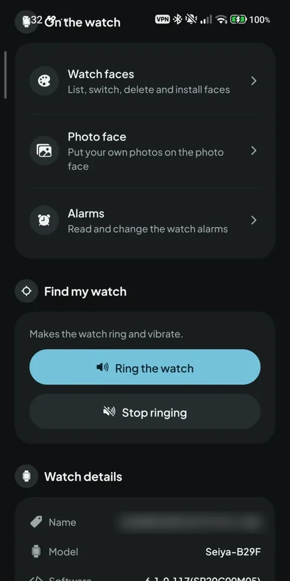
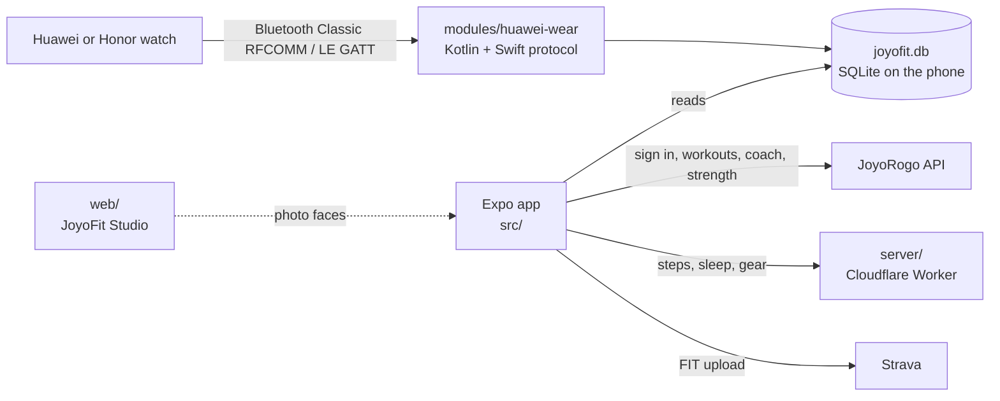

# JoyoFit

Open-source companion app for Huawei and Honor watches, and a strength and run logger that also works with no watch at all. Android and iPhone, Indonesian and English. Data stays on the phone; cloud sync is optional.

Website: <https://fit.joyorogo.com> (source in [`site/`](site/)) · Licence: AGPL-3.0-or-later

| Today | Strength: routines | Strength: exercise library | Watch |
|---|---|---|---|
|  |  |  |  |

## What it is

JoyoFit pairs with a Huawei or Honor watch over Bluetooth, with no Huawei Health install, and writes steps, heart rate, SpO2, sleep and workouts into a SQLite database on the phone. On top of that it computes recovery, strain and readiness, analyses workouts, logs strength training, and suggests what to train today.

The Huawei Watch Fit 4 Pro is the only watch tested on hardware. Other Huawei and Honor models are experimental; the list and how to report a model are in [docs/watch-reference.md](docs/watch-reference.md#supported-watches).

It is a sibling of [JoyoRogo](https://joyorogo.com) (food diary). They share one account, but each works alone.

## Features

Free:

- **Watch sync.** Per-minute steps, calories, distance, heart rate, SpO2, resting heart rate, TruSleep sleep stages, workouts with GPS, live heart rate. Background mode keeps the watch connected and syncs every 30 minutes.
- **Scores and fitness metrics.** Recovery, strain, readiness, VO2max, recovery time, training status, race predictions, HRV status, sleep need. Every formula is a tested pure function and is documented.
- **Workout analysis.** Map, scrubber charts, splits, laps, heart-rate zones, best efforts, training load, comparison with earlier workouts.
- **Strength logger** (Hevy style). Active workout with a rest timer, exercise picker with custom exercises, set types, RPE, previous values, supersets, PRs, routines with folders and starter routines, history with calendar, per-exercise charts, weekly muscle heat map. See [docs/strength.md](docs/strength.md).
- **Works without a watch.** A no-watch onboarding route, a strength-first Today, manual workouts and a body-feel check-in. Nothing nags about a watch you do not own.
- **Strava.** Workouts upload as FIT files with the watch's own numbers; gear links to Strava shoes and bikes. Details in [docs/strava.md](docs/strava.md).
- **Gear.** Shoes and bikes with lifetime distance, retirement reminders and per-sport defaults.
- **Watch faces and Studio.** Install, customize and photo faces from the phone. [JoyoFit Studio](web/README.md) is a browser editor for faces; modular watch faces came from a community pull request (#3).
- **Routes.** Import GPX or TCX, draw a route on a map, send it to the watch.
- **Health Connect and Apple Health export**, FIT file import, Huawei Health export import.
- **Share cards**, **Social** (JoyoRogo feed and groups inside the app), **Keluarga** (family monitoring, [docs/family-monitoring.md](docs/family-monitoring.md)).
- **Several phones, one account.** Pro keeps preferences, routes, templates, workouts, strength, coach, gear and health history in the cloud and restores them on a new phone; free data stays on the phone. See [docs/multi-device.md](docs/multi-device.md).
- **Settings hub**, full Indonesian and English translation ([docs/i18n.md](docs/i18n.md)), route navigation, OTA updates.

With a JoyoRogo Pro account:

- **Coach.** A rule-based daily suggestion, run plans (5K, 10K, half marathon, three a week), full-body strength plans, a 100+ exercise library with credited images, and a chat (Tanya coach) that has your day's numbers. Not medical advice. See [docs/coach.md](docs/coach.md).
- **Cloud sync** of workouts, strength history, gear and the coach plan to your JoyoRogo account, restored on a new phone.

JoyoFit also feeds JoyoRogo: burned energy for the day, and the daily body metrics that JoyoRogo's AI connector can read.

## Roadmap

Generated from [`docs/roadmap.json`](docs/roadmap.json) (Indonesian, no dates). Work in progress lives on branches such as `multi-watch` and `sensors` until it is ready.

<!-- roadmap:start -->
<!-- Generated by scripts/roadmap-sync.ts from docs/roadmap.json. Edit the JSON, not this block. -->

**Sedang dikerjakan**

- Sambungkan lebih dari satu jam, ganti jam aktif dengan cepat
- Sensor Bluetooth: chest strap detak jantung, sensor kadens/kecepatan sepeda, power meter, foot pod
- Rekam latihan langsung dari HP (GPS + sensor), tetap jalan saat layar terkunci
- Data bersepeda kelas pro: Normalized Power, TSS, FTP, kurva power, deteksi tanjakan
- Kartu dan stiker share yang baru (banyak gaya, stiker transparan untuk Story)
- Bagikan latihan sebagai gambar seperti Strava
- Riwayat dari Apple Health di iPhone
- Unduh data dari Huawei Health

**Berikutnya**

- Sticker Studio: bikin stiker share sendiri
- Dukungan jam Huawei lain: Watch Fit 3, Watch Fit 5 / 5 Pro, GT series, Band
- Impor riwayat Huawei Health dari file ekspor
- Sambung jam di iPhone tanpa bolak-balik ke pengaturan Bluetooth
- Tarik aktivitas dari Garmin Connect / Wahoo / Strava

**Nanti**

- Peta di jam (basemap di bawah rute)
- Dukungan Huawei Watch Fit 1 / Fit SE
- Fitur gym di jam: timer istirahat dan log set dari jam

Diperbarui 2026-10-18. Tanpa tanggal: urutannya bisa berubah.
<!-- roadmap:end -->

To change the list, edit `docs/roadmap.json` and run `bun scripts/roadmap-sync.ts`. The landing page imports the same file. `bun scripts/roadmap-sync.ts --check` fails when the README is stale.

## Architecture



| Path | What |
|---|---|
| `src/app/` | Expo Router screens: tabs for Today, Workouts, Social, Watch, Settings, plus coach, strength, routes, family stacks |
| `src/features/` | Screen logic by feature (strength, coach, fitness, workouts/analysis, strava, gear, share, social, routes, ...) |
| `src/db/`, `src/cloud/` | SQLite queries and migrations; JoyoRogo sign-in, cloud API client and uploaders |
| `src/i18n/` | i18next setup and `locales/{id,en}/*.json` |
| `modules/huawei-wear/` | Local Expo module: the watch protocol (port of [Gadgetbridge](https://codeberg.org/Freeyourgadget/Gadgetbridge)'s Huawei support) in Kotlin and Swift, plus the shared SQLite schema |
| `modules/ble-sensors/` | Local Expo module: Bluetooth chest straps, cycling and running sensors, bathroom-scale scan and GATT transport, and the phone-recorded workout session (GPS, foreground service) |
| `protocol/` | Protocol notes and observations |
| `server/` | Cloudflare Worker (Hono, D1, R2) for steps, sleep, gear and Strava glue |
| `web/` | JoyoFit Studio, the watch-face editor (Vite, React) |
| `packages/hwt` | TypeScript codec for Huawei `.hwt` face packages |
| `site/` | Landing page, Panduan (guide), blog and privacy page for fit.joyorogo.com (Vite, prerendered) |
| `plugins/` | Expo config plugins |
| `scripts/` | Release, OTA, i18n check, roadmap sync, asset builders |

The schema is one JSON file, `modules/huawei-wear/schema/joyofit-db-migrations.json`, read by JS and native alike. Tables that must ship over the air (gear, strength, coach) are created from JS instead. How data is stored: [docs/app-reference.md](docs/app-reference.md#where-data-lives).

## Development

Requirements: [Bun](https://bun.sh), JDK 17, Android SDK (platform 36). Bluetooth needs a physical Android 10+ phone; emulators cannot reach a watch. iOS builds need macOS ([docs/ios-mac.md](docs/ios-mac.md)) or the Linux path in [docs/ios-linux.md](docs/ios-linux.md).

```bash
bun install
bunx expo prebuild -p android      # generates android/ (gitignored)
bun run android                    # build, install, start Metro

bun run typecheck                  # tsc --noEmit
bun run lint                       # expo lint
bun test ./src/                    # app unit tests
bun scripts/i18n-check.ts          # id/en key parity, no hard-coded UI text
bun run test:native                # Kotlin unit tests (protocol + session)
bun run test:ios-protocol          # Swift tests for HuaweiProtocol
```

Server (`server/`): `bun install`, then `bun run dev`, `bun run test`, `bun run typecheck`. Deploying needs your own Cloudflare account and the bindings in `server/wrangler.jsonc`; migrations are `bun run db:migrate:local` / `db:migrate:remote`. Secrets are set with `bunx wrangler secret put <NAME>`, never committed.

Studio (`web/`): `bun install`, `bun run dev`, `bun run test`, `bun run deploy`.

Site (`site/`): `bun install`, `bun run dev`, `bun run build` (typecheck, Vite build, prerender), `bun run deploy`.

### Releases and updates

- **Store builds.** `scripts/build-release.sh` (APK) and `scripts/build-release.sh --play` (Play AAB) sign with a local keystore that is not in the repo. iOS: `scripts/build-ios-mac.sh`. Store notes: [docs/play-store.md](docs/play-store.md), [docs/app-store.md](docs/app-store.md).
- **GitHub Actions.** `ci.yml` runs on pull requests and pushes to `master` with no secrets (app, server, site, Kotlin and Swift tests). `release-android.yml`, `release-ios.yml` and `ota.yml` are manual and wait for owner approval in the `release` environment. See [docs/ci-release.md](docs/ci-release.md).
- **Over-the-air updates.** JS and asset changes ship with `scripts/ota.sh "message"` or the OTA workflow (EAS Update). Native changes need a new binary. Policy, rollback and runtime versions: [docs/ota.md](docs/ota.md).

## Documentation

| Doc | Covers |
|---|---|
| [docs/watch-reference.md](docs/watch-reference.md) | Supported watches, protocol overview, what works, watch-side features, Studio |
| [docs/app-reference.md](docs/app-reference.md) | Permissions, Health Connect, cloud sync, Strava, gear, imports, analysis, fitness metrics, sharing, social, routes, data storage |
| [docs/strength.md](docs/strength.md), [docs/strength-cloud.md](docs/strength-cloud.md) | Strength logger and its cloud sync |
| [docs/multi-watch.md](docs/multi-watch.md) | Several watches: device column, primary rules, switching, background visits |
| [docs/sensors.md](docs/sensors.md) | External sensors, phone-recorded workouts, device test script |
| [docs/scale.md](docs/scale.md) | Bluetooth bathroom scales: supported protocols and sources, JoyoRogo weight sync, test script |
| [docs/replay.md](docs/replay.md) | Workout replay: player, camera, map, MP4 export with the native encoder, privacy, known limits |
| [docs/ride.md](docs/ride.md) | Ride on the web: the phone as sensor bridge, the relay, the wire protocol, virtual power (the game: [docs/ride-web.md](docs/ride-web.md)) |
| [docs/coach.md](docs/coach.md) | Coach rules, plans, library, chat |
| [docs/strava.md](docs/strava.md) | Strava integration and review checklist |
| [docs/family-monitoring.md](docs/family-monitoring.md) | Keluarga |
| [docs/i18n.md](docs/i18n.md) | Translation workflow |
| [docs/ota.md](docs/ota.md), [docs/in-app-updates.md](docs/in-app-updates.md) | OTA and the Play update prompt |
| [docs/ci-release.md](docs/ci-release.md) | CI and release workflows |
| [docs/play-store.md](docs/play-store.md), [docs/app-store.md](docs/app-store.md), [docs/ios.md](docs/ios.md), [docs/ios-mac.md](docs/ios-mac.md), [docs/ios-linux.md](docs/ios-linux.md) | Store listings and iOS builds |
| [docs/brand-marks.md](docs/brand-marks.md) | Third-party brand artwork rules |
| [protocol/README.md](protocol/README.md), [server/README.md](server/README.md), [web/README.md](web/README.md) | Protocol notes, Worker API, Studio |
| [LEGAL.md](LEGAL.md), [NOTICE](NOTICE) | What JoyoFit is and is not; upstream credits |

## Contributing

Pull requests are welcome, especially watch reports and translations.

1. **Watch reports.** Own a watch that is not tested? Connect once, then in the app open Watch, Help support your watch, Report on GitHub. The report has no Bluetooth addresses or serial numbers. Or use the [watch report template](https://github.com/dzulfikar08/joyofit/issues/new?template=watch-report.yml).
2. **Before you open a PR**, run what CI runs: `bunx tsc --noEmit`, `bun test ./src/`, `bun scripts/i18n-check.ts`, and the Kotlin or Swift tests if you touched `modules/huawei-wear`.
3. **UI copy** goes through i18next with keys in both `id` and `en`; no emojis in UI text; icons are Ionicons, except workout types, which use the Material Design Icons pictograms of `SportIcon` (`sportIcon()` maps a sport name to one); use the app's own components, not native alerts.
4. **Watch code is safety-critical.** Bounded transfer sizes, malformed-input handling, timeouts, no leaked Bluetooth connections, nothing that can hang the watch or break its pairing.
5. **No secrets or personal data** in code, logs, fixtures or screenshots.
6. **Review.** [CodeRabbit](https://coderabbit.ai) reviews every PR with the rules in [`.coderabbit.yaml`](.coderabbit.yaml); the owner merges. Ported Gadgetbridge files keep their package names and a `Modified for watch-fit` header so upstream fixes can be diffed in.
7. **Licence.** By contributing you agree your work is released under AGPL-3.0-or-later.

## Support

JoyoFit is free and open source. If it is useful, you can support it on [Trakteer](https://trakteer.id/dzulfikar_ats_tsauri). Support helps development and buying or borrowing watches to test; it does not buy features or priority.

Android closed test: join the [Google Group](https://groups.google.com/g/joyofit-testers), then open the [test page](https://play.google.com/apps/testing/com.joyodigitama.joyofit) and tap **Become a tester** once Google enables access. iPhone: public TestFlight beta, linked from the website.

## Licence

[AGPL-3.0-or-later](LICENSE). The project is derived from Gadgetbridge; see [`NOTICE`](NOTICE). If you distribute this app or a modified version, you must provide the source.

[`LEGAL.md`](LEGAL.md) explains what JoyoFit is and is not: independent interoperability software, not affiliated with Huawei or Honor, not a medical device.
