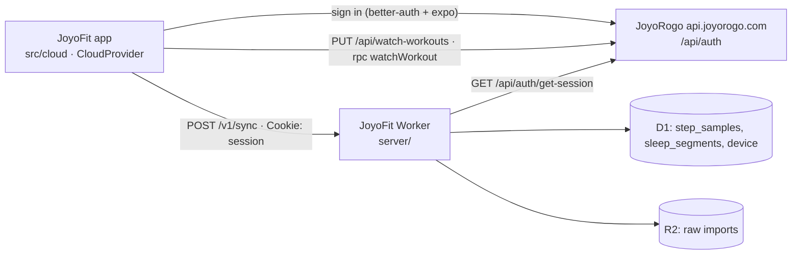

# App reference

Detail for the JoyoFit features that live on the phone: permissions, Health Connect, cloud sync, Strava, gear, imports, workout analysis, fitness metrics, sharing, social, routes and where data is stored. The overview is in the [README](../README.md); watch protocol and watch-side features are in [watch-reference.md](watch-reference.md). Strength training and the coach have their own pages: [strength.md](strength.md), [coach.md](coach.md).

## Permissions

| Permission | Why |
|---|---|
| `BLUETOOTH_CONNECT` (`BLUETOOTH` / `BLUETOOTH_ADMIN` up to API 30) | list bonded watches and open the RFCOMM or Bluetooth LE (GATT) link; no scan or location permission is needed for either, JoyoFit connects to a device you already paired |
| `FOREGROUND_SERVICE`, `FOREGROUND_SERVICE_CONNECTED_DEVICE` | the background service (Android 14 requires the typed permission) |
| `POST_NOTIFICATIONS` | show the service notification (runtime prompt on Android 13+) |
| `RECEIVE_BOOT_COMPLETED` | restart background mode after a reboot or app update |
| `WAKE_LOCK` | keep the CPU awake while a reconnect or sync runs in the background |
| Notification access (special, granted in Android settings) | read posted notifications to forward them |
| `VIBRATE` | find my phone vibration |
| `READ_PHONE_STATE`, `READ_CALL_LOG`, `READ_CONTACTS` | show incoming calls on the watch: call state, the caller's number, the contact name (runtime prompt from Settings; only the first is required). The Google Play build has only `READ_PHONE_STATE`: the watch shows "Incoming call" without a caller |
| `ANSWER_PHONE_CALLS` | accept or reject a call from the watch (runtime prompt from Settings) |
| `android.permission.health.WRITE_STEPS`, `WRITE_DISTANCE`, `WRITE_ACTIVE_CALORIES_BURNED`, `WRITE_HEART_RATE`, `WRITE_RESTING_HEART_RATE`, `WRITE_OXYGEN_SATURATION`, `WRITE_SLEEP`, `WRITE_EXERCISE` | write the watch data to Health Connect (asked from Settings through Health Connect's own dialog; write only, no read) |
| `INTERNET` | fetch the weather and search cities from Open-Meteo; sign in with JoyoRogo and upload to the JoyoFit cloud server (Settings → Health & cloud → Cloud) |
| `SEND_SMS` | send the SOS text the watch asks for, only with Settings → Safety → "Send SOS texts for the watch" switched on (runtime prompt from that switch; off by default). Not in the Google Play build, which tells the watch that no SMS was sent |
| `ACCESS_COARSE_LOCATION` | weather for the phone's position (runtime prompt from Settings → Weather; not needed in city mode) |

There is no `QUERY_ALL_PACKAGES`: the app chooser lists launcher apps through a `<queries>` entry.
Internet use: weather (Open-Meteo forecast and city search, only while weather is switched on) and, after you sign in under Settings → Health & cloud → Cloud, JoyoRogo's auth server and your JoyoFit cloud server.

## Health Connect / JoyoRogo

JoyoFit can copy what the watch records into [Health Connect](https://developer.android.com/health-and-fitness/guides/health-connect),
Android's on-device health store, so other apps can read it. It only **writes**: it never reads
Health Connect. JoyoRogo reads `ExerciseSession`, `SleepSession`, `Steps`, `Distance`
and `ActiveCaloriesBurned` (`apps/native/src/lib/health-connect.ts`), and aggregates the cumulative
ones with Health Connect's own `aggregateRecord`, which is why steps, distance and energy are
written per minute rather than as daily totals.

Turn it on in **Settings → Health & cloud → Write to Health Connect**. Android shows the Health
Connect permission dialog; allow every type (JoyoRogo needs `Steps`, `Distance`,
`ActiveCaloriesBurned`, `SleepSession` and `ExerciseSession`). Enabling it also writes everything
already in the local database once; **Write everything again** repeats that. After that every sync
is exported by native code, so the background service feeds Health Connect with the app closed.
Then, in JoyoRogo, grant it read access to the same types and sync.

| Local data (`joyofit.db`) | Health Connect record | Shape |
|---|---|---|
| `step_samples.steps` | `StepsRecord` | one per minute with steps > 0 |
| `step_samples.distance` | `DistanceRecord` | one per minute, metres |
| `step_samples.calories` | `ActiveCaloriesBurnedRecord` | one per minute, kilocalories |
| `step_samples.heart_rate` | `HeartRateRecord` | one series per hour, a sample per minute |
| `step_samples.spo2` | `OxygenSaturationRecord` | one per reading, percent |
| `step_samples.resting_heart_rate` | `RestingHeartRateRecord` | one per local day (the day's latest reading) |
| `sleep_segments` | `SleepSessionRecord` with stages | spans less than 1 h apart form one session; light/deep/REM/awake map to the matching stage, spans without a stage are "sleeping" |
| `workouts` | `ExerciseSessionRecord` | one per completed workout; the type is mapped from the Huawei sport type, distance, energy and heart rate go in the notes |

Units: Gadgetbridge stores the step frame's `distance` as metres (it logs the totals as `m`) and its
`calories` as kilocalories (its workout summaries label the same watch numbers `kcal`; a source
comment there wonders whether they could be small calories, which is unconfirmed on the Fit 4).
They are written as metres and kcal. A workout's own energy is not written a second time: the
per-minute energy already covers it, and a second record would be counted twice by readers that sum it.

Re-syncs are idempotent. Each record has the client record id `joyofit:<kind>:<time or day>` and a
client record version equal to the export time, so Health Connect replaces the earlier record
instead of adding another. Records are written with the watch as the device (Huawei, the product
model the watch reported). Switching the export off keeps what was written; delete it in Health
Connect. Types you do not allow are skipped, and the last error and counts are shown in Settings.
The export needs Health Connect: built into Android 14+, a Play Store app on Android 10 to 13.

JoyoFit also sends the energy of each watch workout straight to JoyoRogo's diary (`exercise.upsertJoyofit`, external id `watch:<start>`,
see [strength-cloud.md](strength-cloud.md)), so burned calories reach JoyoRogo even when JoyoRogo has no read access to Health Connect;
JoyoRogo's server stores a workout that arrives both ways once. Status and "Kirim sekarang": Settings → Koneksi → JoyoRogo.

JoyoFit also sends the watch's **all-day active energy** to JoyoRogo with the daily scores (`fitness.upsertScores`, field `activeKcal`,
whole kcal per day, 0..20000). It is the day's sum of the watch-recorded per-minute `step_samples.calories` (`imported = 0`, small
calories / 1000: the same data written to Health Connect as ActiveCaloriesBurned), per local (WIB) calendar day, for today and the
two days before it (`src/features/today/rogoActive.ts`, `useRogoActiveKcal`, `rogoScoreDays`), so a total that grew after the last
push is corrected. A day with no samples or a 0 total leaves the field out (JoyoRogo keeps what it stored; the server keeps the larger
of the old and new value). JoyoRogo counts it in Sisa as exercise credit (its own percentage and cap). Pure JS: no native change.

JoyoFit also sends the **hours slept** (`sleepHours`, 0..24, rounded to 0.1 h) with the daily scores: today's with the body metrics, and
each of the six days before it as an entry of its own (`rogoSleepHoursByDate`, `ROGO_SLEEP_DAYS`), the day being the night that ended on it
plus that day's naps. A night the phone read after that day's last push, and a day before this was sent at all, still reach JoyoRogo; a day
with only naps sends nothing. JoyoRogo shows the hours as that day's "Tidur" (Beranda tile, Tidur screen) unless the person logged the night by hand.
Pure JS: no native change.

## Cloud sync

Settings → Health & cloud → **Cloud sync** signs in with your **JoyoRogo account**. Steps and sleep go to a separate
Cloudflare Worker you deploy yourself ([`server/`](../server/README.md): Hono, D1, R2); workouts go to JoyoRogo and come
back onto a new phone after sign-in. The Huawei history import (below) runs on the phone and does not use the server's
`POST /v1/imports` endpoint; imported workouts are kept in the JoyoRogo cloud with the rest, imported steps and sleep
rows are never uploaded.

Uploading is a **JoyoRogo Pro** benefit. The Worker asks JoyoRogo (`fitness.cloudAccess`, with your session) and
answers `402` with `paywall: true` to accounts that are not Pro; JoyoRogo servers without a paywall (self-host)
count everyone as unlocked. Reads stay open. The app then shows that backup is part of Pro and stops uploading
(no retry loop; coming back to the app or **Sync now** asks again). The self-build links to
`joyorogo.com/pro`; the Play build shows the same text without a purchase link, as JoyoRogo's own Play build
does.

- **Sign-in.** `@better-auth/expo` against JoyoRogo's server (default `https://api.joyorogo.com`, the URL JoyoRogo's
  own app uses; override with `EXPO_PUBLIC_JOYOROGO_URL` or `expo.extra.joyorogoUrl`). It opens JoyoRogo's Google
  sign-in in the browser and returns to the `joyofit://` scheme. The session cookies live in `expo-secure-store`
  (Android Keystore) and are read from JS only: **native code, including the background service, cannot use
  them, so uploads run from the JS app, not the service.** JoyoRogo must trust the `joyofit://` scheme, see
  [`server/JOYOROGO_PATCH.md`](../server/JOYOROGO_PATCH.md).
- **Server URL.** Deploy `server/` and build the app with `EXPO_PUBLIC_JOYOFIT_CLOUD_URL=https://…` (or
  `expo.extra.cloudUrl` in `app.json`). Without it the Cloud section says so and nothing is uploaded.
- **What is uploaded, and when.** Step samples, sleep segments and the device row go to the Worker. **Workouts go to
  JoyoRogo instead**, one gzip document per workout (see below), and only for Pro accounts. A sync runs 2 s after
  every sync the app sees, when the app returns to the foreground, and on **Sync now**; rows the background service
  stored while the app was closed go up at the next of those. Settings → Cloud sync shows the account, the last sync,
  the workouts in the cloud with their size, what is waiting (an estimate in MB) and the progress of a backfill.
  **Wi-Fi only** (off by default) keeps the automatic runs off mobile data; **Sync now** then asks before using it.
  **Automatic sync** (on by default) turns the automatic runs off. Both live in the app's key-value store.
- **Incremental by cursor (steps and sleep).** Migration 4 adds a `rev` column to `step_samples`, `sleep_segments` and
  `workouts` and triggers that stamp every insert or update (from JS or native) with the table's next
  `cloud_cursor.seq`. `cloud_cursor.uploaded` is the last `rev` the server accepted; an upload sends `rev > uploaded`
  in batches (2 000 samples, 500 sleep segments) and moves the cursor only after each batch succeeded. `cloud_state`
  keeps the account, the last sync time and the last error. Signing in as another JoyoRogo account resets the cursors,
  forgets `cloud_workout` and the workout pull cursor, so that account gets everything.
- **Workouts (JoyoRogo Pro).** The contract is `docs/watch-workout-cloud.md` in the joyorogo repo. Each workout, whatever
  its source (watch, FIT file, Huawei export, complete or not), is one gzip JSON document: the `workouts` row, every
  `workout_points` column (GPS, heart rate, altitude, speed, cadence, stride, power, delta coded) and the analysis the
  workout screen computes (`src/cloud/workoutDoc.ts`, `workoutAnalysis.ts`). Migration 13 adds `cloud_workout`, one row
  per uploaded or restored workout (`rev` and `engine_rev` it was built from, server `version`, `hash`, `bytes`). A
  workout is pending when it has no row, its `workouts.rev` moved, or its `engine_rev` is below `ANALYSIS_ENGINE_REV`
  (`src/features/workouts/analysis/engineRev.ts`, bumped when the analysis numbers change). `src/cloud/workoutSync.ts`
  uploads the pending ones newest first, one at a time (`PUT /api/watch-workouts/<start>` with the session cookie) and
  records each in `cloud_workout` before the next, so the backfill of an existing history resumes after any
  interruption. `402` means not Pro (stops, shows the benefit); `410` means the workout was deleted from the cloud, so it
  is deleted here; `400` counts the workout as refused (shown with the last error, retried after the next app update);
  `413 quota` stops with the server's message.
- **Restore.** Before each upload the app pulls `watchWorkout.changes` from the cursor in `cloud_state`
  (`workout_pull_cursor`). A workout the phone does not have is downloaded and inserted (`INSERT OR IGNORE` on `start`,
  never over a local row) with its points and a `cloud_workout` row, so it is not uploaded again; a tombstone deletes the
  local copy. Reading is not locked, so an account without Pro restores too.
- **Delete cloud data.** Calls `watchWorkout.wipe` and the Worker's `DELETE /v1/data`, clears `cloud_workout` and the
  cursors, and turns automatic sync off. The phone's data and the account stay.
- **Retries.** Network errors, timeouts, 408/425/429 and 5xx are retried 3 times with backoff (1 s, 2 s, 4 s,
  or the server's `Retry-After`); a failed run leaves the cursors where they were. A step or sleep row the server
  rejects as invalid (400) is isolated by halving the batch and skipped so it cannot block the rest.
- **Idempotent.** The Worker upserts steps and sleep on `(user, key)` and ignores identical rows, so replays and the 1 h
  overlap of each watch sync cost nothing. JoyoRogo keeps one document per `(user, start)` and answers `unchanged` for
  the same bytes (the gzip header carries no clock, so the same workout always compresses to the same bytes).
- **Not synced:** deletions made on the phone, the profile, alarms and settings.

## Deleting a workout

Workout screen → ⋮ → **Hapus latihan**, or a long press on a card in the Workouts list (also offered as a screen reader action). A dialog says what goes and that the activity on Strava stays; when the workout was shared to the JoyoRogo feed it asks whether the post goes too (the person's newest 200 posts are searched for `stats.startedAt`). After **Hapus** the workout leaves the list at once and a snackbar offers **Urungkan** for 5 s; only then is it deleted (`features/workouts/pendingDelete.ts`; leaving the app commits at once, another delete commits the waiting one).

- **Local.** The `workouts` row, its `workout_points`, `workout_sensor`, `cloud_workout`, `workout_gear`, `strava_gear_sent`, `ride_metrics`, `watch_kcal_sent` and `phone_kcal_sent` rows, the heart-rate minutes a phone recording wrote to `step_samples`, the e-bike mark, the replay video cache, the Coach plan link (the session is open again) and the strength record stored as it (a tombstone; strength sync tells the cloud). `strava_upload` stays on purpose, so the workout is never uploaded to Strava twice (`features/workouts/deleteCore.ts`, `deleteWorkout.ts`).
- **Never comes back.** `workout_deleted` (created from JS) keeps the start of every deleted workout. The native watch sync re-downloads everything after the newest workout it knows of, so the deleted one is written again by the next sync; `purgeDeletedWatchRows` removes that copy (only `imported = 0` rows) at start, when the app returns, after every sync and ahead of every push. The cloud pull never restores a deleted start, and a tombstone pulled from the cloud (a delete on another phone or the web) is recorded the same way.
- **Account.** What the account has to be told is stored in the tombstone and retried at every sync (and by the diary push) until it is sent: `watchWorkout.remove` (the cloud tombstone, which other phones pull and answer by deleting their copy; a phone that uploads it later gets `410`), `exercise.removeJoyofit` for `watch:<start>`, `phone:<start>` and `strength:<id>`, and `social.deletePost` for the posts the person agreed to remove. Nothing is sent while nobody is signed in or sync is paused, and a tombstone made under another account waits for that account. A workout JoyoRogo's server absorbed into a Health Connect / Apple Health row has no `joyofit` row to remove.
- **Strava** is left alone.

## Strava

Settings → **Strava** sends watch workouts to the wearer's own Strava account. It is **free**: no JoyoRogo Pro, no gate
in the Worker. It does need the JoyoRogo sign-in, because the Strava tokens are kept against that account. JoyoFit shares
its Strava API application with JoyoRogo (which reads the athlete's activities for its burned-calorie diary), and Strava
keeps one token per athlete and application, so **JoyoRogo's Worker owns the tokens** and this Worker (`server/src/strava.ts`)
asks it for them; the phone only ever receives the short-lived access token. The design and its Strava-docs reasoning
are in [`docs/strava.md`](strava.md) section 1.

- **Connect.** The **Connect with Strava** button (Strava's official artwork, `assets/strava/`) asks the Worker for the
  `oauth/mobile/authorize` URL (scope `activity:write`, plus whatever the athlete already granted JoyoRogo, so connecting
  never narrows that grant), opens it in the browser, and Strava redirects to the Worker's `/strava/callback`, which has
  JoyoRogo exchange the code and redirects to `joyofit://settings/strava`. **Disconnect** unlinks JoyoFit; the grant is
  revoked at Strava (`oauth/revoke`) only when JoyoRogo is not using it either. If the athlete removes the app on strava.com,
  Strava's deauthorization webhook (one subscription per application, it points at this Worker) is forwarded to JoyoRogo,
  which deletes the tokens of both products.
- **What is uploaded.** A FIT activity file built on the phone from `workouts`, `workout_points` and the workout's
  `summary_json` (`src/features/strava/activityFile.ts`, binary writer in `fitEncoder.ts`, no dependency): a record for
  every sample from start to end (GPS position, heart rate, altitude, and a cumulative distance that is the watch's
  total spread over the active time: the GPS path shares it out, and the stretches before the first and after the last
  fix move at the average speed, so nothing but the pause reads as stopped; the last record is exactly the watch's
  total), timer start and stop events, one lap and one session with the watch's elapsed
  time, **active time** (`total_timer_time`), distance, calories, average and maximum heart rate, elevation gain and
  loss, average and maximum speed, and, for running, walking and hiking, the step count as strides plus the average
  cadence over the active time, then a mapped FIT sport/sub-sport and `sport_type`. The file names the recording watch (`file_id` and a creator
  `device_info`: Huawei watches as manufacturer 348, the model name, the firmware) and JoyoFit as the writing software; Strava does not show
  a device line for it until Strava adds the model to its device list (docs/strava.md 3a). The watch gives no per-sample speed or
  cadence and no list of pauses: when its elapsed time exceeds its active time by 30 s or more, the pause is written as a
  timer stop and start (`elapsed - active` long, centred on the longest gap between GPS fixes, else between samples),
  because Strava takes a run's moving time from the file's timer events and otherwise recomputes it from the distance
  stream. Strava then keeps the watch's numbers. The upload goes
  straight from the phone to `https://www.strava.com/api/v3/uploads` (`data_type=fit`, a binary multipart body) with
  `external_id = joyofit-<workout start>`, so a workout can never be created twice. Per-workout state is in
  `strava_upload` (`processing`, `done`, `failed`, `rejected`).
- **When.** Workouts that **end after the account connected** are sent after each sync; Huawei-export imports and
  history are never sent automatically. **Send to Strava** on a workout's screen sends any workout, and **View on
  Strava** links to the activity.
  On iOS the automatic pass runs while the app is in front and each time it comes back to the foreground (iOS suspends the app and
  locks the session's keychain item while the phone is locked); the connect page is an `ASWebAuthenticationSession`.
- **Description.** Off by default: **Add fit.joyorogo.com to the description** puts that text (plain, never the title)
  in the activity description.
- **Strava's API Agreement.** The only Strava data JoyoFit reads is the status of its own upload and, once the athlete allows `profile:read_all`, their list of shoes and bikes to link gear; that list is shown only to its owner, and only the linked gear's id (and its name on the phone) is kept. Nothing is used for analytics or AI; JoyoRogo's
  database holds only the athlete id and tokens on its behalf. A workout uploaded here is not imported again by JoyoRogo's Strava
  sync (its `external_id` starts with `joyofit-`); JoyoRogo gets it through Health Connect / Apple Health. Owner setup and
  the Strava review checklist: [`docs/strava.md`](strava.md).

## Gear (Settings → Gear, workout screen, free; cloud copy is a JoyoRogo Pro benefit)

Shoes, bikes and other gear with a lifetime distance and time, a retirement distance and a Strava link, like Garmin Connect's gear.

- **Gear.** Name, brand, model, optional photo (picked with `expo-image-picker`, copied into the app's files; it stays on the phone),
  the distance already done, a retire-at distance. A gear is retired by hand (it is then no longer offered or defaulted) or deleted.
- **Defaults.** Per sport: running → shoes, walking and hiking → shoes, cycling → bike (`gearSport` in `src/features/gear/model.ts`
  groups the Huawei sport types). A default applies to workouts that **start after it was set**, once, when the workout has no choice yet
  (`reconcile` runs when the gear screens open, after a sync and before an upload); changing a default never rewrites older workouts.
- **Per workout.** The workout screen has a Gear row with the choices that fit the sport (shoes for foot sports, bikes for rides, other for any), or "no gear",
  which is final (the default is not applied again).
- **Lifetime.** Starting distance plus the watch's distance of every workout done with it, and their moving time (`workouts.distance`,
  `workoutTimes`, the same figures as the workout screen). Retirement reminders: from 90 % of the retire-at distance and again at 100 %, a
  card on the gear screen and on the workout ("Sepatu kamu sudah 650 km, ..."); **Nanti saja** hides that level (`gear.notified`) until the next one, and
  changing the retire-at distance re-arms it. They are in-app on purpose: an OS notification would be a new use of the notification permission,
  which docs/ota.md keeps out of over-the-air updates.
- **Where it is stored.** Three tables in `joyofit.db` (`gear`, `gear_default`, `workout_gear`, plus `strava_gear_sent`), created by
  `ensureGearSchema` from JS at startup, **not** through `joyofit-db-migrations.json`: that file is shipped inside the native module (the
  Android asset and the OTA fingerprint), so a new entry would need a new binary, and a binary that sees `user_version` above its own list
  refuses the database. The native side never touches these tables. Fold them into the migration list at the next native build.
- **Cloud (Pro).** The Worker keeps one JSON document per JoyoRogo user (`gear_doc`, `GET`/`PUT /v1/gear`, optimistic `rev`, see
  `server/README.md`). The phone merges per record by `updatedAt` (deletions are tombstones) after each cloud sync and when gear changes; a 402
  stops the upload (reads stay open, so a free account restores gear on a new phone). The photo and the Strava gear name stay on the phone.
- **Strava.** Each gear can be linked to one of the athlete's Strava shoes or bikes; the upload then sets `gear_id` on the activity, and a later change
  of a workout's gear is sent too. Needs `profile:read_all` for the picker (a second consent) and `activity:write` for `gear_id`: [`docs/strava.md`](strava.md) 3b.
- **Share card and workout screen** show "Sepatu: Nike Pegasus 41 · 312 km": the gear's name and its lifetime distance now.

## Import from Huawei Health (Settings → Import from Huawei Health, Android, free)

A one-time import of the history Huawei Health holds in your Huawei account, so you do not start from an empty
JoyoFit after switching. It reads Huawei's own **Privacy Centre export**, on the phone, and calls no Huawei server.

1. At `privacy.consumer.huawei.com` (or Huawei Health → Me → your account → Privacy Center) choose **Request Your Data**,
   tick **Health**, set a **ZIP password**, and wait for the email (up to 7 days; the link works 21 days).
2. Before unbinding the watch from Huawei Health, sync it there once more (data only on the watch is lost on unbind).
3. In JoyoFit pick the ZIP, type the password (kept in memory only), tap **Import**.

What is read (`HuaweiExportImporter.kt` and the parsers beside it; the file is streamed, one bad record is skipped and
counted, never fatal):

| Huawei export | JoyoFit |
| --- | --- |
| `Health detail data`: `DATA_POINT_DYNAMIC_HEARTRATE` | `step_samples.heart_rate` of that minute |
| `DATA_POINT_REST_HEARTRATE`, `DATA_POINT_NEW_REST_HEARTRATE` | `step_samples.resting_heart_rate` |
| `BLOOD_OXYGEN_SATURATION` (`avgSaturation`) | `step_samples.spo2` |
| `PROFESSIONAL_SLEEP_SHALLOW`/`DEEP`/`DREAM`/`WAKE`/`NOON` | `sleep_segments` (raw kinds 0x06, 0x07, 0x5656, 0x5658, 0x5659) |
| `STRESS_DATA` (`score`) | `health_metrics` type `emotion` |
| `Sport per minute merged data`: `steps`, `distance` | `step_samples.steps` / `distance` (largest value per minute) |
| `Motion path detail data`: one object per workout, `attribute` track (`lbs` GPS, `h-r` heart rate, `alti` altitude) | `workouts` (`complete = 1`) and `workout_points` |

Not imported: per-minute calories (the scale differs by firmware, so imported minutes keep `calories = 0`), weight and
body composition, exercise intensity, water, anything else. Workout calories are imported (kcal; a total that cannot be
kcal is read as small calories and divided by 1000). Only sport ids 3 (cycling), 4 (running) and 5 (walking) are named;
other workouts import as unnamed workouts with the Huawei id in `summary_json`.

How imported data is kept apart: migration `imported` adds `imported INTEGER NOT NULL DEFAULT 0` to `step_samples`,
`sleep_segments` and `workouts`; the importer inserts with `imported = 1`.

- **Watch data wins.** Nothing existing is replaced. A minute the watch stored only gets heart rate, SpO2 and resting heart
  rate filled in where they are NULL; sleep segments that overlap a watch-synced one and workouts starting within two
  minutes of an existing one are skipped. The same export imported twice adds nothing.
- **No upload burst, no Health Connect, no Strava.** The cloud upload (`src/db/cloud.ts`), the Health Connect exporter
  and the Strava upload read `imported = 0` only. The watch's own sync sets `imported = 0` again on any row it writes, so
  a minute, sleep segment or workout the watch later syncs travels like a watch row. `WorkoutStore.syncStart` ignores
  imported workouts when it decides what to ask the watch for.

The format is undocumented and was written from what community converters report (`NOTICE` credits them); it has not
been checked against a real export yet. The first real file may need field-name or scale adjustments.

## Workout analysis (Workouts → a workout)

One workout opens a Strava-style analysis, computed on the phone from the stored points and summary (`src/features/workouts/analysis/`: `analyzeWorkout`,
history from `loadAnalysisHistory`; the screen is `src/app/workouts/[id].tsx`, the views are in `analysis/ui/`). The summary card shows at once and the
analysis fills in a moment later. Sections, each only when the data exists:

- **Summary strip and map.** Distance, time, moving time, pace or speed, elevation. A tile map of the route (OpenFreeMap vector tiles drawn with
  react-native-svg, no native module, `src/features/map/`; cached on the phone) with a km marker per kilometre.
- **Scrubber charts.** Pace or speed, heart rate, elevation, cadence and power on one shared time grid; touching a chart moves a dot on the map and fills a
  readout. The screen's scroll freezes while a chart is touched.
- **Splits and laps.** Per kilometre (pace, heart rate, climb, cadence) and the watch's or FIT file's laps.
- **Heart-rate zones, pace zones, best efforts** (400 m, 1 km, 1 mile, 5 km, 10 km, half marathon, ranked against the same sport of the last 120 days),
  **effort** (JoyoFit workout strain), **training load** (acute against chronic, with the watch's own training effect and recovery time when it reports them)
  and **comparison** with similar earlier workouts.

Workouts without GPS (gym, jump rope, swimming) keep the heart-rate, zones, effort and load sections.

Data availability:

| Data | Watch sync | FIT import | Huawei export import |
| --- | --- | --- | --- |
| GPS track | yes | yes | yes |
| Heart-rate series | yes, sampled by the watch every few seconds | yes | yes, per sample |
| Altitude | yes, per sample | yes | yes, barometric |
| Speed, cadence, stride, power per sample | yes, for workouts synced after migration 12 | yes | cadence only |
| Laps | no: the Sections response carries per-km style blocks without timestamps (raw kept in `summary.sections`) | yes | no |
| Km splits | computed from the track | computed | computed |
| Pace blocks | yes (watch) | no | no |
| Temperature | not recorded by the watch protocol | the FIT record temperature is not imported | no |
| Swim data | summary only (laps, strokes, SWOLF) | summary | summary |
| Calories | one total from the watch (envelope); fat and carbs are an estimate by JoyoFit | yes | yes |

SQLite migration 12 adds per-sample `speed`, `cadence`, `stride` and `power` to `workout_points`. They are only filled for workouts synced or imported after
that version; older workouts show the analysis without those charts. The migration needs the new native build (the schema is shared with the native module).

Map data © OpenStreetMap contributors, tiles by [OpenFreeMap](https://openfreemap.org); the attribution is drawn on every map.

## Fitness metrics (Today cards, Today → Kebugaran; screens in Indonesian)

Code in `src/features/fitness/`; every formula is a pure function with a unit test next to it. The watch's own value is shown first and labelled "dari jam"; when
the watch gave none, JoyoFit's estimate is shown and labelled "perkiraan". Nothing is shown with too little data: the card says what is missing. Each number has a
"Cara dihitung" accordion that repeats the formula below.

| Metric | Watch value | JoyoFit estimate (reference) | Needs |
|---|---|---|---|
| VO2max | `summary_json.vo2max` of the newest workout in 90 days (`maxMET` × 3.5 ÷ 65536, whole-number division as in Gadgetbridge's `HuaweiWorkoutGbParser`, so up to 1 ml/kg/min below the watch; values outside 10 to 90 are ignored) | Uth-Sørensen 2004: 15.3 × max HR ÷ resting HR (median of the last 14 days' daily lowest resting HR; max HR is 220 − age) | 5 days of resting HR for the estimate |
| Recovery time | largest `recoveryHours` still running among the last 7 days' workouts, counted down from each workout's end | hours from strain: 0 below strain 5, 6 h at 5, linear to 48 h at 21; today's strain counts fully, yesterday's counts down from midnight (own heuristic) | a workout with recovery, or heart rate |
| Training effect, training points | aerobic and anaerobic effect (0 to 5), points and the watch's load, as reported (workout detail) | aerobic only: 5 × (1 − e^(−TRIMP/150)) (own curve) | |
| Training status | | ACWR on TRIMP (Gabbett 2016): mean daily TRIMP of the last 7 days ÷ the last 28; above 1.5 overreaching, 1.1 to 1.5 productive, 0.8 to 1.1 maintaining, 0.5 to 0.8 recovery, below 0.5 detraining. The same ratio feeds the Readiness load signal (`fitness/trainingLoad.ts`; it used to average the saturated 0 to 21 strain instead) | 14 days with heart rate |
| Race predictions | | Riegel 1981: T2 = T1 × (D2/D1)^1.06 from the best 5K, 10K or half effort of the last 90 days' runs (`bestEffortsForHistory` of the workout analysis), the base closest to each target | 3 runs with a 5 km effort (GPS) |
| HRV status | | mean ln(RMSSD) of the last 7 nights against the mean ± 1 SD of the 60 days before them (Plews 2013, Buchheit 2014; spread floor 0.05): inside balanced, below low, above unbalanced | Android night HRV: 14 baseline nights, 3 recent; iPhone shows the "not read on iPhone yet" note |
| Intensity minutes | | Monday to Sunday: minutes in Edwards zones 2 and 3 (60 to 80 % of max HR) count 1, zones 4 and 5 count 2; target 150 (WHO 2020, ACSM 2018) | per-minute heart rate |
| Sleep need tonight | | `readiness.ts`: 7 h 30 min + up to 1 h from today's strain ÷ 21 + a quarter of the 7-night sleep debt (at most 1 h) | 3 nights for the debt |
| Sleep of the day | | `stats.ts` `lastSleepSession` (Today summary, readiness sleep signal, JoyoRogo `sleepPct`) and `nights.ts` `sleepByDay` (debt, trend, Sleep screen need %, JoyoRogo `sleepHours`, today's and each earlier day of the week's): night plus naps, a nap belonging to the day it ends on like the main sleep, overlaps counted once; the watch's sleep score, stages and awakenings stay on the main sleep; a day with only naps has no night for debt, trend and `sleepHours` | |
| Energi Tubuh | | 0 to 100, own model: wake level 30 + 60 × min(1, asleep ÷ need) + up to ±10 from the HRV z-score, minus 0.8 per hour awake, minus up to 55 from strain since waking, minus up to 1 per hour from stress above 40, plus 5 per hour of naps and 0.4 per hour of still minutes near resting HR; clamped | last night's sleep |

Max heart rate is `userMaxHr()` everywhere (Sleep, Today, workouts and these metrics), from the profile's birth year, or 220 − 35 without one. The watch's
`workoutLoad` and `trainingPoints` units are not verified against hardware, so they are shown as reported and never combined with TRIMP.

## Share a workout or your day (Share on a workout, share icon on Today)

A story card rendered on the phone as a 1080 px PNG (`src/features/share/`, `react-native-view-shot`): 9:16 story or 1:1 square, on a dark JoyoFit
card (with the GPS route as an SVG polyline when the workout has one), over your own photo, or as a transparent sticker. A workout card shows type,
date, distance, moving time, pace or speed, average heart rate, calories and elevation; the Today card shows steps, sleep, recovery, strain and
readiness (whatever is computed; nothing is shown as a dash). Four targets sit under the preview:

| Target | What it does |
| --- | --- |
| Instagram | Only shown when Instagram is installed (`Share.isPackageInstalled` on Android, `canOpenURL('instagram://app')` on iOS; the `instagram` and `instagram-stories` schemes and the `com.instagram.android` query come from the `react-native-share` plugin in `app.json`). With a Facebook App ID it opens Instagram's Story composer directly (sticker as `stickerImage`, route and photo cards as `backgroundImage`). Without one it hands the PNG to the Instagram app's share target, where you pick Story or post |
| Copy | PNG to the clipboard (`expo-clipboard`), toast "Copied" |
| Save | PNG to Photos / Pictures (`expo-media-library`). iOS asks for add-only access after an in-app "Continue" dialog; Android 11+ needs no permission; hidden on Android 10 |
| More | The system share sheet with the PNG and a caption |

The Facebook App ID is public and the App Secret is never used. The App ID is read from
`EXPO_PUBLIC_FB_APP_ID` at build time, else `expo.extra.facebookAppId` in `app.json`; clear both and the Instagram button uses the fallback.
What the App ID buys: Instagram opens straight in the Story editor, and the sticker lands on Instagram's sticker layer over your own photo.
Without it, on iOS the PNG goes through Photos (Instagram opens the saved image; it is flattened to JPEG, so the sticker option uses the system
share sheet instead to keep its transparency), and on Android it opens Instagram's share chooser.

## Social (Social tab, Share to JoyoRogo on a workout, free)

JoyoFit reads and writes JoyoRogo's social backend with the shared JoyoRogo account (`src/cloud/rogo.ts`, `rogo.group.*` and `rogo.social.*`; screens in
`src/app/social/`, pieces in `src/features/social/`). Nothing goes through the JoyoFit Worker.

- **Feed.** Following (you, people you follow, your groups) and Explore (public posts), kudos, comments, and the author's profile. Signed out, every screen
  shows the same JoyoRogo sign-in as Settings.
- **Groups.** Your groups, join by invite code, and per group today's Recovery, Strain, Sleep and readiness of each member who opted in. You opt in per group
  with *Share JoyoFit scores* (`group.setShareFitness`); *Share food names* is JoyoRogo's existing switch.
- **Share to JoyoRogo** (workout screen) posts the summary (sport, duration, kcal, distance, average and maximum heart rate) as a `latihan` post, visible to
  your groups or public, with the workout analysis as its detail (`detail.analysis`, at most 200 KB; thinned to a coarser series above 190 KB). The composer has switches for
  *Heart-rate data*, *Show map* (the route: off drops the map track, so the post has no map) and *Comparison with earlier workouts*, which `shareableAnalysis` applies to the full analysis before it
  is sent; turning heart rate off also removes zones, effort, load and per-split heart rate. Workouts without an analysis fall back to the older heart-rate
  series (at most 600 averaged readings) and route (at most 1000 points). Building that input is `features/social/watchPost.ts`.
- **Route map and figures on workout posts.** A post of a workout with GPS shows a route drawing under its title in the feed (`RouteMapPreview`, 2:1) and a larger
  one (4:3, with start and finish labels and a hint) on the post screen (`PostMapSection`), above the analysis. It is a plain SVG polyline on a soft grid, drawn by the
  phone from the post's `mapLine`: a Google encoded polyline (precision 5, at most 100 points) that JoyoRogo builds when the post is created, from the route with the
  first and last 200 m cut, simplified. No map tiles and no network request. `src/features/social/feedRoute.ts` is a verbatim copy of JoyoRogo's
  `packages/api/src/lib/feed-route.ts` (and `feedRoute.test.ts` of its test); change both together. `mapLine` is absent when the workout had no GPS or was too short, or
  when the post's or the account's switch hides it. The author switches one post's map on the post screen (*Show map*, `social.setPostMap`) and every map of the account
  in *My profile* (*Route map on posts*, `social.updateProfile({ shareMaps })`). Other viewers get the shared line in `social.workoutDetail`, never the full track. The
  figures row (`postStats.ts`) is distance, time (moving time when the post has it), pace per km on foot or speed for a ride, elevation gain, then energy and heart rate.
  Renders of `RouteMapPreview` (card and detail size, light and dark): `docs/screenshots/social-route-map-light.png`, `social-route-map-dark.png`.
- **Pro paywall on viewing, not sharing.** Anyone can share the detail. The author always sees their own; another viewer gets the full analysis (map, charts, splits, zones, best efforts and more) only on
  JoyoRogo Pro (`social.workoutDetail` answers `locked: true` otherwise, and the post shows a Pro card). The card's link follows the store rules of
  `proOffer`: a web link outside Google Play, the JoyoRogo Play listing on Play, text only on iOS.
- **Strava.** Imported rows (`workouts.imported = 1`: Huawei export or a FIT file, whose origin the app cannot tell, possibly a Strava download) are never
  offered for sharing, like they stay out of the cloud upload. JoyoFit never reads Strava data, so a watch workout carries none.

## Import a FIT file (Settings → Import a FIT file, Workouts → Import a FIT file, free)

A ride or run recorded by a bike computer or sports watch (iGPSPORT first; Garmin, Wahoo, Bryton, Magene, XOSS and
anything else that writes a standard FIT activity) becomes a full workout: route, heart rate, speed or pace, ascent,
calories, power and cadence. It is JS only (`src/features/fitimport/`): Garmin's `@garmin/fitsdk` decoder reads the file on the
phone, no server is called.

Ways in: the **Choose a .fit file** button (Settings, or on the Workouts tab); on Android also **Open with JoyoFit** from a
file manager and **Share to JoyoFit** from the bike computer's app (intent filters for `content://` VIEW with
`application/vnd.ant.fit` or `application/octet-stream` and a `*.fit` name, and SEND, in `app.json`; the config plugin
`plugins/with-shared-fit.js` turns a shared file into a view intent so Expo Router gets it as a URL, and
`src/app/+native-intent.ts` sends that URL to the import screen). Registering SEND for `application/octet-stream` means
JoyoFit also shows up when you share other binary files; the import then says it is not a FIT file. On iOS the same URL
arrives through the `CFBundleDocumentTypes` entry for `.fit` in `app.json` (not tried on a device yet).

| FIT | JoyoFit |
| --- | --- |
| `file_id.type` must be `activity`, `file_id.manufacturer` names the workout (`Ride (iGPSPORT)`; unknown brands give `Ride`) | `workouts.sport_name` |
| `session` (several, as some head units write after a pause, are added up): start, `total_elapsed_time`, `total_timer_time`, distance, calories, avg/max heart rate, ascent | `workouts.start`, `end`, `duration` (active seconds), `distance`, `calories`, `avg_hr`, `max_hr`, `summary_json` |
| `session.sport` / `sub_sport` | `sport_type`: cycling 3, indoor cycling or virtual 7, running 1, trail run 11, treadmill 5, walking 2, indoor walking 13, hiking 14, anything else 255 (Exercise) |
| avg/max speed, ascent/descent, altitude range, avg/max cadence, avg/max/normalized power | `summary_json` (`workout_points` has no columns for power or cadence) |
| `record`: time, position (semicircles to degrees), altitude, heart rate | `workout_points` (`ts`, `lat`, `lon`, `alt`, `hr`) |
| `record.heart_rate`, averaged per minute | `step_samples.heart_rate`, `imported = 1`: Strain, Readiness and Trends read the per-minute heart rate, not `workouts` |

Same rules as the Huawei import: the row has `imported = 1`, so the cloud upload, Health Connect / Apple Health and the
automatic Strava upload skip it (the per-workout **Send to Strava** button stays the user's choice). The same file again adds
nothing (same start). A file whose time overlaps a stored workout by more than half of the file's own span is skipped with a
message and the stored one, the watch's, is kept; a minute already in `step_samples` is never touched. Errors shown: not a
FIT file, damaged (checksum), not an activity file, no session, already imported, watch already recorded it. Tests:
`src/features/fitimport/` (files built with `src/features/strava/fitEncoder.ts` and Garmin's encoder, the real schema in memory).
The importer has not been run on a real iGPSPORT file yet.

## Routes for the watch (Watch tab → Rute, `/routes`; screens in Indonesian)

Plan or import a route, send it to the watch with **Kirim ke jam**, then start it on the watch (Olahraga → outdoor run, ride or
walk → settings → Rute → the route → navigasi olahraga). The watch shows the line and your position; no turn-by-turn
instructions are sent. The P2P push is native (`modules/huawei-wear`, `HuaweiWear.getRoutes()` / `pushRoute()`, see
`protocol/README.md`); everything else is JS in `src/features/routes/`, with every user-facing string in `copy.ts`.

- **Storage.** Files, not SQLite: `Paths.document/routes/<id>.json` (facts and a thumbnail) and `<id>.pts.json` (points, at most
  5000 after Douglas-Peucker simplification). `routeStore.ts` has the calls, `routeStorage.ts` the pure part.
- **Ways to add a route.** Impor GPX/TCX (system file picker, or **Open with** / **Share to JoyoFit**: `app.json` has VIEW and
  SEND filters for `application/gpx+xml`, `application/vnd.garmin.tcx+xml`, `application/xml`, `text/xml`, octet-stream with a
  `.gpx`/`.tcx` name; iOS declares `com.joyodigitama.joyofit.gpx` and `.tcx`; `src/features/sharedfile/` classifies by name,
  MIME type or the first 1 KB), Gambar di peta (`src/features/routes/map/`, OpenFreeMap tiles, FOSSGIS OSRM, Open-Meteo
  elevation), Dari latihan (GPS rows of a stored workout; also a button on the workout screen).
  Loop baru dari rumah (`src/features/loops/`, [loops.md](loops.md)): a dotted round trip of a chosen number of steps, kilometres,
  minutes or kcal from the phone's position or a saved Home point, on streets the person has not walked.
- **Parsers.** `gpx.ts` (track, else `rte`), `tcx.ts` (course, else activity), on a small tolerant scanner (`xml.ts`, no
  dependency, no DTD, namespaces and CDATA handled). Points without a position or at 0,0 and consecutive repeats are dropped; fewer
  than 2 points is an error. Fixtures: `routeFixtures.ts` (Strava, Garmin Connect with extensions, planned route, TCX course and activity).
- **Sending.** `useRoutePush.ts`: at most 3000 points to the bridge, `hasAltitude` only when every point has one, name cut to
  100 UTF-8 bytes, progress from `onUploadProgress`. A route with the same name already on the watch is not sent again
  (`alreadyOnWatch`): the screen offers to rename and send again. Error codes are mapped in `pushOutcome.ts`.
- **Limits.** Only watches that list route support (`getRoutes().deliver`) take routes; the watch simplifies long routes to a few
  hundred points. Not verified on a watch yet. Tests: `src/features/routes/*.test.ts`, `src/features/sharedfile/`.

## Watch faces from the web (Watch → Tampilan jam → Koleksi → "Dari web", Android, free to read)

The Koleksi tab of the watch faces screen has a "Dari web" section with the watch faces the account uploaded at `app.fit.joyorogo.com` (the web upload is a JoyoRogo Pro benefit; reading the list is open to any signed-in account, so the app gates nothing).

- List: `GET /v1/watchfaces` with the session `Cookie` (`cloudRequest`, so the usual retry rules apply) -> `{ watchfaces: [{ id, name, filename, size, sha256, createdAt }] }`, shown newest first with size and date.
- Install: `GET /v1/watchfaces/:id/file` with the same `Cookie` is downloaded into the cache (`File.downloadFileAsync`), then goes through the same step as a picked `.hwt` (`useWatchfaceImport.importPackage`: extension check, native package parse, save to the phone library with the usual same-title replace, then the install prompt and BLE install with its progress and errors).
- States: cloud not set up in the build (explanation), signed out (link to Settings → Akun), loading, error with "Coba lagi", empty (tells to upload at `app.fit.joyorogo.com`), list. A face whose name already matches a face on the watch shows "Terpasang" and is disabled; without a connected watch the buttons are disabled with "Sambungkan jam untuk memasang". The section is hidden where the picker import is unavailable (iOS, old native build).
- Logic without UI: `src/features/watchfaces/webLibraryModel.ts`; the requests: `src/cloud/webWatchfaces.ts`. JS-only.

## Tab bar

The five tabs are drawn by the navigator's `BottomTabBar`, wrapped in `TabBarWithLive` (`src/app/_layout.tsx`). Its default height, 49 plus the bottom inset, only fits a 10 px label: with the 12 px label and a larger system font the label spilled into the inset area, under the 3-button bar or the gesture pill ("Hari ini" cut in half on a Samsung with 3-button navigation, touching the pill on a Xiaomi). `src/components/tabBarMetrics.ts` sizes the bar from what is drawn instead: 5 dp item padding, 28 dp icon box, a fixed 16 dp label line scaled by the system font size (capped at 1.3), 5 dp padding, then `insets.bottom` on top of that (gesture area, 3-button bar or the iOS home indicator). A label that is still too wide for its fifth of the screen (Pengaturan on a narrow phone) shrinks to at most 70 % rather than ending in an ellipsis. Tests: `src/components/tabBarMetrics.test.ts`.

## Deep links (`joyofit://`)

Every URL that opens the app goes through `src/app/+native-intent.ts` before Expo Router matches it. `src/features/deeplink/mapDeepLink.ts` normalises `joyofit:` links only (https links, the dev client launcher and `content://`/`file://` files are handled elsewhere or left alone):

- `joyofit://strength` (host form), `joyofit:///strength` (path form) and a trailing slash all open `/strength`. In the host form "strength" is the URL host, not a path; the router handles both.
- `joyofit://?open=strength` opens `/strength` too. JoyoRogo uses this form: a JoyoFit bundle that has no `/strength` yet (an install that has not applied its over-the-air update, which takes the second launch) shows Today for it, while `joyofit://strength` there is the router's "Unmatched Route" page, and because that open succeeds JoyoRogo never falls back to the plain `joyofit://` link.
- A link no screen answers to (checked against the route files in the bundle, read from the router's own file list) opens Today, query dropped. In-app navigation to a missing route is not a system URL, so it still ends in `src/app/+not-found.tsx` ("Halaman tidak ditemukan" with a button home).

Tests: `src/features/deeplink/` run the real Expo Router URL parsing and matcher over the route files, with Bun's `URL` and the phone's (`whatwg-url-minimum`).

## A damaged database ("database disk image is malformed")

**Why it happens.** `joyofit.db` is opened by two SQLite engines in one process: expo-sqlite's own build (3.50, JS side) and Android's `android.database.sqlite` (the framework's SQLite, 3.3x on Android 12, the native sync writer). SQLite's own list of ways to corrupt a database names this case ([howtocorrupt, 2.3](https://www.sqlite.org/howtocorrupt.html)): each copy keeps its own table of open files, so a `close()` in one cancels the POSIX locks the other holds on the same file, and both can then write the WAL or checkpoint at once. Nothing else in the code touches the file (no `deleteDatabase`, no file copy, no VACUUM, `allowBackup` is off, there is no restore flow). It cannot be proven from a damaged file we do not have; it is the one cause the architecture permits. A second hazard sat next to it: the framework's default `DatabaseErrorHandler` deletes the file (and its WAL) when the native connection meets corruption, under the JS connection that still holds it (`DefaultDatabaseErrorHandler` in AOSP); `SyncStore.kt` now passes a handler that only records it.

**What the app does** (`src/db/recovery/`, JS only, no native call needed):

- *Detect.* Any rejection that says the file is corrupt (`isCorruptionError`: "database disk image is malformed", "file is not a database", `SQLITE_CORRUPT`, also inside native "Caused by" text) from a query on the app's handle (`serialize.ts`), from the native sync (`WatchProvider` `runSync`), or while the database opens starts the repair. `errorMessage()` never shows SQLite's words for it.
- *Open.* `DatabaseGate` builds the schema on a connection of its own before `SQLiteProvider` opens the app's handle (the provider keeps a failed open for good, so it cannot retry), repairs once when that says corrupt, builds again, and otherwise shows a retry screen.
- *Repair* (`recover.ts`, tested on real damaged files): `PRAGMA integrity_check`; a copy of the file and its WAL to `joyofit.db.corrupt-<ms>` (the repair stops if that copy fails); `REINDEX` when only rows and indexes disagree; `VACUUM INTO`; row salvage into a new database built by `buildAppSchema` (damaged leaves are skipped by an exponential then binary search over rowids, indexes and triggers are rebuilt, trigger-kept `rev` counters are copied as they were); an empty schema when nothing reads. The result goes over the damaged file *in place* with SQLite's online backup, which works under the open connections of both engines (a rename would leave them writing into the old file). Only when that fails and nothing has the file open is it swapped by files, otherwise at the next start (`applyPendingSwap`). The app's own queries wait while it runs (`gate.ts`, 60 s at most).
- *After a loss* the pull cursors of the workouts, health records, step/sleep restore and strength sync are cleared, so the next sync starts from the beginning and the cloud gives back what was not readable; the watch refills `step_samples` and the rest from `device.last_sync` on its next sync. Phone-only data that never reached the cloud (and a lost pairing) is only in the kept `.corrupt-<ms>` file.
- *Tell.* `DbHealthNotice` (id/en, `common:dbRecovery`) says what was saved, what comes back and that the old file is kept; a failed repair offers another try. FIT import repairs and retries the same file once.

Tests: `src/db/recovery/*.test.ts`.

## Where data lives

`joyofit.db` in `<app files>/SQLite` is shared by the screens (expo-sqlite, read) and the native
module (`android.database.sqlite`, write, WAL with a 10 s busy timeout). The schema is one JSON file,
`modules/huawei-wear/schema/joyofit-db-migrations.json`, imported by `src/db/migrations.ts` and shipped
as an Android asset that the native side migrates from, so JS and native cannot drift. Native
upserts the same rows the JS queries used to, and advances `device.last_sync` in the same transaction.
The profile, background and notification settings are in native SharedPreferences (`joyofit_settings`).

Workouts are two more tables from migration 3: `workouts` (one row per session: watch workout number,
start/end, Huawei sport type and GB's name for it, duration, distance, calories, average/max heart
rate, steps, `summary_json` with everything else, `complete`) and `workout_points` (`workout_id`, `ts`,
`lat`, `lon`, `alt`, `hr`; from migration 12 also `speed`, `cadence`, `stride`, `power`). GPS points have lat/lon, heart-rate samples have `hr`; a point has only
what its source had. A workout is replaced as a whole in one transaction, keyed by `start`.

The cycle log is two tables from the cycle migration: `cycle_periods` (`start` and `end` as local `YYYY-MM-DD`, `end` NULL while a period is going on, `modified`
unix seconds) and `cycle_days` (one row per day with `flow` and `cramps` 0 to 3). It never leaves the phone: it is not part of the cloud upload or Health Connect.
The switches of fall detection, the SOS relay, the sleep report and the cycle calendar are in `joyofit_watch_extras` SharedPreferences.

The P2P health metrics are two tables from the `health_metrics` migration: `health_metrics` (`type`, `ts` and `last_ts` in unix seconds, `value` = the number a chart plots or NULL,
`values_json` with every field; one row per dictionary entry, keyed by `(type, ts)`) and `health_metric_status` (per metric: the ExpandCapability gate in words, whether the watch
supports it, the last check / sync, rows stored, a note). Neither is part of the cloud upload yet. Healthy Living and course switches are in `joyofit_p2p` SharedPreferences.

The DataSync features keep their state in `diet_day` (the latest day: `date`, `meals_json`, `goals_json`, `updated_at`, `pushed_at`) and `body_metrics` (key / value: weight, body fat, resting
metabolism, blood pressure, each with its time), both from the `diet_day` migration, so the background service can answer the watch with JS closed. Ring goals and reminders are in
`joyofit_goals` SharedPreferences, the push status in `joyofit_diet`. None of it is part of the cloud upload.

**Forget pairing** deletes the stored auth key. The next connect then does a fresh bind.

