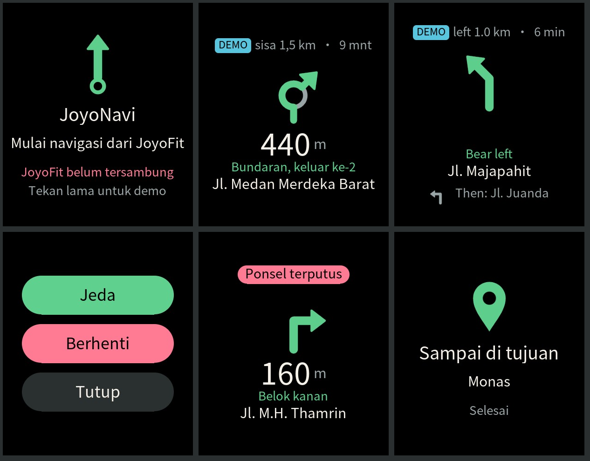

# JoyoNavi: JoyoFit's own watch app (`com.joyodigitama.navi`)

JoyoNavi shows JoyoFit's turn-by-turn navigation on the Huawei Watch Fit 4 / 4 Pro: big arrow, distance to the turn,
street, remaining distance and time, next-turn preview, a buzz at 200 m and 50 m. JoyoFit (phone) computes everything and
sends small JSON messages over Wear Engine P2P (link service `0x34`, `protocol/watch-nav.schema.json`, `protocol/README.md`
"P2P (f)"). Sources and app behaviour: `watch-app/navi/README.md`. Tracking: JRG-439 (feature), JRG-440 (developer
account).

Evidence tags below: **[DOC]** official Huawei documentation, **[CODE]** public source code, **[OBSERVED]** our own build,
simulator run or logs, **[REPORT]** third-party field report, **[INFERENCE]** our reasoning, not tested.



## Status (2026-10-26)

| Step | State |
|---|---|
| App code (pages, protocol, vibration, watchdog, demo route, ID/EN) | done, `bun test` in CI |
| Unsigned build from the command line, no account | **works** on macOS arm64 [OBSERVED] |
| Lite-wearable simulator, demo route, all screens | **works** headless [OBSERVED] (screenshot above) |
| Signed debug build, install on the owner's watch | needs the account steps below |
| Wear Engine P2P with JoyoFit on a real watch | needs a signed install; JoyoFit side on `feat/jrg-439-watch-nav-phone` |
| AppGallery release | needs identity verification + HarmonyOS release invitation |

## Toolchain

- **Project type:** HarmonyOS lite wearable, JS, FA model (`config.json`, `deviceType: ["liteWearable"]`,
  `hvigorfile.ts` with `legacyHapTasks`), `compatibleSdkVersion 4.0.0(10)`, `targetSdkVersion 5.1.0(18)`. API 10 is
  what Huawei's Wear Engine lite guide asks for [DOC](https://developer.huawei.com/consumer/en/doc/connectivity-Guides/integrating-fitnesstwatch-sdk-0000001052859174);
  the same pair is used by a public lite + Wear Engine sample [CODE](https://github.com/Explore-In-HMOS-Wearable/sportwatch-wear-engine-lite-wearable-to-mobile);
  an API 20 build failed with install error 40 on a GT 6 on fw 6.0 while API 18 installed [REPORT](https://bbs.itying.com/topic/69ac986a6f4d61004c83e5ce).
  Untested on the Fit 4 [INFERENCE].
- **DevEco Studio:** current release 26.0.0 (2026-08-28), macOS arm64 supported
  [DOC](https://developer.huawei.com/consumer/en/doc/harmonyos-releases/overview-allversion). It still has the
  `[Lite]Empty Ability` template and the Lite Wearable Simulator, which takes signed and unsigned HAPs
  [DOC](https://developer.huawei.com/consumer/en/doc/harmonyos-guides/ide-run-simulator). The GUI is **not** needed to build.
- **Command line (verified here):** Command Line Tools for HarmonyOS 6.0.1.251 (hvigor 6.21.1, ohpm 6.0.1, SDK API 21;
  [DOC](https://developer.huawei.com/consumer/en/doc/harmonyos-guides/ide-commandline-get)) + JDK 17. The SDK in that zip
  contains everything the lite build uses: hvigor's `LegacyCompileLiteJS` / `LegacyGenerateLiteCode` / `LegacySignLiteBin`
  tasks, ace-loader's `webpack.lite.config.js` and the lite previewer [OBSERVED]. Commands:

  ```bash
  export DEVECO_SDK_HOME=<command-line-tools>/sdk PATH=<command-line-tools>/bin:$JAVA_HOME/bin:$PATH
  cd watch-app/navi
  ohpm install
  hvigorw assembleHap --mode module -p product=default -p buildMode=debug --no-daemon     # or buildMode=release
  # BUILD SUCCESSFUL in ~4 s -> entry/build/default/outputs/default/entry-default-unsigned.hap (1.6 MB, one haptobin .bin)
  ```

  The lite compiler validates the HML/CSS (it flagged three redundant `flex-direction: row`, `COMPILE RESULT:SUCCESS`).
  Release mode compiles the page to bytecode (`index.bc`, 25 KB). The official zip sits behind the Huawei download centre
  (https://developer.huawei.com/consumer/en/download/command-line-tools-for-hmos); for this unsigned test build we used
  the copy of `commandline-tools-mac-arm64-6.0.1.251.zip` on huggingface.co/csukuangfj/harmonyos-commandline-tools
  (SHA-256 `9c10511d23d6a0ae597c4238e45b1f2d8730a62a93a2bf96fca3d92837733fc0`, not checked against Huawei's published
  hash). Use Huawei's download for anything that gets signed.
- **Simulator without the GUI:** `sdk/default/openharmony/previewer/liteWearable/bin/Simulator` runs headless and
  streams JPEG frames over a WebSocket (`-lws <port>`); command in `watch-app/navi/README.md` [OBSERVED]. In the simulator
  there is no `@system.wearengine`, `@system.vibrator` or `@system.brightness` (each throws a TypeError, the app logs and
  carries on) and the locale is always `zh` [OBSERVED].
- **Platform limits we hit:** a page in debug (JS parser) mode must be under 48 KB: the simulator refuses a bigger one
  with `index.js is bigger than 48 KB` [OBSERVED]. Huawei's watch-side SDK file `wearengine.js` (5.0.2.306, Apache-2.0,
  [DOC](https://developer.huawei.com/consumer/en/doc/connectivity-Library/litewearable-sdk-cn-0000001705004353)) is 17 KB
  on its own, so `common/link.js` is our own small client of `@system.wearengine` that makes the same service calls the
  SDK makes for text messages (debug page now 33 KB). A page method named `render` is not reachable as `this.render`
  (the ViewModel owns the name) [OBSERVED]. Lite CSS has no descendant selectors; a `text` in a row needs a parent with
  a width. Widths are in %, and every column fits in 396 px, because the lite layout size of the Fit 3/4/5 family is
  reported as 336x396 on the 408x480 panel [REPORT](https://github.com/AlanLinYu/huawei-lite-watch-development/blob/main/references/device-compatibility.md).

## Wear Engine (watch side)

- `@system.wearengine` calls, as in Huawei's SDK [CODE, Apache-2.0 SDK file]: `getWearEngineVersion({sdkVersion:"3",
  complete})`; from service 303 `setPackageName({appName})` and `setFingerprint({appName, appCert})`; from service 401
  `subscribeMsg` / `sendMsg({deviceId:"remote", bundleName, abilityName:"", message})` / `unsubscribeMsg` on
  `@system.wearengine`, before that on the `FeatureAbility` global. Text arrives as `data.message`; the first callback is
  `{isRegister}`.
- **Peer package:** `com.joyodigitama.joyofit` (Android package = iOS bundle id). **Peer fingerprint (phone app):** the
  SHA-256 of the certificate that signs JoyoFit's store build, 64 hex, upper case, no colons, as registered for the
  HUAWEI ID service [DOC](https://developer.huawei.com/consumer/en/doc/connectivity-Guides/send-message-0000001052460491).
  The watch SDK refuses to send with an empty fingerprint [CODE]. Until JRG-440 it is `PLACEHOLDER-JRG440-PHONE-SHA256`
  in `common/config.js` and in `config.json` `supportLists` (the pre-HarmonyOS 2 place for the same value). JoyoFit
  routes JoyoNavi's messages by source package and accepts any fingerprint (agreed with the phone side), so the
  placeholder already works with JoyoFit; it would not with Huawei Health [INFERENCE].
- **Watch app fingerprint (for the phone side):** `com.joyodigitama.navi_<base64 of the public key in the watch signing
  certificate>`, at most 127 characters on lite wearables
  [DOC](https://developer.huawei.com/consumer/en/doc/connectivity-Guides/signature-0000001053969657). Huawei's example
  starts with `B`, i.e. the raw uncompressed EC point `04‖X‖Y` (65 bytes, 88 base64 characters) [INFERENCE]:

  ```bash
  echo "com.joyodigitama.navi_$(openssl x509 -in debug.cer -noout -pubkey | openssl ec -pubin -outform DER 2>/dev/null | tail -c 65 | openssl base64 -A)"
  ```

  Debug and release certificates differ, so the value changes at release [INFERENCE]. Placeholder on the phone side:
  `PLACEHOLDER-JRG440-WATCH-FINGERPRINT`.
- **Permissions:** the watch app needs none from Wear Engine; the phone app needs `DEVICE_MANAGER` ("Basic device
  information", includes P2P messages) [DOC](https://developer.huawei.com/consumer/en/doc/connectivity-Guides/applying-wearengine-0000001050777982).
  JoyoFit is the phone side of the link itself and does not use Huawei's phone SDK, so on the JoyoFit path nothing on
  the phone checks that permission [INFERENCE]; apply anyway: it is the documented route, Huawei Health users need it, and
  AppGallery review of a Wear Engine watch app may ask for it [INFERENCE].
- Message limit 1 KB per message [DOC](https://developer.huawei.com/consumer/en/doc/connectivity-Guides/send-message-0000001052460491)
  (our messages are at most 1000 bytes by schema).

## Signing

Everything that installs on a watch must be signed: `.p12` keystore (ours), `.cer` certificate and `.p7b` profile (from
AppGallery Connect; a debug profile lists the watch UDIDs) [DOC](https://developer.huawei.com/consumer/en/doc/harmonyos-guides/ide-signing-manual).
`signAlg` is `SHA256withECDSA`. Two ways, both keep secrets out of git (`watch-app/navi/.gitignore` ignores
`*.p12 *.cer *.csr *.p7b material/`):

1. **DevEco:** File > Project Structure > Project > Signing Configs, untick "Automatically generate signature", fill
   Store file, Store password, Key alias, Key password, Sign alg, Profile file, Certpath file. DevEco writes them into
   `build-profile.json5` `app.signingConfigs` with **encrypted** passwords and a `material` folder; do not commit that
   change [DOC](https://developer.huawei.com/consumer/en/doc/harmonyos-guides/ide-hvigor-build-profile-app).
   Then `hvigorw assembleHap ...` produces `entry-default-signed.hap`.
2. **Command line:** build unsigned, then sign with the SDK's `hap-sign-tool.jar`
   (`sdk/default/openharmony/toolchains/lib/`); plaintext passwords in `build-profile.json5` are not documented to work
   [INFERENCE]:

   ```bash
   java -jar hap-sign-tool.jar sign-app -mode localSign -keyAlias joyonavi -keyPwd "$PW" \
     -appCertFile debug.cer -profileFile debug.p7b -profileSigned 1 -inFile entry-default-unsigned.hap -inForm zip \
     -signAlg SHA256withECDSA -keystoreFile joyonavi.p12 -keystorePwd "$PW" -outFile entry-default-signed.hap -signCode 0
   ```

   [CODE](https://raw.githubusercontent.com/mixin-ai/harmonyOS-signing/main/SKILL.md) (written for Stage `.app`
   packages; `-signCode 0` vs `1` for a lite haptobin HAP is untested [INFERENCE]).

A debug certificate lasts **14 days while identity verification is pending, 1 year once verified**
[DOC](https://developer.huawei.com/consumer/en/doc/app/agc-help-debug-cert-0000002283256797).

## Install paths

| Path | Verdict | Evidence |
|---|---|---|
| End users: Huawei Health > Devices > the watch > AppGallery > JoyoNavi > Install, or AppGallery on the watch | **The supported path.** Listed for Fit 4 / 4 Pro. Needs an AppGallery release (identity verification + HarmonyOS release invitation, "Sports watch" device type). | [DOC](https://consumer.huawei.com/ie/support/content/en-gb16066729), [DOC](https://developer.huawei.com/consumer/en/doc/connectivity-Guides/app-release-0000001051058047), [DOC](https://developer.huawei.com/consumer/en/doc/app/agc-help-release-app-devicetype-0000002271592112) |
| Owner's watch before release: debug-signed HAP (watch UDID in the profile) installed with HUAWEI DevEco Assistant on a phone that runs Huawei Health (not HarmonyOS NEXT) | **Works per Huawei's flow**; lite wearables have no hdc/USB debugging. | [DOC](https://developer.huawei.com/consumer/en/doc/app/agc-help-add-device-0000001946142249), [DOC](https://developer.huawei.com/consumer/en/doc/harmonyos-guides/ide-run-device), [REPORT](https://github.com/megaacheyounes/harmonyos-dev-guide) |
| JoyoFit pushes the app over the link itself (file upload `0x28`, file type 6 = app, `.bin` haptobin with an `hw signed app` trailer, install status on `2A/02`) | **Not viable for users.** The wire path exists in Gadgetbridge, but the watch verifies the package signature: only a debug build carrying that watch's UDID installs; on fw ≥ 6.0.0.328 even watch faces need a Huawei server signature (our own unsigned face on 6.1.0.117 was accepted, then deleted after `100014`). No report of any third-party app installed this way on fw 6.x. A debug HAP signed for the owner's watch pushed by JoyoFit might install [INFERENCE, untested]. | [CODE](https://codeberg.org/Freeyourgadget/Gadgetbridge) `FileUpload.java:38-44`, `HuaweiBinAppParser.java`, `App.java`, commit `4fed65266891`; maintainer in [GB #4175](https://codeberg.org/Freeyourgadget/Gadgetbridge/issues/4175), [GB #6005](https://codeberg.org/Freeyourgadget/Gadgetbridge/issues/6005); [OBSERVED] `protocol/README.md` (watch face `100014`), `docs/watchfaces-signing.md` |
| Wear Engine install API | **Does not exist** (device info, messages, files, notifications only). | [DOC](https://developer.huawei.com/consumer/en/doc/connectivity-Guides/service-introduction-0000000000018585) |

**What this means for JoyoFit users:** JoyoNavi gets onto a watch through Huawei Health (or the on-watch AppGallery),
after which JoyoFit talks to it. JoyoFit users do not keep Huawei Health connected, and switching between Huawei Health
and JoyoFit is the JRG-414 territory (the watch's "reset to pair with this phone?" account prompt, `protocol/README.md`
2026-10-25). Whether an installed JoyoNavi survives that switch, and whether the on-watch AppGallery can download while
JoyoFit is the phone, is **untested** [INFERENCE]. Test once the app is in AppGallery: install with Huawei Health, move
the watch back to JoyoFit the way `docs/watch-reference.md` describes, check the app list.

### `hw.wearable.httpProxy` (DataSync event 800100011)

- What it is [OBSERVED]: DataSync (service `0x37`) cmd 2 from `hw.wearable.httpProxy` to `hw.unitedevice.httpProxy`: the
  watch asks the phone to make an HTTP call to Huawei's cloud for it. Tags: `01` request id, `02` path, `04` GRS host key
  (no host name), `05` method, `06` headers JSON, `07` body, `08` cloud type, `09` foreground. The one in
  `~/re/agps/logcat_lab11.txt` at 21:18:13 (line 870) is `GET /healthAlgorithm/v1/algorithm/algorithmParams?type=600002&subTypes=140&version=1`
  on host key `domainHealthdataHicloud`, header `x-version: Wearable-6.1.0.117(SP20C00M05)`, request id `0x2723`, the
  same id as at 21:17:12 and 21:17:42: the watch retrying an unanswered request about every 30 s. Others seen: health
  report queries (`/dataService/v1/healthDatas/...`) and a config poll every 5 min
  (`/commonAbility/configCenter/getConfigInfo` on `domainHealthCloudCommon`, input-method config). Huawei Health
  answers each one with event 800100012 (seen encrypted only, 841 and 1013 bytes) after a logged-in HUAWEI ID request.
- Does the watch AppGallery depend on it? **No evidence either way.** None of the observed requests targets an app
  market host; Huawei Health's own server list has `com.huawei.agWearAppDistSDK` (`appMarketRequestUrl`,
  `appMarketCloudUrl`), which points to the phone app handling watch-app distribution itself [INFERENCE]. Nobody has
  logged the on-watch AppGallery with JoyoFit as the phone. Cheap test: open AppGallery on the watch while JoyoFit logs
  DataSync; an 800100011 with a market host key settles it.
- JoyoFit today logs "no handler" for it (`DataSyncService.kt`), which costs nothing but the watch's retries. Answering
  would need a HUAWEI ID session JoyoFit does not have; Gadgetbridge has no handler either
  [CODE](https://codeberg.org/Freeyourgadget/Gadgetbridge/src/branch/master/app/src/main/java/nodomain/freeyourgadget/gadgetbridge/service/devices/huawei/datasync).

## Owner checklist (the account exists; identity verification pending)

Do them in this order; items marked *after verification* wait for Huawei's approval of the identity. Never send us the
`.p12`, its passwords or the `.csr`.

1. **Finish identity verification** (Huawei Developers > Account Center). While it is pending a debug certificate lasts
   14 days instead of a year, and the HUAWEI ID / Wear Engine applications list verification as step 1.
2. **Create the watch app ID** in AppGallery Connect: **Certificates, app IDs, and profiles > App IDs > New**. App type
   **HarmonyOS app**; App name **JoyoNavi**; App package name **`com.joyodigitama.navi`** (must equal the bundle name);
   Level-1 category **App** (cannot be changed later). On "Integrate open capabilities" type a new project name
   (**JoyoFit**) and click **OK**: this creates the project and the app ID. [DOC](https://developer.huawei.com/consumer/en/doc/app/agc-help-create-app-0000002247955506)
   There is no separate "lite wearable" choice; the device type comes from our `config.json`.
3. **Get the watch UDID:** on an Android phone that is *not* on HarmonyOS NEXT, install **HUAWEI DevEco Assistant** and
   Huawei Health; Assistant > **Lite Wearable** tab > **Connect**, pair the watch in Huawei Health (Devices > Add >
   Smart watch > HUAWEI WATCH FIT 4 Pro > PAIR), then **Copy** the 64-character UDID. (This pairs the watch with Huawei
   Health; expect the JRG-414 account prompt when going back to JoyoFit.)
4. **Register the watch:** **Certificates, app IDs, and profiles > Devices > Add device**: Name `Fit 4 Pro owner`, Type
   **Sports watch**, UDID from step 3. (100 devices per year.) [DOC](https://developer.huawei.com/consumer/en/doc/app/agc-help-add-device-0000001946142249)
5. **Make the key and CSR** in DevEco Studio: **Build > Generate Key and CSR**: Keystore name `joyonavi.p12`, password
   (8+ characters, 2+ character classes), Alias `joyonavi`, Validity 25 years, Country code `ID`, Organization
   `Joyodigitama`; then CSR file `joyonavi.csr`. Keep the `.p12` and the password in the password manager.
6. **Debug certificate:** **Certificates > New certificate**: name `JoyoNavi debug`, type **Debug certificate**, upload
   `joyonavi.csr`, then download `joyonavi-debug.cer`. [DOC](https://developer.huawei.com/consumer/en/doc/app/agc-help-debug-cert-0000002283256797)
7. **Debug profile:** **Profiles > Add**: App name **JoyoNavi** (package fills in), Profile name `JoyoNavi debug`, Type
   **Debug**, Certificate `JoyoNavi debug`, Device = the watch from step 4; download `joyonavi-debug.p7b`.
   [DOC](https://developer.huawei.com/consumer/en/doc/app/agc-help-debug-profile-0000002248181278)
8. **HUAWEI ID service for JoyoFit** (*after verification*): Huawei Developers **Console > App services > Development >
   HUAWEI ID > Apply for HUAWEI ID**: Product type **Mobile app**, Product **New** (JoyoFit), Package name
   **`com.joyodigitama.joyofit`**, and the SHA-256 of every certificate that signs JoyoFit (Play app-signing key from Play
   Console > Setup > App signing, our upload/sideload key `E4:A5:12:CA:…:C8:A9:D2` from `docs/ci-release.md`).
   [DOC](https://developer.huawei.com/consumer/en/doc/connectivity-Guides/registering-applying-account-0000001050818011)
9. **Wear Engine** (*after step 8*): **Console > App services > Development > Wear Engine** (the "+" next to
   Development adds the card) > **Apply for Wear Engine**, accept, **Android app**, product JoyoFit, permission **Basic
   device information (DEVICE_MANAGER)** only. Data usage text: "JoyoFit sends turn-by-turn navigation instructions to
   its own watch app JoyoNavi (com.joyodigitama.navi) as P2P messages; no data is read from the watch." Screenshots: the
   JoyoFit navigation screen and the watch app. Review takes 1-2 weeks.
   [DOC](https://developer.huawei.com/consumer/en/doc/connectivity-Guides/applying-wearengine-0000001050777982)
10. **Send us** (none of these is secret): `joyonavi-debug.cer` (or the output of the `openssl` line in "Wear Engine"
    above), the SHA-256 values entered in step 8 exactly as the console shows them, the Wear Engine application status,
    and whether step 2 worked before verification finished. We then replace both placeholders (watch
    `common/config.js` + `config.json`, phone `watchNavConfig.ts`).
11. **Build and install the debug app** on the owner's Mac: `git pull`, then in `watch-app/navi` sign either through
    DevEco's Signing Configs (do not commit `build-profile.json5`) or with the `hap-sign-tool.jar` command under
    "Signing"; copy `entry-default-signed.hap` to the phone's `/sdcard/haps/` and install it from DevEco Assistant >
    Lite Wearable. Open JoyoNavi on the watch, reconnect the watch to JoyoFit, start a route with the lab switch on and
    send us `adb logcat -d -s JoyoFit:V | grep -i "watchnav\|P2P"`.
12. **Release** (*after verification*): email **agconnect@huawei.com** with the registered name, developer ID, reason
    ("HarmonyOS lite-wearable app for HUAWEI WATCH FIT 4 / 4 Pro, sports watch") and device type to get HarmonyOS release
    access (1-3 working days) [DOC](https://developer.huawei.com/consumer/en/doc/connectivity-Guides/app-release-0000001051058047);
    then a **release** certificate and **release** profile (same screens, type Release), a release build, and the
    listing under the app ID: Supported devices **Watch**, then **Sports watch** on App information, screenshots from
    `docs/screenshots/joyonavi-simulator.png` until real ones exist, privacy policy URL. The watch fingerprint the phone
    uses changes to the release certificate's (send us the release `.cer`).

## Not done / open

- Nothing has run on a real watch: Wear Engine service version on the Fit 4 Pro, real font rendering, vibration, the
  48 KB / heap limits on the device, and install-error codes are unverified.
- Whether a debug HAP pushed by JoyoFit over `0x28` installs (would avoid DevEco Assistant and Huawei Health for the
  owner's own watch) is untested; Huawei's documented path is DevEco Assistant.
