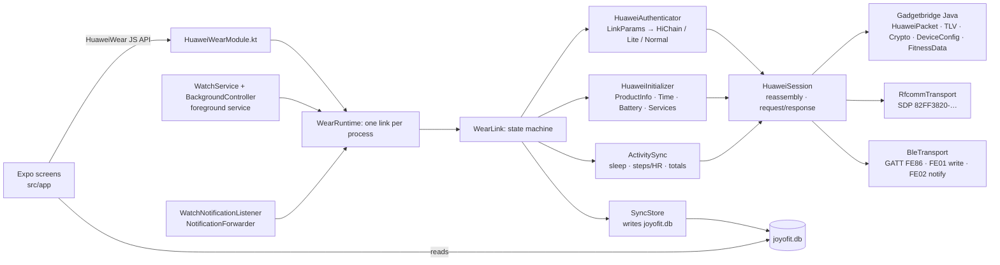

# Watch reference

Detail for the Huawei and Honor watch side of JoyoFit: supported models, how the app talks to the watch, what works, and the watch-side features. The overview is in the [README](../README.md); app features that do not depend on a watch are in [app-reference.md](app-reference.md).

## Supported watches

JoyoFit talks to Huawei Watch models over Bluetooth Classic (RFCOMM), the link the Watch Fit 4 Pro uses, and to Huawei and Honor bands over Bluetooth LE (GATT). The model list comes from Gadgetbridge's Huawei support (see `WatchModels.kt`). **Only the Huawei Watch Fit 4 Pro has been tested with JoyoFit.** Everything else is a best guess until someone tries it.

| Status | Watches | Notes |
| --- | --- | --- |
| **Tested** | Huawei Watch Fit 4 Pro | Checked on a real watch. |
| **Experimental** | Huawei Watch Fit 4, Huawei Watch Fit 5, Huawei Watch Fit 5 Pro, Huawei Watch Fit 3, Huawei Watch Fit 2, Huawei Watch GT 2, Huawei Watch GT 2 Pro, Huawei Watch GT 3, Huawei Watch GT 3 Pro, Huawei Watch GT 3 SE, Huawei Watch GT 4, Huawei Watch GT 5, Huawei Watch GT 5 Pro, Huawei Watch GT 6, Huawei Watch GT 6 Pro, Huawei Watch GT 7, Huawei Watch GT 7 Pro, Huawei Watch GT Runner, Huawei Watch GT Runner 2, Huawei Watch GT Cyber, Huawei Watch 3, Huawei Watch 3 Pro, Huawei Watch 4, Huawei Watch 4 Pro, Huawei Watch 5, Huawei Watch D2, Huawei Watch Ultimate, Huawei Watch Ultimate 2, Huawei TalkBand B6, Honor MagicWatch 2, Honor Watch GS 3, Honor Watch GS Pro, Honor Watch 4, Honor Watch 4 Pro | Bluetooth Classic models in Gadgetbridge's list. Never tried with JoyoFit, so some or all features may not work. |
| **Experimental** | Huawei Watch Fit, Huawei Watch GT, Huawei Watch GT 2e, Huawei Band 2, Huawei Band 2 Pro, Huawei Band 3, Huawei Band 3 Pro, Huawei Band 3e, Huawei Band 4, Huawei Band 4 Pro, Huawei Band 4e, Huawei Band 6, Huawei Band 7, Huawei Band 8, Huawei Band 9, Huawei Band 10, Huawei Band 11, Huawei Band 11 Pro, Honor Band 3, Honor Band 4, Honor Band 5, Honor Band 6, Honor Band 7, Honor Band 9, Honor Band 10, Honor Watch | Bluetooth LE (GATT) models in Gadgetbridge's list. **Untested, please report:** the LE link was ported from Gadgetbridge without a band to try it on, so connecting, pairing or sync may fail. Connect once and send the report (see below). JoyoFit lists bonded devices, so the band must show up as paired in Android's Bluetooth settings. Band 3e and 4e use a variant of the handshake. Honor Band 7, 9 and 10 use Honor's own GATT service, and Gadgetbridge calls those three experimental too. |
| **Not yet** | Honor Watch 5, Honor Watch 5 Pro, Honor Watch 6 | Honor's newer pairing (HiChain PAKE) is not implemented. |
| **Not yet** | Earphones (FreeBuds, FreeClip, FreeArc, FreeLace, Earbuds) | Not watches; they do not speak the watch protocol. |

A Huawei or Honor watch that is not in the list is **unknown**: JoyoFit tries to connect to it like a Huawei watch (over Bluetooth Classic, or over Bluetooth LE if Android reports the device as LE only), and it may not work. Anything that is not a Huawei or Honor watch is refused.

### Help support your watch

If you own an experimental or unknown model, connecting once helps a lot:

1. Pair the watch and connect it in JoyoFit.
2. Open the **Watch** tab, then **Help support your watch**, then **Report on GitHub**.
3. The app opens a prefilled [watch report issue](https://github.com/dzulfikar08/joyofit/issues/new?template=watch-report.yml) and copies the full report to the clipboard. Say what works and what does not, paste the report into the **Log** field, and submit. **Share as text** sends the same report anywhere else.

The report is plain text: app version, phone, watch model and software, supported commands, ExpandCapability and the connect log. It has no Bluetooth addresses and no serial number.

No watch to test with, or your model is not listed? The [Dukung jam](https://fit.joyorogo.com/dukung-jam) page (Indonesian) explains how to lend a device for testing, pool funds, or request a model.

## How it talks to the watch

The Fit 4 Pro (and the other Classic watches) use **Bluetooth Classic RFCOMM** by default. Huawei and Honor bands speak the same packet
protocol over **Bluetooth LE GATT** (service `0xFE86`, write `FE01`, notifications `FE02`; Honor Band 7, 9 and 10 use Honor's own
service), which `BleTransport` carries. The Fit 4 Pro also exposes that service over LE: with the developer switch below, link params,
HiChain3 auth, battery and an activity sync all ran over GATT on a real watch (see `protocol/README.md`, Observations). `WatchModels.kt`
picks the transport per model. See [`protocol/README.md`](../protocol/README.md) for the frame format,
the commands used, and how the app picks an auth path.

**Developer switch: Bluetooth LE link.** Settings, Advanced, Experimental (the Experimental row is in the Advanced group) has a switch that makes the next connect open GATT (`BleTransport`)
whatever the model's own link is. It exists to find out whether a Classic watch such as the Fit 4 Pro also speaks the protocol over LE, which
an iOS port (CoreBluetooth only) would need. It scans for the watch's LE address (service `FE86`, the bonded name, the bonded address; needs
the Nearby devices permission, which the switch asks for) and falls back to the bonded address. Default off. Every scan result, GATT step
and packet of an LE link is logged under logcat tag `JoyoFitBle`. Without touching the app, from a computer:

**Debug builds only:** the switch row (`__DEV__`) and `BleProbeReceiver` (manifest in `modules/huawei-wear/android/src/debug`) are absent from release, sideload and Play builds; the adb commands below need a debug build.

```bash
adb shell am broadcast -n com.joyodigitama.joyofit/com.joyodigitama.huaweiwear.BleProbeReceiver \
  -a com.joyodigitama.joyofit.BLE_PROBE [--es address AA:BB:CC:DD:EE:FF] [--ez sync false] [--ez restore false]
adb logcat -s JoyoFitBle
```

The probe pauses background mode, connects over LE, reads the battery and runs an activity sync, then restores the switch and background
mode. The receiver requires `android.permission.DUMP`, so only the adb shell and the system can send it.

**Bind lab.** The same receiver can authenticate over LE as a phone the watch has never seen, to learn what a first bind (an iPhone's) looks like
without touching the binding the app holds. It uses its own session and a throwaway identity in separate preferences (`huawei_wear_lab_TAG_*`):

```bash
adb shell am broadcast -n com.joyodigitama.joyofit/com.joyodigitama.huaweiwear.BleProbeReceiver \
  -a com.joyodigitama.joyofit.BLE_PROBE --es lab t1 --es stop negotiation   # or pin, step2
adb shell am broadcast ... --es lab real                                      # the stored identity, reconnect only, every frame in full
adb shell am broadcast ... --es lab t1 --ez commit true --ez adopt true      # a REAL bind
```

`stop negotiation` and `stop pin` only ask the watch questions. `step2` also sends HiChain operationCode 1 steps 1 and 2 and stops before the auth token
is delivered. Without a stop, a lab identity that never bound completes the bind, which makes the watch drop the binding the app holds (it keeps one),
so the lab refuses without `--ez commit true`; `--ez adopt true` then makes the lab identity the app's stored one so the app keeps working. Frames and the
session's secrets are logged in full under `JoyoFitBle`. On Android 14 and newer the lab refuses runs that reach the first HiChain bind step (`step2` or a bind): the phone asks for ATT MTU 517,
the watch answers in 514-byte notifications and Android discards anything over 512 bytes, so the watch's reply never arrives (see protocol/README.md, Observations).



## What works

| Feature | Status |
|---|---|
| Bonded-device list, connect, disconnect | implemented |
| Auth: HiChain (first bind with on-watch confirmation, then reconnect), HiChain Lite, normal | implemented (ported from GB) |
| Product info, time sync, battery | implemented |
| Sync per-minute steps / kcal / distance / HR / SpO₂ / resting HR, sleep segments, today's totals | implemented |
| Heart rate, SpO₂ and TruSleep switched on in the watch on every connect (Settings → Watch & sync → Heart rate and sensors, default on; optional high/low heart-rate alerts, default off); live heart rate on Today while it is on screen; the hero shows the live bpm, else the newest stored one with its age, else `--` | implemented, ported from GB; the realtime push layout is a guess (GB has no parser), unverified on the Fit 4 |
| Local storage + Today screen + raw packet log (copy to clipboard) | implemented |
| Sleep stages from TruSleep / dictionary files (file download services 0x2C and 0x0A) | implemented, gated like GB; unverified on the Fit 4. Watches without dictionary sleep (ExpandCapability 143, older HarmonyOS) only give the TruSleep state ranges, which are the watch's sensor windows rather than a verdict of sleep: GB reads them as light sleep, JoyoFit stores them with no stage, shows "Sleep (no stages)" with a hint about the TruSleep switch, and cleans them when read (workouts, spot HRV measurements and minutes of walking subtracted, runs under 20 minutes dropped, a workout or an hour of nothing splits the night; stored history is re-derived, staged sleep untouched). Fixtures come from Watch Fit 2 screenshots; no `sleep_state.bin` dump from that watch yet, so the rule is a heuristic |
| Background mode: foreground service keeps the watch connected, reconnects with backoff, syncs every 30 min (configurable), starts on boot | implemented; unverified on the Fit 4 |
| Notification forwarding (app name, title, text) with a per-app list | implemented; unverified on the Fit 4 |
| Profile (height, weight, birth year, sex) and daily step goal sent to the watch | implemented; unverified on the Fit 4 |
| Write steps, distance, calories, heart rate, SpO₂, resting HR, sleep and workouts to Health Connect (for JoyoRogo and others), also from the background service | implemented; unverified on the Fit 4 |
| Workouts (sport sessions): totals, heart rate, pace splits, swim data and the GPS track, shown in the Workouts tab as a full analysis (map, scrubber charts, splits, zones, best efforts, laps, load: see [Workout analysis](#workout-analysis)) | implemented, ported from GB; unverified on the Fit 4 |
| Weather on the watch: current conditions and a 24 h / 8 day forecast from Open-Meteo (no key) for the phone's coarse location or a chosen city, pushed on connect, when the watch asks, and every hour (configurable) | implemented, ported from GB; unverified on the Fit 4 |
| Find my watch (phone → watch) from the Watch tab | implemented, ported from GB; unverified on the Fit 4 |
| Find my phone (watch → phone): loud ringtone on the alarm volume, vibration, notification with Stop; works from the background service | implemented, ported from GB; unverified on the Fit 4 |
| Incoming calls on the watch (caller name or number), accept / reject from the watch | implemented, ported from GB; unverified on the Fit 4 |
| Alarms: read the five event alarms and the smart alarm, add, edit, delete, enable, push | implemented, ported from GB; unverified on the Fit 4 |
| Watch faces: list with the active one, set active, delete, install a `.hwt` from Huawei Theme Studio Pro with upload progress | implemented, ported from GB; **an unsigned face is deleted by the watch** (VERIFIED on the Fit 4 Pro: activation answered 100014, face removed about 3 s later), so install works only for a Huawei-signed face, which has not been tried |
| Customize the editable faces already on the watch (Watch faces → Customize): read a face's selected style, background, typeface, hands, colour and widget options, change them, Apply, Revert | native codec and `WatchfaceCustomizer` (DataSync events 800100008 / 800100009) **implemented from the Huawei Health RE, UNVERIFIED on the watch**; JVM codec tests pass; options are labelled by position because the watch sends no names or counts |
| Fall detection switch, SOS text relay (`SmsManager`), DST answer, morning sleep report, cycle log with watch calendar and reminders (Settings → Safety, Settings → Cycle) | implemented from the Huawei Health RE (DataSync, service `0x32`); unverified on the Fit 4 |
| Health metrics from the watch's data dictionary over P2P (service `0x34`): skin temperature, HRV, stress / emotion, sleep apnea, plus raw capture of arterial stiffness and arrhythmia; stored in `health_metrics`, shown on **Today → Health** with the latest value and a 7-day sparkline; metrics the watch does not support (blood pressure, altitude, AMS here) are skipped and listed as such | implemented, ported from GB (`HuaweiP2PDataDictionarySyncService`), gated by ExpandCapability like GB; unverified on the Fit 4 (see `protocol/README.md` → P2P) |
| Healthy Living (Health Clover) tasks: answers the watch's request with steps, exercise, sleep, calorie intake and clover progress from JoyoFit data (Settings → Health & cloud) | implemented from the Huawei Health RE (protobuf field numbers read from the APK's generated classes); unverified on the Fit 4, clover leaf mapping is a documented substitution |
| Running courses (warm-up, intervals, cool-down by time or distance with pace / heart-rate / cadence targets) pushed to the watch (Settings → Advanced → Running courses) | **experimental, off by default**: format from the Huawei Health RE, the watch's acknowledgement and some fields are not known; see `protocol/README.md` → P2P (c) for exactly what is missing |
| Calorie intake from JoyoRogo on the watch's calorie card, weight / resting metabolism / Health Glance answers, activity-ring goals and reminders (Settings → Meals on watch, Goals and reminders) | implemented from the Huawei Health RE over a new DataSync framework; **unverified on the Fit 4 Pro** |

The protocol layer is covered by the Gadgetbridge packet, TLV and crypto tests plus our own
session reassembly tests and fake-watch tests for downloads and watch face upload, 222 JVM tests in total. **It has not yet been run against a real Fit 4.**
The first connect is the real test. When you do it, save the log (Settings → Advanced → Log → Copy) and add the
link parameters to `protocol/README.md` → Observations.

## Using it

JoyoFit ships only through Google Play and the App Store; there is no public APK download. A self-build from source (see [Releases and updates](../README.md#releases-and-updates)) can also enable the extra call-log and SMS features that the store versions leave out.

Step-by-step install and pairing guide (Indonesian, with an English section): <https://fit.joyorogo.com/panduan>. Also reachable in the app from the Watch tab and Settings → About.

1. Unbind the watch from Huawei Health. The watch can only be bound to one app at a time; a
   factory reset of the watch also works.
2. Pair the watch in **Android Settings → Bluetooth**. It shows up as `HUAWEI WATCH FIT 4-XXX`.
3. Open JoyoFit → **Watch** → grant Nearby devices → tap the watch → **Connect**.
   - On the first connect, confirm the pairing on the watch within 30 s.
4. Go to **Today** and tap **Sync now** (or pull down). The first sync pulls the last 7 days. Each later sync starts
   from the previous one, with 1 h of overlap.
5. **Settings** is a grouped menu: Watch & sync (background toggle, sync interval, heart rate and sensors), Notifications & calls,
   Weather, Health & cloud, Profile & goal and Advanced. The watch you last connected from **Watch** is the one
   background mode follows.
6. **Settings → Advanced → Log** shows every TX/RX frame in hex.

### First-run setup guide (Settings → Setup guide)

The first launch opens a guide (`src/features/onboarding/`, route `/onboarding`, a hidden tab with no tab bar). It resumes where it was left if the app is closed, can be
reopened from **Settings → Setup guide**, and is never shown on its own to someone who already has a paired watch (a watch linked now, remembered for background, or a
`device` row from an earlier sync: a `bypassed` record is written once). Progress is one JSON record in the `expo-sqlite/kv-store` key `joyofit.onboarding`. Back and a skip
exist on every step except while the watch is connecting; Continue on the pairing step waits until the watch is linked. There is no event tracking in the app, so the guide sends none.

Order, with the rules in `flow.ts` (pure, tested in `flow.test.ts`): Welcome, Huawei Health, Pair, First sync, Notifications, Apple Health / Health Connect, Weather, Background
(Android only), JoyoRogo sign-in, JoyoRogo Pro (hidden when the build has no cloud server), Done.

- **Huawei Health first**: the watch accepts one app, so it is released before pairing. It is also the last point to let Huawei Health sync once more and to request the data export
  (which takes up to 7 days), so the step carries the real import sections behind a button and the ZIP can be imported when it arrives. A watch reset is only mentioned as a last resort
  under the pairing step, because it wipes the watch's stored data.
- **Pair** is the Watch tab's list and bind confirmation (`AvailableWatchesSection`, `BindConfirmDialog`), not a copy; nothing asks for Bluetooth before the pre-prompt "Continue".
- **First sync** comes right after pairing: it proves the link, and the scores, exports and backups below all need data. The native sync reports no percentage, so the step shows that it
  is running and then what came in.
- **JoyoRogo Pro** (`pro.ts`): the price and the AI scan limits are read from `GET https://api.joyorogo.com/api/config` (`founderPriceIdr`, `founderYearlyPriceIdr`, `founderDailyCap`,
  `freeDailyScans`, `promo`), never written in the app. By store: iOS only says Pro is available in JoyoRogo, with no price and no link
  ([App Store Review Guideline 3.1.1](https://developer.apple.com/app-store/review/guidelines/#in-app-purchase)); a Google Play build shows no price and links to the JoyoRogo app's Play
  listing ([Play Payments policy, section 4](https://support.google.com/googleplay/android-developer/answer/9858738)); only a sideloaded Android build shows the price and a button to
  `joyorogo.com/pro` (`utm_campaign=evergreen-onboarding`). Using JoyoFit stays free either way.

### Background mode

Turn on **Keep connected in the background** in Settings. A foreground service (type
`connectedDevice`, with a low-priority notification) owns the one watch link: it connects when it
starts, reconnects after a drop (5 s, doubling up to 5 min; at once when Bluetooth turns on or the
watch's ACL link comes up), and syncs and reads the battery on a timer. After a reboot it starts again.
Sync results are written to the database by native code, so data accumulates while the app is closed.

- The first bind still has to be confirmed on the watch from the Watch tab; the service never starts a bind.
- Tapping **Disconnect** in the app pauses auto-reconnect until you connect again.
- Android 13+ asks for the notification permission when you enable it. Without it the service still
  runs but its notification is hidden.
- Battery optimisation: if your phone kills the service, exempt JoyoFit from battery restrictions.

### Watch history and how long the watch keeps it

The first sync after binding pulls everything the watch still holds (steps and heart rate, sleep, night HRV, workouts), not a fixed week. The
pull is cut into slices (everything older than 8 weeks as one, then 14 days at a time) and each slice is committed on its own, so a cut-off
pull resumes from the last finished slice. Later syncs only fetch what is new. **Settings → Background and sync → Fetch all history from
watch** (Android) runs the full pull again; rows already stored are upserted by timestamp, so only what is missing is added.

Over Bluetooth LE on Android 14 and newer the phone discards any 514-byte notification, so a watch reply longer than that loses its head
(the log shows "Magic mismatch" and the request times out). A step or sleep frame that gets no answer is skipped and logged as
`... skipping this frame`; a second unanswered frame in a row aborts the pull. Classic (RFCOMM) watches are not affected; the developer LE
switch only applies in debug builds.

To read how far back the watch actually reaches, run a sync and read the `History:` lines (logcat tag `JoyoFit`):

```
adb logcat -d -s JoyoFit:V | grep "History:"
```

`History: summary oldest step sample <unix s>, oldest sleep <unix s>, oldest stored workout <unix s>; N step samples, ...` is the retention:
convert with `date -d @<unix s>`. Per-slice counts are logged as `History: slice i/n from..to`. The watch's step, sleep and workout counts per
request are in the neighbouring `Sync:`, `StepDataCount` and `Workout` lines.

### Notifications

In Settings, grant **notification access** (on Android 13+ a self-built app must first be allowed
under App info → ⋮ → *Allow restricted settings*), then switch on forwarding. Ongoing notifications,
group summaries, local-only ones, calls (VoIP calls ring the watch as calls, see *Calls* below), media controls, progress bars and JoyoFit's own are skipped.
Apps you have not chosen are on, except system apps; **Notification apps** (Settings → Notifications & calls) overrides either way.
Notifications only reach the watch while it is connected, so use background mode to keep it connected.

### Weather

In Settings → **Weather**, switch on *Send weather to the watch*, pick °C or °F and where the weather
is for: **This phone** (asks for the coarse location permission) or **A city** (type a name, e.g.
`Bandung` or `Bandung, Indonesia`; it is looked up with Open-Meteo's geocoding). The forecast comes
from `api.open-meteo.com`; only the coordinates, rounded to about 1 km, are sent. The weather is pushed
when the watch connects, whenever the watch asks for it (opening its weather app), and every hour
(30 min to 4 h) while the watch is connected, so background mode keeps it fresh. **Update now** sends it at once.

- It is off until you switch it on. While off, a watch that asks gets a "weather disabled" reply.
- Location uses `LocationManager` (no Google Play services): the newest last-known coarse fix, else one
  fresh network fix, else the last position it stored. Without background location access Android may
  give the background service no fresh fix, so the last position is reused. Choose **A city** if that is not good enough.
- Temperatures are always sent in °C, like Gadgetbridge; the unit setting tells the watch which one to show.
- Moon rise and set come from Open-Meteo's daily `moonrise` / `moonset` (unix seconds, null on a day the moon skips one) and are sent
  with the sun times, so a watch that does not list sun rise/set (bit 0 of `0f/0a`) gets neither. The moon phase is computed.
  Air quality is not sent, and a current-location name comes from Android's `Geocoder` when the phone has one.
- Settings → Weather says what the watch did with the forecast of the last push: sent (24 hours, 8 days), refused (the code it
  answered), not confirmed, or "takes current weather only" when the watch does not list the forecast command. The support
  report carries the same lines, the commands the watch lists and every step of the last push, so a watch that shows today's
  weather but no forecast (reported on a Watch Fit 2, cause not confirmed yet) can be diagnosed from one report.

### Night HRV

Night HRV comes from the watch's own automatic stress records (Android only; the iPhone app does not read them yet). It needs a
watch that offers **Automatic stress** and that switch on in Settings → Heart rate and sensors (one minute of calibration). The app
then averages the records the watch made while you slept, once at least three usable ones exist. What it says when there is none:
"Night HRV not available on this watch" when the watch does not offer automatic stress, or when the switch has been on for three nights
and no record from sleep ever arrived; "Night HRV is off" when the switch is off. Recovery and Readiness say the same instead of
waiting for a night that will not come, and Readiness states that it was worked out without night HRV; a 1-minute reading
(Measure HRV) stands in for it only when you took one. Whether a Watch Fit 2 records stress while asleep is not known (one user
reports night HRV never arrives); the support report carries the `Night HRV` lines that settle it.

### Find my watch, find my phone, calls and alarms

- **Find my watch**: Watch tab → *Ring the watch* / *Stop ringing* (watch connected, and it must report
  find-device support).
- **Find my phone**: on by default in Settings → *Notifications & calls*. When you press find-phone on the
  watch, the phone rings in a loop on the **alarm** stream at maximum volume (your alarm volume is restored
  afterwards), vibrates, and posts a high-priority notification with **Stop**. It stops when the watch says
  stop or when you tap Stop; either way the phone then tells the watch it stopped, like Gadgetbridge. It needs
  no UI, only the link, so background mode is enough. It does not use a full-screen activity.
- **Calls**: switch on *Show incoming calls on the watch* and allow Phone state (needed), Call log (the
  caller's number; Android hides it otherwise) and Contacts (shows the name instead of the number). While
  ringing, the watch shows the call; answering or ending it on the phone clears it. With *Answer and reject
  calls from the watch* on (needs the Answer phone calls permission), the watch's accept and reject buttons
  call `TelecomManager.acceptRingingCall()` / `endCall()`. There is no mute button: the watch protocol
  Gadgetbridge knows only has accept and reject. Outgoing calls are not shown.
- **VoIP calls** (WhatsApp, WhatsApp Business, Telegram, Signal, Google Meet/Duo, LINE ...): the same *Show incoming
  calls on the watch* switch also rings the watch for an app's incoming-call notification (notification category
  *call*, or a `CallStyle` of type incoming), with the caller from the notification and the app name on the
  number line when the watch has one. The dialer is left to the phone-state path, so a normal call never rings twice.
  An *ongoing* call notification never rings: a `CallStyle` type decides when there is one; otherwise only a
  notification with a full-screen intent, an insistent alert or both an answer and a decline action counts as ringing.
  The ring stops when the notification goes away (answered, declined or missed), and an answer on the phone sends
  start-call. **Notification apps** still applies: an app you switched off does not ring. The watch's reject button
  fires the notification's decline action; the accept button fires its answer action, or is ignored if there is none
  (an app may refuse to start its call screen from the background). Both follow *Answer and reject calls from the watch*.
- **Alarms**: Watch tab → *Alarms*. The screen reads the watch whenever it opens with the watch connected,
  keeps the last copy on the phone, and every change pushes the whole list and shows what the watch reports
  back. Five event alarms (name, time, weekdays) and, if the watch has one, the smart alarm.

### Watch faces

**Watch** tab → *Watch faces*. The screen reads the watch's face list when it
opens: name, id and version, an *(active)* marker, and *preinstalled* for the factory faces. *Set active* switches the watch to
that face, *Delete* removes it (not offered for preinstalled faces). After each of these the app reads the list again and
reports an error if the watch did not do what it was asked.

**Customize** (shown on faces whose `editable` bit is set; UNVERIFIED that the bit means "has options"). Opens an editor that asks the
watch for the face's current options and shows what it reports: a picker each for style, background, typeface, hands (and symbol, time,
scale, dual when the face has them), a colour palette with an optional custom colour, and one picker per widget slot. *Apply* sends the
picks and then asks the watch again; the screen says which picks the watch did not take. *Revert* puts back the options the face had when
you opened the editor. If the user edits the face on the watch, the watch's report updates the screen.

- **Options are numbered, not named.** The watch reports only which option is selected. How many exist, and what they look like, lives in
  Huawei's per-face editor page, which JoyoFit does not have. Each picker starts with six numbers and grows with *More*; an index the face
  does not have is expected to be refused, and the apply result then lists it.
- Needs ExpandCapability 84 (DataSync events). Without it the editor says so; the decision is logged as `FaceCustom: … ExpandCapability 84 …`.
- Status: wire format **UNVERIFIED** (read from Huawei Health's `CustomConfigWatchFaceService`; `protocol/README.md` → *Editing a face's
  options*, including the device test to run). Codec **VERIFIED by JVM tests** against the byte layout documented in `protocol/README.md`. The screen,
  its hook and the native module compile and lint clean but were **not exercised on the watch**.

*Install from file* opens Android's file picker. Pick a `.hwt` that Huawei signed (for example one from **Huawei Theme Studio Pro**
with a developer account; see *Unsigned faces* below). The Watch Fit 4 and
Fit 4 Pro screen is 480 x 408 px (Theme Studio Pro calls it 408 x 480; GB's theme version `HWHD13`). The app checks the package's
theme version against the screen size the watch reports and refuses a face made for another screen before sending anything.
The upload shows a progress bar; the watch pulls the data in chunks of its own choosing.

- **Unsigned faces are deleted by the watch.** **VERIFIED** on the Fit 4 Pro (firmware 6.1.0.117): the upload is accepted, the
  activation is answered with status 100014 and the watch removes the face about 3 s later (`protocol/README.md` → *Why a face did not
  install*); Gadgetbridge issue #6199 (HarmonyOS 6.1 cannot install `.hwt`) agrees. Firmware 6.x requires Huawei's signature, which is tied
  to the Huawei account, the face id and version, and the watch (*What the signature covers*). JoyoFit cannot sign a face, so this
  screen only works for a face Huawei signed; a signed face has not been tried here. When the watch refuses, the screen and the Log
  tab show the exact status code it returned (`Upload: rejected by the watch at … status code N`); if it takes the upload but the face
  never shows up in its list, the result says so ("the watch does not list the new face"). A face that works without a signature is the
  **photo face** (Watch → Photo face, with a picture from JoyoFit Studio or the gallery).
- Only one operation runs on the link at a time: a sync that starts during an upload waits for it.
- GB does not check for the `0x28` upload service in the watch's service list, and neither do we; the Fit 4 does not list it.

### Safety: fall detection, SOS texts, morning sleep report (Settings → Safety)

- **Fall detection** shows the watch's own switch and sets it (DataSync config `900500038`). It is offered only when the watch reports what Huawei Health
  checks (ExpandCapability 83 and SupportedCommands `0x33/01`); the Fit 4 Pro's service list has no `33`, so there the row says "not available" and why.
- **SOS texts.** When the watch asks for an SOS SMS (event `800100040`) the phone sends it with `SmsManager` (long texts are split) and tells the watch if it
  went out. It never sends unless you switch it on, grant SMS permission and a SIM is ready; otherwise it answers the watch "failed" so nobody waits for help that
  is not coming. The watch decides the number and the text; JoyoFit picks no recipient. "Check without sending" shows what would happen and sends nothing. The log
  shows only the last two digits of the number and the message length.
- **Morning sleep report.** Once each morning, after the first sync that holds a night of at least 3 h that ended today, the watch shows how long you slept, the times
  and the stages (event `80030001`). On by default; "Send last night's report now" pushes it for testing.
- **Time zones and DST** need no setting: when the watch asks (event `800100020`) JoyoFit answers with the next transition of the phone's zone.

### Cycle (Settings → Cycle)

Log when a period starts and ends, flow and cramps (0 to 3), add earlier periods, and see an estimate of the next period and the fertile window from the average of
your logged cycles (28 days with no history). The estimate is not medical advice. The switch "Show the cycle calendar on the watch" (off by default) sends the
capability, the reminder switches and, when the watch asks, the cycle list, daily status and flow/cramps over service `0x32` and DataSync dictionary `400018`
(`protocol/README.md`). Unverified on the Fit 4: the exact fields were read from Huawei Health, never seen on the wire.

### Meals on the watch, body data and ring goals (DataSync, service `0x37`)

All of these ride the DataSync framework (`DataSyncService`: the four "sample" commands `37/01..04`, an inbound dispatcher keyed by package and id, capability gates
ExpandCapability 83 / 84 / 85 / 173). **None of it has been seen working on the Fit 4 Pro yet**: the layouts follow the behaviour of Huawei Health 17.0.8.300 (`protocol/README.md`
→ Calorie intake, Body data, Activity goals). Every send, every watch request and every gate decision is in the Log (`adb logcat -d -s JoyoFit:V`, lines starting `DataSync`, `Diet:`, `Body:`, `Goals:`, `Health Glance:`).

- **Meals on watch** (Settings → Meals on watch). JoyoRogo's `food.listByDate` (today's diary: kcal, macros, meal type), `profile.myProfile` (daily kcal target, BMR, goal weight) and
  `weight.history` (latest weigh-in) are read over JoyoRogo's oRPC API (`POST <server>/rpc/<router>/<procedure>`, the session cookie in a `Cookie` header, read-only) and handed to the
  watch: config `900300023` (goals, per-meal budget) and `900300022` (goal weight), then the whole day's meal slots as dictionary `600002`, with empty placeholders for
  the meals not eaten yet. Meals map `sarapan` 10, `makan_siang` 20, `makan_malam` 30, `snack` 40; an item logged 3 h or more after the first of its meal goes to the extra slot 11 / 21 / 31,
  which the watch only gets with ExpandCapability 215 (else it is folded into 40). It refreshes when the app opens, returns to the foreground, after each sync and when the watch connects;
  **Push now** does it at once. The watch's own requests are answered from the stored day (`{event:1}` the meals, `{event:5}` the weight, `500018` the resting metabolism, `80030004` "not VIP").
  A meal quick-logged on the watch (`{event:6}`) is stored, acknowledged (`{punchResult:0,event:6}`, needs bit 215) and written to JoyoRogo as a diary item by the app (`food.add`); until then it stays on the phone.
  - **Limitation.** The JoyoRogo sign-in lives in `expo-secure-store` and native code cannot read it, so the background service cannot refresh from JoyoRogo. With the app closed it answers from the last day the
    app stored, rolled over to an empty new day with the same goals; a watch meal logged then is written to JoyoRogo the next time the app opens.
  - JoyoRogo has no body fat or blood pressure, so the Health Glance card (event `80030006`) gets only height, weight and BMI; unknown fields are left out, as Huawei does.
- **Goals and reminders** (Settings → Goals and reminders). Steps, active kcal (sent as kcal x 1000 like Gadgetbridge), exercise minutes and stand hours, plus the stand, progress and goal-reached
  reminders, sent as configs `900200006`..`900200009`, the bundle `900200002` and `900200004` / `900200010` / `900200011` on every save, and on every connect once you have saved goals (nothing is pushed before, so goals set on the watch survive). Defaults are Huawei's:
  10 000 steps, 300 kcal, 30 min, 12 h, reminders on (the steps goal is the profile's daily step goal until you save it here, and afterwards the two stay equal). If the watch changes a goal itself, JoyoFit stores it.

## JoyoFit Studio

[`web/`](../web/README.md) is a watch face editor for the Fit 4 and Fit 4 Pro, hosted as a Cloudflare Worker with static assets. You design a 408 x 480 face in the browser (time, date, analog hands,
data fields such as steps, heart rate, battery, altitude and temperature, progress rings, images, solid, gradient or photo
backgrounds, six templates) against a simulated watch. Nothing leaves the browser. It builds on
[`packages/hwt`](../packages/hwt/README.md), the TypeScript `.hwt` codec.

- **Photo face (the export that works with JoyoFit).** Export gives a `<Name>.photo.png`: the picture layers (background and
  images) flattened onto opaque black at exactly 408 x 480. Send it to the phone and pick it in **Watch → Photo face**; a picture
  of exactly that size is uploaded without the crop step and without resampling. The watch draws its own clock and data over a
  photo face, so Studio's live layers (time, date, hands, data, rings) are not in the picture; the stage's *Photo face preview*
  shows what is left. The photo-face upload itself is **VERIFIED** on the Fit 4 Pro (`protocol/README.md` → photo faces); the
  exact-size shortcut in JoyoFit is new and **UNVERIFIED** on a watch.
- **`.hwt` export (not installable from JoyoFit).** The file is still written, for Huawei Theme Studio Pro with a Huawei developer
  account (which signs it) and for inspecting the layout. An unsigned `.hwt` is deleted by the watch (see *Unsigned faces* above).
- A *field browser* (Add → Fields) lists every `value_type` id the codec knows with its evidence (verified, unconfirmed, unknown),
  the layer types Huawei allows for it and its container slot, and adds the ones Studio can write as a number, a ring or an icon set.
  Elements whose ids are known only from sample faces are marked *Unconfirmed* and can be left out of the `.hwt`; elements with no
  known id (calories, AM/PM) are *Preview only* and never exported. The export dialog lists both, plus the package size against
  Huawei's limits.
- Setup, tests, deploy and the element-to-layout mapping are in [`web/README.md`](../web/README.md).

