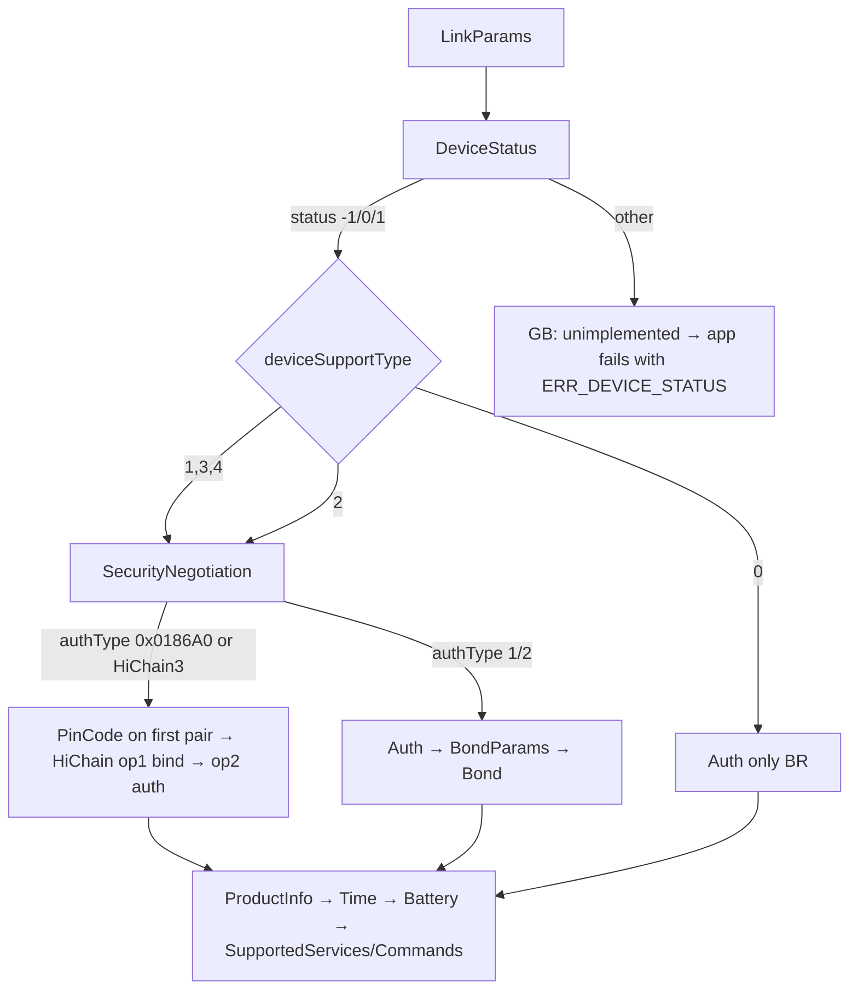

# Huawei link protocol: what this app uses

These notes come from Gadgetbridge (upstream `bb7a1e83`, 2026-10-13). Nothing here has been
captured from our own watch yet. Gadgetbridge lists the Watch Fit 4 and Fit 4 Pro as supported
devices (`HuaweiJoyoFit4ProCoordinator`). When a capture from a real watch confirms or contradicts
something below, note it under **Observations**.

## Transport

| Item | Value | GB source |
|---|---|---|
| Link | Bluetooth Classic (BR/EDR) RFCOMM, **not BLE GATT** | `HuaweiBRCoordinator.getConnectionType() = BT_CLASSIC` |
| SDP service UUID | `82FF3820-8411-400C-B85A-55BDB32CF060` | `HuaweiConstants.UUID_SERVICE_HUAWEI_SDP` |
| Socket | `createRfcommSocketToServiceRecord` (secure, needs a bond) | `btbr/BtBRQueue.connect` |
| Advertised name | `HUAWEI WATCH FIT 4-XXX` / `HUAWEI WATCH FIT 4 Pro-XXX` | `HuaweiConstants.HU_JOYOFIT4*_NAME` |

The BLE service `0xFE86` (`FE01` write / `FE02` notify) is how Huawei and Honor bands connect (`HuaweiLECoordinator`,
`BleTransport`; Honor Band 7, 9 and 10 use Honor's own service, `isNewHonorProtocol`). The Fit 4 is a BR device, so that
service doesn't apply to it. This is why the old GATT explorer never found a usable channel. The packet format, the
HiChain / Lite / normal auth and the init requests are the same on both links. What differs over LE (`WatchModels.kt` picks
the link per model): no Android bonding (`BONDING_STYLE_NONE`); notifications are enabled on `FE02` before LinkParams; each
packet is written in pieces of at most LinkParams' `mtu` and at most what one ATT write carries; `DeviceStatus` is skipped
for `HuaweiDeviceType.BLE`; normal mode continues with BondParams and Bond; Band 3e and 4e (`AW`) ask LinkParams and
ProductInfo with their own tag sets. None of this has been tried on a real band yet.

## Frame

```
5A | len:u16 BE | slice:u8 | [flag:u8 if sliced] | service:u8 | command:u8 | TLV… | CRC16:u16 BE
```

- Unsliced frames: `slice = 0x00` and `len = 1 + 2 + |TLV|`.
- Sliced frames: `slice` goes 01, 02, …, 03 (last). `flag` is a counter, and service/command
  appear only in the first slice.
- The CRC16 covers everything from `5A` up to the CRC field (`CheckSums.getCRC16(…, 0)`).
- Payloads use nested TLV with varint lengths (`HuaweiTLV`). Tags with bit 7 set are containers.
- After auth, TLVs are encrypted with AES-CBC or AES-GCM, chosen by `encryptMethod`. Encrypted
  TLVs use tags `0x7C/0x7D/0x7E` (`HuaweiTLV.encrypt`).

## Commands used by the app

| Service | Cmd | Name | Purpose |
|---|---|---|---|
| `01` DeviceConfig | `01` | LinkParams | protocol version, slice size, MTU, server nonce, auth version/algo, `deviceSupportType`, encrypt method |
| `01` | `16` | DeviceStatus | decides whether a HiChain bind is needed |
| `01` | `33` | SecurityNegotiation | returns `authType` (HiChain vs HiChain Lite) |
| `01` | `2C` | PinCode | the watch supplies the PIN used by HiChain on first pairing |
| `01` | `28` | HiChain | 4-step ISO exchange: op 1 = bind, op 2 = auth; HKDF-SHA256 session key |
| `01` | `13` | Auth | HMAC challenge/response (normal and HiChain Lite modes) |
| `01` | `0F` / `0E` | BondParams / Bond | sends the encrypted bonding key (HiChain Lite / BLE) |
| `01` | `07` | ProductInfo | model, firmware, hardware, serial |
| `01` | `05` | TimeRequest | read/set watch time |
| `01` | `08` | BatteryLevel | battery % |
| `01` | `02` / `03` | SupportedServices / SupportedCommands | capability discovery |
| `07` FitnessData | `0C` / `0D` | sleep MessageCount / MessageData | sleep segments `(start, minutes, type)` |
| `07` | `0A` / `0B` | step MessageCount / MessageData | per-minute steps / kcal / distance / HR / SpO₂ / resting HR |
| `07` | `03` | FitnessTotals | today's totals |
| `07` | `02` | UserInfo | height, weight, age, birthday, gender, walk/run step lengths; sent in init when the profile was saved |
| `07` | `01` | MotionGoal | daily step goal (goal type 1); the calorie and duration goals are not sent |
| `07` | `16` / `17` / `1C` / `24` | TruSleep / EnableAutomaticHeartrate / EnableRealtimeHeartRate / EnableAutomaticSpo | one boolean (`01`), encrypted. GB sends these only when a setting changes (all default off, none in its init queue); JoyoFit sends TruSleep, continuous HR and SpO₂ on every connect when SupportedCommands lists them. `1C` is GB's realtime mode: it replaces `17` there and its boolean is the automatic-HR flag; JoyoFit sends `1C` on while Today is on screen and `1C` off + `17` (user's setting) after |
| `07` | `1D` / `22` / `25` | HighHeartRateAlert / LowHeartRateAlert / LowSpoAlert | `01` enabled, `02` threshold bpm (only when enabled). GB offers high 100 to 150, low 40 to 50. JoyoFit sends the two heart-rate alerts at connect only when on, and on change; `25` has no setting in JoyoFit and is never sent |
| `07` / `17` | `23` / `17` | NotifyRestHeartRate / Workout NotifyHeartRate | capability notifications GB sends at init when `07/23` / `17/17` are listed: TLV `01` = int 1 / int 3 |
| `07` | `1C` (pushed) | realtime heart rate | not parsed by GB. JoyoFit subscribes to `07/1C` and takes the first single-byte value of 30 to 250 from the TLV (containers searched too); the raw frame is in the log, so the real layout can be read from there |
| `02` Notifications | `05` | NotificationCapabilities | only asked when `supportsPromptPushMessage` and protocol version 2 (GB default capability byte `0xFF` skips it) |
| `02` | `02` | NotificationConstraints | content format and maximum content length; asked when `02/01` is supported and protocol version is 2 |
| `02` | `04` | NotificationState | the watch-side notification switch (`0x81{02:on,03:on}`); sent in init and when forwarding is toggled, if `02/04` is supported |
| `02` | `01` | NotificationAction | one notification: id, type (`7F` generic, `0F` email), title/sender/text elements, source package, optional key/channel/category/timestamp tags by ExpandCapability |
| `02` | `06` | NotificationRemoveAction | dismisses one notification on the watch; only when ExpandCapability 94 or 120 is set |
| `0B` FindPhone | `01` (watch → phone) | start / stop find phone | tag `01` bool: true = start; a missing tag means stop |
| `0B` | `02` | StopFindPhone | `01` = 2, sent whenever the phone's alert ends |
| `37` DataSync | `01` | ConfigCommand | find my watch: `01` = `hw.unitedevice.finddevice`, `02` = `findDevice`, `83{84{05 = 900100002, 06 = 2 start / 1 stop}}`; gated by ExpandCapability 79 (find device) and 83 (config commands) |
| `04` Calls | `01` (watch → phone) | AnswerCall | tag `01` byte: 1 = reject, 2 = accept |
| `08` Alarms | `01` | EventAlarms | set: `81{82{03 index 1-5, 04 on, 05 hour<<8 \| minute, 06 repeat, 07 name}…}`; an empty list sends a bare `82{03 = 1}` |
| `08` | `02` / `03` / `04` | SmartAlarm / EventAlarmList / SmartAlarmList | set smart (`03` = 1, `04`, `05`, `06`, `07` = minutes early) / read the event alarms / read the smart alarm; list gated by SupportedCommands `08/03`, smart by `08/02` |
| `2C` FileDownload | `01` init, `03` info, `04` block request, `05` data (pushed), `06` complete | new-sync file download | `sequence_data` (sleep dictionary 700013), `sleep_state.bin`, `sleep_data.bin` |
| `0A` FileDownload | `01` init, `02` parameters, `03` info, `04` block request, `05` data (pushed), `06` complete | old-sync file download | `sleep_state.bin` / `sleep_data.bin` when SettingRelated `truSleepNewSync` is false |
| `17` Workout | `07` count, `08` totals, `0A` data, `0C` pace, `0E` swim segments, `14` SpO₂, `16` sections, `15` capability | workout sync | workouts, heart-rate series, pace splits; see Workouts and GPS |
| `2C` / `0A` | as above | GPS file | `<n>_gps.bin` for a workout (file type `0x11`; `0A`: init type `02`, FileParameters type `02`) |
| `0F` Weather | `09` start, `05` unit, `02` support, `06` extended support, `0A` sun/moon support, `01` current, `08` forecast, `07` / `0C` error, `04` device request | weather push | see Weather |
| `18` GpsAndTime | `07` | current position | sent after the current weather when `18/06` is listed; see Weather |
| `19` HrRriTest | `01` open/close, `05` (pushed) | 1-minute HRV measurement (`HrvSpot.kt`, `HrvSpotCodec.kt`) | `19/01 {01: 3}` opens the RR stream, `19/05` pushes `82{83{04 rri ms (2 bytes), 05 sqi (1 byte)}, ...}` (GB `HrRriTest`), `19/01 {01: 4}` closes after 60 s. Live heart rate uses the same service (`19/01 {01: 1, 02: 2}`, `19/03`), so it is paused for the minute. Layout from GB; what the Fit 4 Pro really sends is logged (`HRV: report #n ...`), UNVERIFIED |
| `20` Stress | `09` | AutomaticStress (`StressSwitch.kt`) | `{01: 1 on, 02: score, 03: 12 big-endian floats, 04: calibration time s}` or `{01: 2}` off. The features and score come from the same minute of RR intervals (GB `HuaweiStressHRVCalculation`, `HuaweiStressScoreCalculation`). Sent again on every connect while the switch is on. The answer is logged; GB does not wait for one, UNVERIFIED on the Fit 4 Pro |
| `27` Watchface | `01` params, `02` list, `06` names, `03` operation, `05` confirm (pushed), `08` photo info, `09` photo save | watch faces, photo face | list, set active, delete, install confirmation, photo list; see Watch faces |
| `28` FileUpload | `01` file request (pushed), `02` info, `03` hash, `04` ack, `05` chunk request (pushed), `06` chunk, `07` result, `08` error (pushed) | watch face upload, photo upload | the watch drives, the phone answers; `01`: the watch asks for a photo; see Watch faces |
| `34` P2P | `01` | cmd 1 ping, 2 data, 3 answer | module traffic to the watch's apps: health dictionary, Healthy Living, courses; see P2P (service 0x34) |

## Notifications and profile

The app forwards a phone notification with `02/01` when SupportedCommands lists it (GB
`supportsNotificationAlert`). Text elements: type `03` title (the app name when the notification has
none), `02` sender (the app name; GB leaves it empty for non-SMS), `01` text. A text longer than the
watch's content length is cut to `length - 13` characters plus `...`. ExpandCapability bits that add tags:
73 reply actions, 77 timestamp (`0x15`), 89 reply key (`0x18`), 94 repeated notify and 120 remove single
(`0x19` key, `0x1A` id, `0x1B` channel), 256 pictures (not used). Notifications are not acknowledged
by anything we parse; a missing ack is only logged.

Init appends, after `ConnectStatus` and in GB order: UserInfo `07/02` and MotionGoal `07/01` (only if
the user saved a profile; each only if the watch lists the command), NotificationCapabilities,
NotificationConstraints, NotificationState. UserInfo carries the optional gender-unknown (ExpandCapability
`0x57`) and precision-weight (`0xB3`, weight × 100 in tag `0x0B`) fields. VO2 max is never sent.

## Sleep files (TruSleep / dictionary)

After the frame-based sync, `SleepSync` follows GB's `downloadTruSleepData(start, end)`:

1. Nothing unless SupportedCommands lists FitnessData `07` command `16` (`supportsTruSleep`).
2. ExpandCapability bit 143 (`supportsDictSleepSync`): download `sequence_data` for dictionary class
   700013 over service `2C`, parse it with `HuaweiSequenceDataFileParser` and
   `HuaweiTrueSleepSequenceDataParser` into one-minute stages (watch stage 1 light, 2 REM,
   3 deep, 4 awake, 5 nap), merged into segments. GB does not fall back to the state/data files when this fails.
3. Otherwise `sleep_state.bin` and `sleep_data.bin` (service `2C` if SettingRelated tag `02` bit 1 is set,
   else `0A`). Each 16-byte record of the state file is a `(start, end)` range, stored by GB as one
   light-sleep span (raw kind `06`). GB does not interpret `sleep_data.bin`; the app only parses it for the log.
   The 8 bytes after each range are not understood.

   A range is the watch's TruSleep sensor window, not a verdict that you slept. From the Watch Fit 2 reports in
   2026-10, a 1-minute stress or HRV check and a workout started on the watch each leave such ranges: a "nap" of four
   fragments of 1 to 3 minutes, a night with a 32-minute block at the time of a morning run, tails of 1 to 5 minute
   ranges with gaps of 1 to 13 minutes. The real night in the same data is one range of 3 h 59 min. No raw
   `sleep_state.bin` from that watch has reached us, so what the 8 unknown bytes say is not known. JoyoFit therefore
   stores the ranges as they come (without a stage) and cleans them whenever they are read
   (`src/features/sleep/cleanSleep.ts`, `SleepCleaning` on Android and iOS): workouts, spot HRV measurements and
   minutes with 15 or more steps are subtracted, runs with under 20 minutes of sleep are dropped, a workout or more
   than an hour of nothing starts a new session. Segments with a stage are never touched.

GB's P2P data-dictionary sync (`34`/`01`, module `hw.unitedevice.datadictionarysync`) carries skin
temperature, HRV, emotion, sleep apnea and similar. It carries no sleep stages, steps, heart rate
or SpO₂, and is ported separately: see [P2P (service 0x34)](#p2p-service-0x34). Sleep detail
(dictionary class 700013) stays with the file download above.

## Night HRV (stress records, `NightHrv.kt`; Android only, UNVERIFIED on any watch)

Three different things look like "HRV" in Huawei's data; JoyoFit reads one of them overnight:

| Source | What it is | Gate (GB `HuaweiState`) | JoyoFit |
|---|---|---|---|
| Stress records, file `rrisqi_data.bin` | the watch's own automatic stress measurements (about every 30 min at rest, also while asleep, per Huawei's help page); each record holds the RMSSD the watch computed from its beat-to-beat intervals | `20/09` listed (`supportsAutoStress`), the switch turned on with a calibration (`20/09` status 1) | **night HRV**: mean RMSSD of the records made while asleep, needs 3 usable records per night |
| Sleep details, dictionary class 700013 (`avgHrv` = 700013878) | the HRV figure of Huawei Health's sleep screen, sent with the sleep stages; rolled out on HarmonyOS 5 watches in 2025 (Watch GT 5 Pro and D2, then GT 5; Gadgetbridge issue 6461 is a GT 5 owner who sees it in Huawei Health) | ExpandCapability 143 (`supportsDictSleepSync`) | parsed by the vendored GB parser, not used |
| P2P dictionary 500044 (`heartRateVariabilityRMSSD`) | all-day HRV from the data dictionary | ExpandCapability 235 (`supportsHRV`) | stored in `health_metrics`, not used for night HRV |

A watch that lists `20/09` only records stress while the user has turned **Automatic stress** on in JoyoFit (Settings → Heart
rate and sensors; the minute of calibration is computed on the phone, as GB does) and re-sent on every connect. A watch that does
not list `20/09` cannot give night HRV through this path at all. The Watch Fit 2 reported by a user in 2026-10 has no
dictionary sleep (no ExpandCapability 143), which suggests an older firmware without Huawei's sleep HRV; whether it lists `20/09`
or records stress while asleep is **not known**: no capability dump from that watch has reached us.

What the app says about it (`src/features/today/nightHrv.ts`): watch lists no `20/09` (`StressStatus.knownSupported === false`, kept
from the last connect) or Automatic stress has been on for three nights with no night record stored: "Night HRV not available on this
watch"; switch off: "Night HRV is off" with where to turn it on; fewer than three nights since: waiting; iPhone: "Night HRV is not
read on iPhone yet". Recovery and Readiness say the same instead of "sync after a night", and Readiness says it was computed without
night HRV (a 1-minute reading stands in only when one was taken).

Support report lines to read on the next report from such a watch: `Supported commands` service `20` (is `09` there), the
`Night HRV gates:` line (20/09 listed, switch, calibration time, ExpandCapability 143 and 235, new sync service for the stress
file) and the `Night HRV last sync:` lines (file size, number of stress records and their time span, per night: records in the
window, records made while asleep, usable ones). A file with records but none inside the nights means the watch does not
measure stress while asleep.

## Workouts and GPS

`WorkoutSync` follows GB's `HuaweiWorkoutSyncManager` after the activity sync, over service `17`:

1. Skipped when SupportedCommands is known and has no service `17`. `17/15` WorkoutCapability (only if listed)
   returns `supportNewStep` (bit 1 of tag `01`), which adds tag `06` to the data request and changes the walking cadence.
2. `17/07` WorkoutCount for `[start, end]`: per workout a number, the counts of data, pace, swim-segment, SpO₂ and
   section chunks, and `trajectoriesData` (tag `0E`, 1 when a `_gps.bin`/`_pdr.bin` exists). `start` is the end of the
   newest stored workout + 1 (2022-06-10 when none; the oldest incomplete workout wins). An error answer or a count that
   does not match the list splits the window in halves, up to 5 levels (GB).
3. Per workout, in number order: `17/08` totals (start, end, calories, distance m, steps, total and active seconds,
   sport type byte, altitude and elevation in dm, heart-rate peaks, training load, recovery time, swim and run-pace
   fields), `17/0A` data chunks (header: workout, chunk, timestamp, interval, count, length, bitmap; per sample heart rate,
   speed dm/s, step rate, swolf, stroke rate, altitude dm, an inner block of running/cycling metrics, calories, jump
   frequency, cycling power), `17/0C` pace blocks (per km `type 0` / per mile `type 1`, seconds per unit, last block a
   fraction in 1/10000), `17/0E` swim segments, `17/14` SpO₂, `17/16` sections.
4. Each request that answers with an error (tag `7F`), a wrong workout/chunk number or no usable TLV is repeated 3 times,
   then skipped and the workout is marked `missingData`. Section error `0001E079` is ignored (GB: normal). A timeout
   aborts the sync and stores the workout as incomplete (GB aborts without storing).
5. GPS: file `<n>_gps.bin` (file type `0x11`, start/end 0) over `2C` when SettingRelated tag `02` bit 3 is set
   (`gpsNewSync`); otherwise the `0A` init with `02{02:02, 86{07:01, 88{09:workout}}}` answers with the workout's file list
   (`8B/8C/0D`, `;` separated), the `_gps.bin` entry is downloaded with FileParameters type `02`. Skipped when the watch
   sent `trajectoriesData = 0`. A failed GPS download does not make the workout incomplete.

Sport type bytes map to GB's `HuaweiActivityType` names (`WorkoutSportTypes.kt`, 107 types; unknown ones are shown as
`Workout (type N)`). GPS file layout (`HuaweiGpsParser`, little endian): 0x20 trim bytes, a type byte (`& 3 == 3` means
altitude is present), start time, longitude, latitude (degrees, plus altitude), padding up to offset 62 / 70, then
15 / 19-byte records `(time delta s, ?, lon delta f32, lat delta f32, ?, ?, pause[, altitude i16, ?])`. GB's loop
leaves out a final record that would end exactly at the end of the file.

### AGPS / ephemeris (service `1F` + file service `1C`; Android `Ephemeris.kt`, `EphemerisDownload.kt`; iOS `Ephemeris.swift`, `AgpsWire.swift`, `AgpsSource.swift`; UNVERIFIED on the Fit 4 Pro)

Without it an outdoor workout sits on "Locating..." until the watch finds the satellites unaided. The watch drives; the source is
Gadgetbridge `HuaweiEphemerisManager`. Log lines carry `AGPS:`.

| Step | Direction | Wire |
|---|---|---|
| 1 | watch | `1F/01 81{02 op, 03 time}`; op 1 = new request, op 2 = progress poll |
| 2 | phone | op 1: `1F/01 {7F 100000}` (`100007` without network), then `1F/02 {81}` consult. op 2: `1F/01 81{02: 02, 03: the time bytes, 04: state}` |
| 3 | watch | `1F/02 81{04 time, 05 downloadVersion, 06 tag list joined by ';', children 8x{03 url}}` (version 0 only uses the urls) |
| 4 | phone | downloads (IO dispatcher), then `1F/03 {01 state}`: 3 ready, 4 failed, 5 unknown version (versions other than 0 get 4) |
| 5 | watch | `1C/01 {02 type, 03 product}` file list; `1C/02` consult (`01` protocol, `03` transfer size, `04` max data, `06` type); `1C/03 {01 name}` file info; `1C/04 {01 name, 02 offset, 03 len}` data request; `1C/06 {01 result}` done |
| 6 | phone | `1C/01 {01 "a;b"}`; `1C/02 {7F 100000}`; `1C/03 {02 size i32, 03 CRC16 (init 0) i16}`; `1C/04 {7F, 02 sha256hex(address) + name, 03 offset}` then `1C/05` frames `index byte + bytes` (each encrypted, up to max data per request); `1C/06 {7F 100000}`; `100001` for anything refused |

Served: version 0 only (`https://gllto.glpals.com/7day/v6/latest/lto.dat`, the public Broadcom LTO file, saved as `gpslocation.dat`; a plain GET
with no app identification and no credentials; about 115 KB, header `FF CA DE`, valid 7 days; 6 h phone copy), and only when the watch's consult
names version 0. The phone always fetches this fixed address, whatever URL the watch names. Versions 1 to 3 (tags `HW_AGNSS`, `HW_PGNSS_*`,
`MTK_EPO_*`, `HW_RSMC_*`, `HW_PRECSION_ION`) name data that only the watch maker's app prepares: they are answered state 4 (failed) and the watch
carries on without; nothing else is offered in their place (the watch does not validate files). The phone can also start the exchange itself
("Perbarui sekarang"): it sends `1F/02` with no op 1 before it. The Fit 4 Pro answers `7f 118001` with no `0x81` container (no request open on its side);
the update has to be started on the watch (Settings > Workout settings > Location Services > Satellite updates). The watch's consult version and tag
names are kept (`getAgps().lastAskVersion`, `lastAskTags`: tag names only); the full tag and URLs go to the platform console only (Android logcat
tag `JoyoFit`, iOS unified log category `JoyoFit`; line `AGPS: consult tag=...`). The two platforms send the same bytes (the iOS `1C/05` frames are
`HuaweiPacket.serializeFileChunk1c`, GB `serializeFileChunk1c`); on iOS the stored file name uses the peripheral identifier in place of the watch's
Bluetooth address. Policy, safety rules, sources and why Huawei's servers are not used: [docs/agps.md](../docs/agps.md).

### Live workout (`LiveWorkout.kt`, `LiveWorkoutCodec.kt`; as Huawei Health 17.0.8.300 behaves, UNVERIFIED on the Fit 4 Pro)

Huawei's "reverse linkage": a workout started on the watch, mirrored on the phone.
All DataSync, watch package `hw.sport.linkage.device`, phone package `hw.sport.linkage.app`:

- `37/02` event `800400014` (control), data `{01 workoutType, 02 op (0 start, 1 stop, 2 resume, 3 report), 03 time ms,
  05 watch state (0 pre-sport, 1 running, 2 paused)}`. The phone answers start / stop / resume with the same event id and
  `02 01 <op> 04 01 00` (code 0 accepts; Huawei rejects types other than 1, 2, 3, 5, 7, 15 and JoyoFit accepts all).
- `37/02` events `800400002` start, `...03` stop, `...04` pause, `...05` resume, data `{01 time ms, 02 workoutType}`, no answer.
- `37/03` points, one `86{87{08 dict field id, 09 big-endian value}}` list per push, no answer. Units: duration s, heart
  rate bpm, distance dm, calories cal (kcal x 1000), speed km/h x 100, pace s/km, step rate /min, steps, cycling cadence rpm,
  altitude m (signed in 4 bytes), climb / descent m, training effect x 10, `50004770` state (1 running, 2 paused, 3 stopped).

The watch pushes all of it unprompted; the phone sends nothing first. Sending the answer needs ExpandCapability 84. Huawei
also announces reverse-capability bits 47..59 (55 = service `37`) that GB and JoyoFit do not: the first thing to try if the
watch never sends the start event. The watch sends no fat or carbohydrate figure and Huawei Health computes none; the fat
and carbs on the live screen are JoyoFit's estimate (`SubstrateEstimator`: %HRmax to %VO2max after Swain, RER curve,
fat share `(1 - RER) / 0.3`, 9 and 4 kcal per gram).

## Weather

Port of GB's `HuaweiWeatherManager.sendWeather` (`Weather.java`, `SendWeather*Request`). The watch only
takes it if it lists `0f/01` in SupportedCommands (`supportsWeather`); every request below waits for the
watch's reply with the same service and command (5 s), like GB's request chain. All TLVs are encrypted. The first five
steps are queries: what they return decides what the packets may carry, so a missing reply ends the push (GB's chain stalls
there too). Current weather, position and forecast are pushes, whose reply is only a receipt: a missing one is logged and the
sequence goes on, so an unreadable receipt for the current weather cannot keep the forecast from being sent (GB would stop).

| Step | Command | Sent when | Content |
|---|---|---|---|
| 1 | `0f/09` WeatherStart | always | `01: 03`. The reply's tag `7f` must be `0x186A0` or `0x186A3`, else GB stops the chain and so do we |
| 2 | `0f/05` WeatherUnit | `0f/05` listed | `01:` 0 = °C, 1 = °F |
| 3 | `0f/02` WeatherSupport | always | `01:`; reply bitmap: bit0 weather, 1 wind, 2 pm2.5, 3 temperature, 4 location name, 5 current temperature, 6 unit, 7 air quality |
| 4 | `0f/06` WeatherExtendedSupport | `0f/06` listed | reply bitmap: bit0 time, 1 source, 2 icon |
| 5 | `0f/0a` WeatherSunMoonSupport | `0f/0a` listed | reply bitmap: bit0 sun rise/set, 1 moon phase |
| 6 | `0f/01` Current | always | `81{02 icon, 03 wind = (direction << 8) + beaufort}`, `85{06 low, 07 high}`, `04` pm2.5, `08` location, `09` current temp, `0a` unit, `0b` AQI, `0c` observation time, `0e` source, `0f` UV (ExpandCapability 0x2f), `10` humidity, `11` wind km/h, `12` feels-like (ExpandCapability 0xc0) |
| 7 | `18/07` GpsAndTime | `18/06` listed | `01` time (now - 1 day, as GB), `02` lat f64, `03` lon f64 (7 decimals); a missing reply is only logged |
| 8 | `0f/08` Forecast (sliced) | `0f/08` listed | `81{82{03 time, 04 icon, 05 temp, 06 rain %, 07 UV}}` up to 24 hours; `90{91{12 time, 13 icon, 14 high, 15 low, 16/17 sun rise/set, 1a/1b moon rise/set, 1e moon phase}}` up to 8 days (today first). Each tag only if the matching support bit is set. A watch that does not list `0f/08` gets current weather only |

A tag the watch did not report as supported is left out. Temperatures are whole degrees Celsius in a signed byte in
every unit (GB sends `K - 273` and sets the unit tag only); whether the watch converts for display is not verified.
Today's entry uses the current icon and the observation time, later days use the observation time plus whole days
(GB's `SendWeatherForecastRequest`). Sun and moon times outside their local day are sent as 0 (GB `fixupWeather`: a wrong one makes
the watch show no weather at all). Moon rise/set (`1a`/`1b`, unix seconds) are Open-Meteo's daily `moonrise`/`moonset`; GB writes them
under the same `sunRiseSetSupported` bit as the sun times (`Weather.java` day loop), not under the moon-phase bit. A day the moon skips a
rise or set has none (0, which the packet skips). The moon phase (`1e`) is computed from the synodic month ([0..360) degrees to GB's
eight phases) and follows the moon-phase bit.

**Counts.** Gadgetbridge issue 6973 (Watch GT 4, 2026-10): the watch showed only today, no hourly or daily forecast, and Gadgetbridge's
developer found that the GT 4 firmware wants exactly 24 hours and 8 days (today first) and shows nothing with fewer; a GT 6 Pro does not.
JoyoFit asks Open-Meteo for 8 days, which gives 192 hours and 8 daily rows (checked against the live API for Bandung, no missing
values), sends the next 24 hours and 8 days, and logs a warning line when either count falls short. Which counts a Watch Fit 2
wants is **not known**.

**Icon flag (suspected, not confirmed on any watch).** GB sets "icons supported" only from the `0f/06` reply (bit 2). A watch that
does not list `0f/06` can never say so, and then the current weather and every forecast row carry no weather condition (`81{02}`,
`82{04}`, `91{13}`), which a watch might answer by showing no forecast: the symptom of the Watch Fit 2 report (current weather
shows, forecast does not). The basic support bitmap (`0f/02`) lists the current-weather tags in order (bit 0 weather condition, 1 wind,
2 pm2.5, 3 temperature, 4 place, 5 current temperature, 6 unit, 7 air quality), so without `0f/06` JoyoFit takes the icon flag from bit 0
and logs `Weather: the watch lists no 0f/06, so the icon flag follows bit 0 of the support bitmap`. A watch that lists `0f/06` is
untouched. If a report shows the forecast still missing with icons on, or the current weather worse, revert this one line in
`HuaweiWeatherSender.run` (and its Swift twin).

**What a push reports.** Each step logs `Weather step <name>: answered 0x... in N ms` or `no answer within N ms`, the first line of a
push is `Weather gates:` (which of `0f/01 05 06 08 0a 07 0c`, `18/06` and ExpandCapability `0x2f` and `0xc0` the watch lists), then
`Weather flags the packets will follow:` (what the support answers switched on) and `Weather forecast: 24 hours (tags 03 04 05),
8 days (tags 12 13 14 15 ...)`, the tags read back from the packet GB's class built. The forecast ends as one of: `sent` (OK
reply, `0x186A0` or `0x186A3`), `unsupported` (`0f/08` not listed), `unacknowledged` (no reply in 5 s) or `rejected` (another
code); Settings → Weather shows it and the support report summary carries the same (`Weather:` and `Weather last push:` lines),
so a report from a Watch Fit 2 says which of the three failure shapes it is.

Errors (`0f/0c` WeatherErrorExtended when listed, else `0f/07` WeatherErrorSimple): `0` network, `1` GPS permission
(used for no location available), `2` weather disabled.

**Watch request.** The watch sends `0f/04` with tag `7f` = `0x000186AA` to ask for weather. We answer with the push above
(or the matching error). Any other `0f/04` is acknowledged with `0f/04` `01: 0x186A0`, unencrypted, without waiting for a reply
(GB `handleAsyncMessage`). A request inside five minutes of the last fetch reuses that data.

**Icons.** Open-Meteo gives WMO codes. GB has no WMO table, only OpenWeatherMap code to Huawei icon
(`openWeatherMapConditionCodeToHuaweiIcon`, ported unchanged), so WMO goes through the closest OpenWeatherMap code
(table in `WeatherModel.kt`): 0 sunny; 1 and 2 cloudy; 3 overcast; 45 and 48 fog; 51 to 55 drizzle, 61 and 80 light rain, 63 and 81 rain,
65 and 82 heavy rain; 56, 57, 66, 67 freezing rain; 71, 77, 85 light snow, 73 snow, 75 and 86 heavy snow; 95 to 99
thunderstorm. Icon byte values are in `Weather.java` (`iconToByte`, unknown = `0x63`).

## Find phone, find watch, calls and alarms

- **Find phone** (watch → phone): `0B/01` arrives unrequested. GB ignores it unless its find-phone setting is on, then
  rings (alarm stream at maximum volume, vibration, notification). When the alert ends for any reason, including the
  watch's own stop, GB sends `0B/02` (`01` = 2). We do the same and never answer the start.
- **Find watch**: GB's `HuaweiDataSyncFindDevice`, a DataSync config command (service `37`, command `01`), not a
  FindPhone packet. Request only; GB does not wait for a reply, and replies and watch-side events are only logged
  (`DataSync config from ... id=900100002 action=...`; GB notes actions 2 and 4).
- **Calls**: an incoming call is a normal notification `02/01` with type `01` (call): text element `01` = caller name
  (number if unknown), and element `07` = number in the format the watch reported (`incomingNumberFormat`) when it
  supports incoming numbers (NotificationConstraints). Answering on the phone sends the same packet with type `0D`
  (start call, ExpandCapability 74) or `0C` (stop) and an empty text; the end of the call sends `0C`. Those two are
  not acknowledged. The watch's buttons come back as `04/01` (1 reject, 2 accept).
- **Alarms** (service `08`): event alarms use watch index 1 to 5 (the smart alarm is separate, index 1 of `08/02`). A
  slot missing from the list is not an alarm, and a set replaces the whole event list. The app sends the list, then
  reads it back, because a missing acknowledgment is otherwise invisible.

## Watch faces

Port of GB's `HuaweiWatchfaceManager`, `HuaweiUploadManager`, `HuaweiFwHelper.parseAsWatchFace`, the watch face branch of
`HuaweiInstallHandler` and the `0x27` / `0x28` packet classes (`Watchface.java`, `FileUpload.java`). Everything on the
watch face list is TLV-encrypted like the other services.

| Service | Cmd | Name | Content |
|---|---|---|---|
| `27` Watchface | `01` | WatchfaceParams | request tags `01..05, 0e, 0f` empty (Huawei Health: `01..05`, plugin `01..05, 14, 15`); reply `01` max version (`2.10`), `02` width, `03` height, `04` supported file type, `05` sort, `06` other versions (`2.1`…`2.10`), `11` capability bit field, `12` power level, `14`, `15`, `16` wear support, `19` one touch, `1a`, `1b`, `17` sync and `18` mode (the Fit 4 Pro sends neither). Capability bits: 1 try-out, 4 dial unite, **8 watch face signature**, 16 / 32 member signature, 64 storage dialog. Gated by SupportedCommands `27/01` (`supportsWatchfaceParams`); the whole TLV is logged |
| `27` | `02` | DeviceWatchInfo | request `06 = 3`; reply `81{82{03 id, 04 version, 05 type bits, 07 expanded type}…}`. Type bits: 0 current, 1 factory, 3 editable, 4 video, 5 photo, 6 trial, 7 kaleidoscope |
| `27` | `06` | WatchfaceNameInfo | request `01 = 1, 82{83{04 id}…}`; reply `82{83{04 id, 05 name}…}` |
| `27` | `03` | WatchfaceOperation | `01` id, `02` version, `03` operation: 1 = apply / announce, 2 = delete, optional `07` sync, **`08` watch face signature**, `09` member signature. Reply `01`, `02`, `04` need-receive (1 = send the file, 0 = the watch has it), `7f` status (0 or `100000` fine, `100007` / `100014` = signature failure in Huawei Health) |
| `27` | `05` | WatchfaceConfirm | watch → phone: `01` id, `02` version, `03` report type (2 = transfer success, 3 = face deleted, 6 = trial end), `04` failed count. We answer `01`, `02`, `7f = 0x186A0` to every report; type 2 makes the phone send operation 1 (activate), as Huawei Health does |
| `28` FileUpload | `02` | FileInfoSend | `01` name `<id>_<version>`, `02` size, `03` file type (1 watch face, 2 music, 3 background image, 6 app, 7 firmware), watch faces also `05` id and `06` version. Reply `7f`: `100000` = accepted |
| `28` | `03` | FileHashSend | watch asks (`01` file id), phone answers `01` file id, `03` SHA-256 of the data |
| `28` | `04` | FileUploadConsultAck | watch sends `01` file id, `02` protocol, `03` app wait time, `04` bitmap enable, `05` unit size, `06` max apply data size, `07` interval, `08` received size, optional `09` no-encrypt; phone answers `7f = 0x186A0`, `01` file id, and `09 = 1` when the watch said no-encrypt |
| `28` | `05` | FileNextChunkParams | watch asks for data: `02` bytes uploaded, `03` next chunk size |
| `28` | `06` | FileNextChunkSend | phone → watch, not TLV: per `unit size` packet `fileId, index, position (u32 BE), data`, the whole payload wrapped in the encryption TLV unless the watch said no-encrypt; sliced like any frame |
| `28` | `07` | FileUploadResult | watch announces the end (`01` file id, `02` validity result: 1 = the file was accepted, as Huawei Health reads it); phone answers `7f = 0x186A0`, `01` file id |
| `28` | `08` | FileUploadDeviceResponse | watch → phone error report: `01` file id, `7f` code; GB ends the upload when the id is the current one |

**Install flow** (`WatchfaceOps.install`, `FileUploader`), in the order Huawei Health's "install from a file" uses:

1. `27/01`; the face's `screen` and `<version>` are checked against the watch.
2. **`27/03` announcement** (id, version, operation 1; Huawei Health adds the signature, tag `08`). The reply carries
   `need-receive`. GB skips this step.
3. `28/02` … `28/07`: the phone sends the file info, the watch drives, every packet it sends reaches the uploader through
   `HuaweiSession.subscribe` (`28/05` chunk requests are answered with `28/06` of exactly the bytes asked for, cut into `unit size`
   packets). Each watch message has to follow within 60 s of the previous one. Chunks are logged as one summary line.
4. `27/05` type 2 (transfer success), acknowledged, then the phone activates the face with `27/03` operation 1 (Huawei Health
   sends no signature here). The confirmation can take a while: the uploader waits up to 60 s (Huawei Health keeps its install
   state for 60 s), then 8 s more for a type 3 report.
5. `27/02` to see whether the face is there.

The cleartext TLVs the watch is sent are logged before encryption (`Watchface: WatchfaceOperation announce … TLV before
encryption: 01="…" 02="…" 03=01`, `Upload: FileInfoSend TLV before encryption: 01="…" 02=… 03=01 05="…" 06="…"`).

**Package.** A `.hwt` is a zip with `description.xml` (root `HwTheme`, or `HnTheme` for Honor), `preview/cover.jpg` and
`com.huawei.watchface` (`com.honor.watchface`). The SpaceRed and JoyoFit Pulse files hold the face binary directly in that entry
(it starts `02 00 …`); a nested zip holds `watchface.bin`. Huawei Health sends the inner `watchface.bin` when the entry is a zip
and the watch has the dial-unite capability (`c2.a`, `unzipWatchFace`), otherwise the entry as it is; JoyoFit does the same. The
`screen` of `description.xml` is a theme version code; GB's table maps it to `height*width`, and the install is refused when it
does not equal the watch's `WatchfaceParams` height and width. A code the table does not know is left to the watch. The
`<version>` must have the watch's major version and a minor no higher than its maximum (`2.8.2` against `2.10`), or be listed
among its other versions (Huawei Health's rule). The file is uploaded as type 1 under `<nine random digits>_<face version>`, like
a store face (`2184389193_2.10.5`); a version that is not a dotted number gets a random one in Huawei Health's style (three
numbers from 1 to 10). GB used `<nine digits>_1.0.0`; Huawei Health's own local installs use the fixed id
`000000001`.

**Screen.** Huawei lists the Watch Fit 4 and Fit 4 Pro with a 1.82 inch AMOLED of 480 x 408 px. In GB's table that is
`HWHD13` = `480*408` (height 480, width 408); Theme Studio Pro calls the same size "408 x 480". The watch reports width `0x0198`
(408) and height `0x01E0` (480).

**Errors.** `28/02` answers other than `100000` and `28/08` reports end the upload with the code the watch sent. GB names three:
`140004` too many watch faces or music files, `140008` file already exists, `140009` not enough space. A `27/03` announcement
answered with another status than 0 / `100000` ends the install; `100007` and `100014` are described as signature failures
(Huawei Health `isSignFailErrorCode`).

### Why a face did not install (Watch Fit 4 Pro, Huawei Health 17.0.8.300 behaviour and phone logs)

The upload itself was never the problem: `28/07` returned `02 = 1` (validity accepted) for SpaceRed and JoyoFit Pulse alike.

1. **No announcement (GB flow).** Without the `27/03` the watch took the file and never sent `27/05`; the list stayed at 14 faces.
   Huawei Health always sends `27/03` first.
2. **No signature.** With the announcement the watch answers `7f = 0`, `04 = 1`, takes the file, sends `27/05` type 2, and then:
   the activation (`27/03` op 1, as Huawei Health sends it after type 2) is answered `100014`, and about 3 s after the confirmation
   the watch pushes `27/05` `01 = id, 02 = version, 03 = 3` (face deleted). Without the activation the face is listed for those
   3 s and then gone too. The watch accepts a garbage tag `08` in the announcement (`7f = 0`), so it checks the signature later.
   The capability word of this watch is `0x3d`, which has the signature bit 8.

   Huawei Health requests that signature from Huawei's theme service before the announcement (a POST with the face id, `version`,
   an `operateType`, a `watchDeviceInfo` object, and the user's Huawei account token), and sends the whole response string in tag `08`
   of the announcement. Huawei's own test procedure for `.hwt` files says to
   log in to Huawei Health with a Huawei developer account. A face whose id and version Huawei did not sign is therefore thrown
   away, however well the file is made; that includes SpaceRed. Whether a signature captured from Huawei Health could be replayed
   (it names the account and a device id) is not known. JoyoFit cannot obtain a signature itself, but it can carry one: the
   announcement puts `installWatchface(uri, signature, fileName)`'s `signature` in tag `08` and installs under the signed face's
   `<id>_<version>` when `fileName` is given, which is the replay experiment.

### What the signature covers (from Huawei Health 17.0.8.300's observed behaviour, nothing was sent to Huawei)

Analysis only: JoyoFit never requests a signature from Huawei and implements nothing that fetches, forges or reuses one. The
`signature` parameter of `installWatchface` quoted above exists in the code base and is outside this analysis.

**Request** (one POST per face and version, as Huawei Health makes it; the answer is cached under `<id>_<version>`). JSON body:

| Field | Value |
|---|---|
| `hitopId` | the face id (5 is added to the first digit for a member-free face) |
| `version` | the face version |
| `mode` | `"1"` when the watch is in AP mode, else `"0"` |
| `operateType` | decimal string; 0 for a store install, 1 for a trial |
| `watchDeviceInfo.screen` | the watch's screen string (`480*408`) |
| `watchDeviceInfo.deviceModel` / `phoneType` | watch model plus its software version / watch model |
| `watchDeviceInfo.deviceId` | upper-case SHA-256 of the watch's device identifier: its `device_Identify`, or its shortened id when the watch supports MAC cutting |
| `watchDeviceInfo.deviceType` / `clientType` | `"5"` / `"6"` |
| `watchDeviceInfo.osVersion` | the newest face format the watch takes (`2.10`) |
| `watchDeviceInfo.adaptScreenInfo` | `{"<w>*<h>": "<supported version>"}` of the first compatible screen, when known |

Headers: `x-versioncode`, `x-clienttraceid` (random UUID), `x-appid: 10003`, `x-hc` (country), `x-language`, `x-devicemodel`,
`x-ostype: emui`, `x-osversion`, `x-phonetype`, `x-screen`, `x-clienttype: 1`, `x-packagename`, `x-brandChannel`,
`Content-Type: application/json; charset=UTF-8`, `x-ability` (`{"100009":{"memberSignFlag":"1"}}` when the watch has the member
signature capability), and the account credentials `x-usertoken` / `x-authtype` (`AT` or `ST`).
There is no file hash and no file content in the request: the server answers for an id and version it already knows.

**Response.** The phone parses only `resultCode` / `resultInfo`; the whole response string is cached and sent unchanged as the
value of tag `08` of `27/03` (UTF-8 bytes, length as a varint), and
only when the operation is 1, 5 or 7. The layout of the response is
`result.content.{huid, hitopId, version, deviceId,
watchContentHash, status, recycle}` and `result.contentSign`.

**Bound to** (fields of the signed `content`): the Huawei account (`huid`), the face (`hitopId`), its version (`version`), the watch
(`deviceId`, the hash above) and the face's content (`watchContentHash`, a hash the server holds for that id and version: the phone
sends no hash, so the watch has to compare it with the face it received [INFERENCE]), plus `status` and `recycle` flags (meaning
not visible). `contentSign` is the signature value. **Algorithm: not visible.** The client holds no key, no algorithm name and no
verification code, so what `contentSign` signs over (the whole `content` object or a subset) and how is only known to the server
and the watch firmware [INFERENCE: the whole `content`]. The member signature (tag `09`, capability
bits 16 / 32) is the same shape with `content.{huid, deviceId}` and `contentSign`, and carries no face.

**Watch side.** Not inspectable here. Observed (section above): tag `08` is not checked at the announcement (`7f = 0` for a garbage
value); the check comes at activation (`100014`, or `100007`, the sign-failure codes) and the face is deleted about 3 s
later. A signature therefore ties one face id and version to one account and one watch; a face Huawei never signed cannot carry a
valid one. Photo, video and kaleidoscope content is not a face and carries none (next section).

### Editing a face's options (as Huawei Health 17.0.8.300 behaves; the watch side UNVERIFIED)

Status legend: **VERIFIED** = seen on the Fit 4 Pro; **UNVERIFIED** = based on Huawei Health's observed behaviour only. Nothing in this section was
verified on the watch yet: the watch left JoyoFit's bond while this was being built (HiChain op2 answered `errorCode -1`), so the
device test below is still to be run.

The phone-side editor sends a custom-config query and apply as DataSync sample events; the TLV encoding is below.

**Transport (UNVERIFIED).** DataSync `37/02` sample event, `01 src = hw.app.watchface.custom`, `02 wear = hw.watch.watchface.custom` for the
phone's requests; level 0. The watch answers with `src = hw.watch.watchface.custom`. Sending needs ExpandCapability 84
(the same gate as every DataSync event); JoyoFit checks it and logs the decision (`FaceCustom: query <id>: ExpandCapability 84 …`).

| Event | Direction | Data (event tag `05`, Huawei's own TLV: tag byte, 7-bit varint length, value; tag top bit = nested) |
|---|---|---|
| `800100008` query | phone → watch | `01` marketId, UTF-8 |
| `800100009` apply | phone → watch | `01` marketId; `82{83{04 mode, 05 index}…}` when any style; `06` colour index; `07` custom colour, UTF-8, left out when empty; `88{89{0a slot, 0b option}…}` when any widget |
| `800100009` report | watch → phone | same layout: the reply to a query, and (presumably) the push when the user edits the face on the watch |

**Value encodings.** `04`, `05`, `0a`, `0b` are one byte, so an index is 0 to 255.
`06` is the minimal big-endian bytes of the int (1 to 4 bytes, 0 is `00`). Strings are UTF-8. Lists and structs are
tagged `tag | 0x80`; an empty list is not written. The reader reads any int as 1 to 4 big-endian bytes and masks the top bit
of tags. Order on the wire: `01`, `82`, `06`, `07`, `88`.

**Modes** (`DIAL_EDIT_MODE_*`): 0 style, 1 background, 2 dual, 3 scale, 4 symbol, 5 typeface, 6 time, 7 hand. Huawei Health's model
has no field for dual: on read, modes 2 and 3 both fill "scale"; on write the scale index is sent under mode 2 **and** mode 3.
JoyoFit keeps the watch's raw modes and sends exactly the modes it is given. On read, a style missing its mode or
index is skipped, and a widget whose slot is not below the list size is skipped; widget options are taken in list order,
so slot = position.

**marketId** is the face id of the watch's face list (`27/02` tag `03`, ASCII digits): Huawei Health compares the install's face id
with the `27/05` report's face id, and the editor compares its `marketId` with the same report's face id.
In JoyoFit that is `WatchfaceInfo.id`.

**Where the option lists come from.** Not from the watch. The query is a JavaScript bridge call the face's H5 editor page
makes (`{deviceId, marketId}`); the page is Huawei's per-face editor (an `h5pro` mini-app, downloaded at runtime and not in the APK) and
knows its own style / background / colour / widget lists. The watch's report carries only the selected index of each option, the
modes the face exposes, a colour index when it has a palette and one option per widget slot. No count, no label. The list flags
do not help: Huawei Health reads only type bits 0 (current), 1 (preset), 2 (can delete), 4 / 5 / 7 (video / album / kaleidoscope) and the
expanded type; it never reads bit 3, the `editable` flag JoyoFit shows. JoyoFit
therefore labels options by position and shows "Customize" on faces whose `editable` bit is set (UNVERIFIED that the bit means this).

**Apply / ack flow.** Huawei Health sends `800100009` and remembers the marketId; its callback fires with status 0 when
the `27/05` report (tag `03` = 1, `01` = the same face id) arrives for that id.
It has no timeout and no failure path. In Huawei Health's install flow the apply comes after the
`27/03` announce says the face exists (`need-receive 0`) or after the transfer, and the face is activated with
`27/03` afterwards. It ignores any packet with `7f` other than `100000`
(success); no other error code exists in that flow. JoyoFit instead (`WatchfaceCustomizer.apply`): sends `800100009`,
waits 2.5 s for a watch push, then queries and compares, and reports the parts the watch did not take; it does not subscribe to `27/05`
(`FileUploader` owns that subscription during an install).

**Device test (to run when the watch is bound to JoyoFit).** On a built-in editable face (Modules 2025, Maximum Modules): Watch →
Watch faces → Customize. Expect `FaceCustom: report from the watch for face … styles=…` in the Log. Pick one option, Apply, and check
the log line `apply …: The watch now reports the requested configuration.` and the watch screen; then Revert. Record: whether the
watch answers a query for a face that is not active, which modes and widgets it reports, whether an index past the last option is
ignored, clamped or stored, whether `7` takes `#RRGGBB`, and whether an edit on the watch produces a push (`pushed, nobody asked`).

### Photo faces (as Huawei Health 17.0.8.300 behaves; upload VERIFIED on the Fit 4 Pro 2026-10-14, the watch's "add photo" prompt still OPEN)

Huawei Health's older photo-album flow reads the photo list from `82{83}`; the Fit 4 Pro answers with `84{85}`, the layout of the newer photo-face flow, so that is the one JoyoFit follows.

**Capability.** There is no capability tag: a face is a photo face when bit 5 (`0x20`) of its type in `27/02` is set
(Huawei Health takes the first such face). Video is bit 4, kaleidoscope bit 7, trial bit 6. The Watch Fit 4 Pro lists exactly one:
`2180736265_2.4.11`, type `0x2a` (factory, editable, photo), no name in `27/06`. The other 13 faces have no photo bit. Each kind has its
own commands: photo `27/08` get and `27/09` save, video `27/0f` / `27/10`, kaleidoscope `27/11` / `27/12`, "wear" `27/13` / `27/14`;
the end report is `27/05` with type 4 (photos), 7, 8, 9 respectively.

| Step | Direction | Content |
|---|---|---|
| `27/08` | phone | tags `01 02 03 04 0c 0d 08 09 0a` empty (Huawei Health's Diy path asks for `01 02 03 04 08 09`; the watch answers every tag either way) |
| `27/08` | watch | VERIFIED: `01` max photos (20), `02` text colour from photo (1), `03` background type (2 = `.bin`), `84{85{06 index from **0**, 07 name, 0c port position, 0d portrait mode, 0e time style, 0f time colour, 10 background colour (`#AARRGGBB` strings), 18 / 19 / 1a smart time / font / position, 1b…1e Gaussian saturation / brightness / blur / font opacity, 29 time size}…}`, `08` position (2), `09` style (1), `0a` data index (0), `0b` image option (1 = RGB24), `11` wrist switch, `12` style applies to all, `93{94{15 container, 16 option}}` data slots (6 on the Fit 4 Pro), `17` carousel mode, `9f{a0{21 option}}` selected options (2) |
| `27/09` | phone | `01` count, `82{83{04 index, 05 name, 0a port position, 0b portrait, 0c time style, 0d time colour, 0e background colour, 29 time size, [15 / 16 / 17 smart, 1c Gaussian switch when the switch is not -1], [18…1b Gaussian when it is 1]}…}` the **whole** list, then `06` position, `07` style, `09` data index, `0f` wrist switch, `10` style applies to all, `91{92{13 container, 14 option}}`, `1c` Gaussian switch, `9d{9e{1f option}}` (only with exactly two). Huawei Health writes every value it holds, -1 as `ff`; the values come from its H5 editor page |
| `27/09` | watch | `7f` 100000 and `08` = how many photos it still needs; 0 = done |
| `28/01` | watch | for each missing photo: `01` file name (`<name>.png`), `02` file type (3), `05` resource type (optional). Answered by the phone with the same tags plus `7f` 100000, or 140006 when it has no such file |
| `28/02` to `28/07` | both | the ordinary upload of `FileUploader`, file type **3** (`background image`), under the requested name; no `05` / `06` tags, no hash of a face |
| `27/05` | watch | `01` face id, `02` version, `03` = 4 (photos received), `04` failed count, `7f`. Acknowledged like every `27/05` (`reportAck`: `01`, `02`, `7f` 100000) |

The bytes sent for a requested name are the face's `.bin` file unless the watch's resource type (tag `05`) is 1, then the PNG.
No signature, account or Huawei-server data takes part: `27/09` and `28/xx` have no tag `08`.

**The `.bin` image.** The picture must be exactly the watch's
screen (408 x 480 on the Fit 4 Pro; otherwise Huawei Health logs "bitmap width or height is not dial width or height" and makes no file).
Header: `45 23`, then the format code (`88 88` image option 0, `88 08` option 1, `65 F5` option 2), width and height as little-endian
16-bit, then the pixels row by row, run-length coded, all little-endian:

- option 0, 32-bit: the ARGB int of `Bitmap.getPixels` (B, G, R, A); a run of 4 or more is `89 67 45 23`, the pixel, the count (each 4 bytes);
- option 1, 24-bit: B, G, R; a run of 4 or more, or any pixel whose colour is `0x456789`, is `89 67 45`, the pixel, the count (each 3 bytes);
- option 2, RGB565 (`R5 G6 B5`) two pixels to a 32-bit word: a lone pixel is written with the next pixel, an odd run gives its last pixel to
  the next pair, a run of 8 or more is `89 67 45 23`, the pixel twice, count / 2.

`PhotoBin` (`PhotoFaceCodec.kt`) implements the three encoders; `PhotoFaceTest` compares its output with reference `.bin` vectors generated outside this repository
for the same pixels. The option is the watch's tag `0b`; Huawei Health treats any value but 1 and 2 as 0.
Max photos and the option are the watch's, not constants. Count and naming: names are free (Huawei's H5 page chooses them); JoyoFit uses `<epoch ms>.png`.

**JoyoFit** (`PhotoFaceUploader.kt`, `PhotoFaceCodec.kt`, `packets/PhotoFace.java`, module functions `getPhotoFace`, `addPhoto`, `deletePhoto`,
`setPhotoFaceActive`, screen Watch → Photo face): the picked picture is cropped on the phone (`CropEditor`, `expo-image-picker`,
`expo-image-manipulator`) to the screen size and saved as PNG, native encodes the `.bin`, sends `27/09` with the old list plus the new
name, serves the watch's `28/01` request and waits for the type 4 report. Delete sends `27/09` with the list minus the photo. The watch
offers no preview, so JoyoFit keeps a copy of what it uploaded (`files/photoface`) for the screen. `27/09` echoes the settings the watch
reported in `27/08` (`PhotoFaceCodec.saveTlv`): a photo already on the watch keeps its per-photo values, a new one goes with index and
name only, and the top-level indexes, wrist / apply-all switches, data slots and selected options go back unchanged. The smart / Gaussian
fields are left out because the watch does not report the switch that decides them.

**Device result (2026-10-14 23:10, first upload, before the echo).** JoyoFit sent `01=01 82{83{04=01 05="1791994229644.png"}} 06=02 07=01
09=00`; the watch answered `08=01`, asked for the file, took the 585551-byte RGB24 `.bin` and reported `27/05` type 4 with 0 failed. It then
listed the photo at index **0** with `0c=02` (= the position index), `0d=00`, `0e=01` (= the style index) and both colours `#00000000`, i.e.
its own defaults. The photo shows as the face's background, but the watch keeps showing its "add photos / scan the QR code in Huawei Health"
prompt. OPEN: whether the full `27/09` (above) clears it. Huawei Health is not known to send anything more after the save;
what its H5 editor page calls afterwards is not known.

## Calorie intake (Huawei Health's behaviour)

**UNVERIFIED. Based on the Huawei Health app's observed behaviour (17.0.8.300); nothing was sent to a watch yet.**

The watch's calorie-management card (watch app `hw.sport.dietcal`) is fed over DataSync `37` with the "sample" commands. Source
package is always `hw.unitedevice.weightMgr`, wear package `hw.sport.dietcal`. TLV tags are the ones `ConfigCommand` already uses.

| Service | Cmd | Direction | Payload |
|---|---|---|---|
| `37` | `03` SamplePoint | phone to watch | `01` src, `02` wear, `03` int32 `600002` (DIET_RECORD_SET), `04` / `05` int32 start / end (Huawei sends `0` or a truncated ms value), `86{87{08 int32 600002, 09 = UTF-8 JSON array of meals}}`, optional `0A` UTF-8 `{"dietaryAnalysis":{"carbohydrates":g,"protein":g,"fat":g,"coefficient":1}}` |
| `37` | `01` SampleConfig | phone to watch | `83{84{05 int32 900300023, 06 = 01, 07 = UTF-8 JSON, 08 int64 modify ms}}`; JSON `{"onePointFull":{"breakfast","lunch","dinner"},"caloricDeficitGoal","weightInit","activityCalGoal","weightManagerType":0 maintain/1 lose/2 gain,...}`; `900300022` = `{"weightGoal":kg}` |
| `37` | `02` SampleEvent | both | `03` int32 eventId (`80030003` weight/diet, `80030004` VIP flag), `04` level 0, `05` UTF-8 JSON. Watch asks `{"event":1,"startTime","endTime"}` (send today's meals), `4` week report, `5` latest weight, `6` watch quick-logged meals `{"meals":[...]}` (phone answers `{"punchResult":0,"event":6}`) |
| `37` | `04` Dictionary | phone to watch | resting metabolism `500018`, weight / body fat `10006`; see Body data below |

Meal JSON element (Gson order): `{"eatTime":<unix seconds>,"hasFood":bool,"kiloCalorie":float,"sugRange":[min,max],"whichMeal":10|20|30|40}`;
10 breakfast, 20 lunch, 30 dinner, 40 snack, `11` / `21` / `31` extra slots only with ExpandCapability 215. Huawei sends the whole day each time
(placeholder entries with `hasFood=false`, `kiloCalorie=0` for meals not yet eaten), at most 42 entries. `sugRange` is the recommended kcal
range for that meal (goal kcal times a ratio, e.g. 0.24 to 0.35 of the day goal for breakfast).

Gates: ExpandCapability **83** (config), **84** (event), **85** (point), **173** (dictionary), **215** (extra meal slots and the watch quick-log
reply). The code never sends without the matching bit and requires the device to be connected. The Fit 4 Pro `SupportedServices` list has no
`37` yet find-my-watch works there, so the bits are the real gate.

When Huawei sends: after a diet record is saved, when cloud diet data syncs down, when the resting metabolism or the `900300022/23` config changes,
and whenever the watch sends the `event:1` request. The watch's own burned-calorie / balance values are not sent back to the phone as far as the code
shows. A Huawei-side capture is not needed to try this: send `37/01` then `37/03` from JoyoFit and watch the card; the link is encrypted, so an
HCI snoop of Huawei Health only shows timing.

### How JoyoFit sends it (`DietSync.kt`, `DataSyncService.kt`)

**Status: UNVERIFIED on the wire.** Packages: phone `hw.unitedevice.weightMgr`, watch `hw.sport.dietcal`. Inputs come from JS (`setDietDay`), the latest day is kept in `diet_day`.

| When | What |
|---|---|
| `setDietDay`, connect, **Push now** | `37/01` config `900300023` (JSON: `onePointFull{dinner,lunch,breakfast}` = `round((min+max)/14)` of each meal's recommended range, `caloricDeficitGoal`, `weightInit`, `activityCalGoal`, default `fatLossRatio{maxRatio:0,minRatio:0,maxWeek:0,gear:1}`, `weightManagerType`), and `900300022` `{"weightGoal":kg}` when a goal weight is known; then `37/03` dictionary `600002` |
| the watch asks `80030003` `{event:1}` | only the `37/03` point; start / end of the point are the request's (start clamped to its day), otherwise the day's start and now (low 32 bits of the ms value, as an int cast gives) |
| `{event:5}` | `37/04` dictionary `10006` (below) |
| `{event:6}` (watch quick log) | meals stored (`src=watch`), `80030003` reply `{"punchResult":0,"event":6}` (`102` plus `punchFailTime` when storing failed) only with ExpandCapability 215, `onWatchMealLogged` to JS, then the day is pushed again |
| `{event:4}` (week report) | not answered (Huawei only triggers a report; there is nothing to send) |
| `80030004` on `hw.unitedevice.common` | request byte `01` answered with `80030004` data `00` (not VIP); any other request is ignored, as Huawei |

The meal list is built the way Huawei Health builds it: meals of one type merged (kcal summed, first time kept); without bit 215 the extra slots 11 / 21 / 31 fold into 40 (and every
folded meal is summed into one entry `sugRange:[0, Σ max]`); for today, a placeholder (`hasFood:false`, `kiloCalorie:0.0`, `eatTime` = start of today in seconds) for each of 10, 20, 30 and (without bit 215) 40 that has none;
at most 42 entries (unreachable here: one day, 7 types). Recommended ranges are `[round(lo·goal), round(hi·goal)]` from Huawei's built-in table for region `it`
(keyed manager type / "day has an extra meal of this group" / meal: e.g. maintain breakfast 0.20 to 0.26, lunch 0.40 to 0.47, dinner 0.30 to 0.35; extra slots 0 to 0.05).
Huawei's table has **no** entry for the 40 slot (its range comes from a cloud config we do not have): JoyoFit uses `[0, round(0.05·goal)]`, so a 2000 kcal day gives `[0,100]` like the reference example. Without a goal the
placeholders carry `"sugRange":[]` (Huawei's empty `int[0]`) and logged meals omit it. `{"dietaryAnalysis":{"coefficient":1,"carbohydrates":g,"protein":g,"fat":g}}` goes in tag `0A` when any meal has macros.
All JSON is compact, Gson field order, floats as `350.0`. Tested against reference example bytes (`DataSyncCodecTest`, `DietSyncTest`).

### Body data and Health Glance (`BodyMetrics.kt`)

- `{event:5}` answers `37/04` dictionary `10006`: one row (`06` start ms = `07` end ms = the weigh-in time, `08` modify ms) with `0B` field key / `0C` value pairs: **2004** `bodyWeight`, **2001** `bodyFatRate`,
  **2024** `basalMetabolism`, each an 8-byte **little-endian** double; unknown fields are left out. The keys are the `healthType` of the field in the APK's `assets/dict_config.json`
  [M: that the key is the field's `healthType` is inferred, not confirmed]. Weight comes from the JoyoRogo weigh-in, else the profile weight.
- Resting metabolism: the watch's `37/04` request for dict `500018` (rows `84{85{06,07}}` or flat `06 / 07`; both are read) is answered with one row, key **500018055** `basalMetabolism`, value a 4-byte big-endian int (kcal; JoyoRogo's BMR);
  also pushed when the value changes and on connect. Gate: ExpandCapability 173.
- Health Glance: event `80030006` on `hw.unitedevice.healthGlanceMgr` / `hw.watch.health.healthcheck`: answer is the same event, level 0, JSON in the field order below, null fields omitted:
  `bloodPressureSource`, `bloodPressureTimestamp`, `bodyMassIndex` (kg / (cm/100)², one decimal), `diastolicPressure`, `fatPercentageTimestamp`, `fatPercentage`, `systolicPressure`, `height`, `weight`, `weightTimestamp` (ms).
  JoyoRogo has no body fat or blood pressure, so today only `bodyMassIndex`, `height`, `weight`(+`weightTimestamp`) are sent. How the watch renders a card with missing fields is not known.

### Activity-ring goals and reminders (`ActivityGoals.kt`)

`37/01` configs from `hw.sport.config` to `in.huawei.motion` (GB's `HuaweiDataSyncGoals`): `900200006` steps, `900200007` calories (**kcal x 1000**, as GB), `900200008` exercise minutes,
`900200009` stand hours, reminders `900200004` stand / `900200010` progress / `900200011` goal reached (1 / 0), each with data `01 time int32 s, 02 goal int32`, action 1. The bundle `900200002` has
data `01 time int32 s, 82{83{04 type, 05 value} x3}` with types 1 steps, 3 exercise minutes, 4 stand hours, type and value as **minimal** big-endian bytes (as Huawei Health builds them).
All are sent on every save and, once the user has saved goals in JoyoFit, on every connect (gate: ExpandCapability 83). Configs the watch sends back from `in.huawei.motion` / `hw.sport.config` update the stored goals. Defaults: 10 000 / 300 / 30 / 12 and reminders on
(Huawei Health itself falls back to 10 000 / 25 / 12 when nothing is stored; 30 minutes is the Huawei Health UI's default, [INFERENCE]).

### DataSync framework (`DataSyncCodec.kt`, `DataSyncService.kt`)

One subscriber per service and command exists on the session, so `DataSyncService` owns `0x37/01..05`. Outbound: `sendConfig`, `sendEvent` (level is **one** byte), `sendSamplePoint`, `sendDictionary`, each gated on the bit above
(83 / 84 / 85 / 173), each logging `DataSync <what>: <command> needs ExpandCapability N: set|NOT set`. Inbound: handlers registered by package and id (`onEvent`, `onConfig`, `onDictionary`, `onPoint`); the watch writes its own package in `01`
and the phone's in `02`, and either orientation matches. A packet with tag `7F` is the watch's answer to something we sent and is only logged. Features implement `DataSyncFeature` (`register`, `onConnected`) and are listed in `DataSyncFeatures.install`.
Find-my-watch still sends through GB's `DataSync.ConfigCommand`; only its (log-only) reply handling moved into the framework.

### Device test steps

1. Save goals once in Settings → Goals and reminders (`Goals: saved ...`, eight `DataSync activity goal 9002000xx: config needs ExpandCapability 83: set` lines; before that, connect only logs `Goals: not sent on connect, no goals saved`). Then connect and `adb logcat -d -s JoyoFit:V | grep -E "DataSync|Diet:|Body:|Goals:|Health Glance"`. Expected on connect, about 1 s after `Connected`: `Goals: sending to the watch (connected)` and the same eight sends (`send hw.sport.config -> in.huawei.motion ids=...`);
   `Diet: ExpandCapability 215 (extra meal slots 11/21/31) is set`, `Diet: meals (connected, 4 entries) = [{"eatTime":...`, `DataSync diet meals: point needs ExpandCapability 85: set`; with a JoyoRogo day stored also `DataSync diet config 900300023: config needs ExpandCapability 83: set`.
2. Open the calorie card on the watch: `DataSync event from watch: src=... wear=hw.unitedevice.weightMgr id=80030003 ... data={"startTime":...,"event":1}` then `Diet: the watch asks for its meals (event 1 ...)` and another `DataSync diet meals` send. If instead `DataSync event: no handler for src=... wear=...` appears, the package names differ from those documented here: copy them from that line.
3. Quick-log a meal on the watch: `Diet: the watch quick-logged 1 meal(s): 10@...`, `DataSync diet quick-log reply: ... data={"punchResult":0,"event":6}`, an `onWatchMealLogged` and, with the app open, `Meals: 1 watch meal(s) written to JoyoRogo`.
4. Open the Health Glance / weight card: `DataSync event from watch ... id=80030006` then `Health Glance: watch asked, answering with [...]`.

## Fall detection, SOS texts, DST, sleep report, cycle calendar (Huawei Health's behaviour)

**UNVERIFIED. Based on the Huawei Health app's observed behaviour (17.0.8.300); nothing was sent to a watch yet.** Every send and receive is logged (`adb logcat -d -s JoyoFit:V`). DataSync framing is the
one of the calorie section: `01` phone package, `02` watch package, events `03` id int32 / `04` level byte / `05` data, configs
`83{84{05 id, 06 action, 07 data, 08 modify ms}}`, dictionary rows `84{85{06 start ms, 07 end ms, 08 modify ms, 89{8A{0B key, 0C value}}}}`.

| Feature | Service / cmd | Packages (phone / watch) | Id | Gate |
|---|---|---|---|---|
| Fall detection switch | `37/01` config | `hw.unitedevice.sos` / `hw.watch.sos.help` | `900500038`, JSON `{"fallDetectionSwitch":0\|1,"timeStamp":ms}`, action 1 sets, action 2 without data asks (the watch also pushes it) | ExpandCapability 83 and SupportedCommands `0x33/01` (the Fit 4 Pro lists no service `33`, so it is reported "not available") |
| SOS SMS relay | `37/02` event | `hw.unitedevice.safetyguard` / `hw.watch.safetyguard` | `800100040`; watch sends JSON `{"phoneNumber","content",...}`, phone answers the same event with the same JSON plus `"status":"0"` sent / `"1"` failed | the user's switch (off by default), SEND_SMS, `SIM_STATE_READY`; ExpandCapability 84 for the answer. The relay always answers a request (`"1"` when it cannot send), whatever the watch lists for `0x33/02` |
| DST transition | `37/02` event | `hw.unitedevice.dstsync` / `hw.watch.dst.sync` | `800100020`; the watch asks at level 0, the phone answers level 0 `{"dst_in":<epoch s of the next transition>,"time_offset":<seconds after>}` from `ZoneRules.nextTransition` (both 0 without a transition) | ExpandCapability 84 |
| Morning sleep report | `37/02` event | `hw.unitedevice.sleepnotification` / `hw.watch.health.sleep` | `80030001`, level 0, data = TLV of UTF-8 strings: `06` title, `07` description, `08` "open" label, `09` "ignore" label, `0a` locale `xx-YY`, `0b` URI of the open action, `0c` URI of the ignore action. The watch answers the same event, data `01` = shown | ExpandCapability 84 |
| Cycle calendar | classic `32` | n/a | see below | SupportedCommands `0x32/01` |
| Cycle flow and cramps | `37/04` dictionary | `hw.unitedevice.physiological` / `hw.watch.health.physiological` | dict `400018`, field keys `400018149` flow and `400018771` cramps (from the APK's `assets/dict_config.txt`), value = 4-byte big-endian int | ExpandCapability 173 and 174 |

Huawei Health answers DST **only** when the watch asks: it registers its listener on connect but sends nothing until asked.
JoyoFit does the same: no push on connect or on a time-zone change.

The sleep report's field mapping: title is tag 06, description 07, "open app" label 08, "ignore" label 09, locale `lang-COUNTRY` 0a,
open URI (from=3) 0b, ignore URI (from=4) 0c. Huawei's
URIs are `huaweischeme://healthapp/router/sleepDetail?from=3|4`; JoyoFit sends `joyofit://today` in both. Huawei's text comes from its own sleep score
and translated strings; JoyoFit has no score, so the description is `7 h 12 min asleep, 23:41 to 06:53. Deep ..., REM ..., Light ....`.

### Service 0x32 (menstrual calendar)

Capability `0x32/01` must be in SupportedCommands. All values are big-endian; `ts` = Unix seconds, 4 bytes, of the local day's midnight.

| Cmd | Direction | Body |
|---|---|---|
| `01` | phone to watch | `01` one byte, bitfield: bit 0 master, 1 period start, 2 period end, 3 fertile start, 4 fertile end, 5 easy-pregnancy (only with ExpandCapability 265) |
| `02` | watch asks, phone answers | answer `01` 4-byte modify time, or `7F` = 150001 (`0x249F1`) when nothing is stored |
| `03` | watch asks, phone answers | ask `01` = [history cycles, future cycles] (1 byte each) plus optional empty `0a`, `0b`, `0c`; answer `01` = [finished cycles, upcoming cycles], `82{83{04 period start ts, 05 period end ts, 06 fertile start ts, 07 fertile end ts, 08 cycle length in days (1 byte, at most 180), 12 1 logged / 0 predicted (only if `0c` was asked)}...}`, `09` modify time, `0a` average cycle length when the watch asked `0b`, `0b` average period length when it asked `0a` (Huawei Health crosses them), or `7F` when there is no data. Cycles are oldest first, the current one, then predicted ones |
| `04` | phone to watch | empty "data changed", the watch asks again |
| `05` | phone to watch | `01` one byte: 3 with ExpandCapability 174 (flow as dictionary points), else 2 (GB sends 2) |
| `06` | watch asks, phone answers | ask `01` history days, `02` future days, `03` frame size; answer `04` frame count (1 byte) or `7F` |
| `07` | watch asks, phone answers | ask `01` frame index; answer `01` index, `02` item count, `83{84{05 day ts, 06 status (2 B), 08 physical (2 B, 0), 09 sub status (2 B, 0)}...}` |

Status codes: 101 period start, 102 period end, 301 / 302 predicted start / end, 401 / 402 fertile window start / end,
403 ovulation day. The phone sends only key days. Cycle fields: period start (tag 04), period end (05), fertile start (06), fertile end
(07), cycle length (08), logged (12). Commands `08` / `09` (the phone pulling the watch's own daily records) are not implemented.
The dictionary answer is at most 10 rows, one per (day, field), sorted by start; only rows changed after the watch's modify time.
What the watch does with `0b` / `0a` crossing, the row end time (`start + 24 h - 1 ms`) and the day-key-only frames is **inferred**, not seen.
Predictions are a plain average-cycle estimate: cycle length = mean of the last 6 start-to-start intervals of 15 to 60 days (28 with none), period
length = mean of the last 6 finished periods (5 with none), ovulation 14 days before the next start, fertile window 5 days before to 1 day after it.

## P2P (service 0x34)

Port of GB's P2P stack (`HuaweiP2PManager`, `HuaweiBaseP2PService`, `HuaweiP2PDataDictionarySyncService` and its dictionary handlers, `packets/P2P.java`,
`HuaweiP2PSubMsg`), mounted on `HuaweiSession.subscribe(0x34, 0x01)` by `P2pStack`. **Status key:** *GB* = layout from Gadgetbridge, which runs it on other Huawei
watches; *HH* = behaviour of the Huawei Health 17.0.8.300 app; *UNVERIFIED* = not yet seen on our watch. **Nothing in this section has been run against the Fit 4 Pro yet.**
Every packet and decision is logged (`adb logcat -d -s JoyoFit:V`, lines `P2P tx` / `P2P rx` / `Health metric` / `Healthy Living` / `Courses`).

`34/01` TLV (GB `P2P.java`): `01` cmd (1 ping, 2 data, 3 answer, 4 get app version), `02` sequence (i16), `03` source package, `04` destination package, `05` / `06`
source / destination fingerprint (cmd 2 only), `07` payload, `08` answer code (a byte from the watch, an int from the phone). Phone package is `hw.unitedevice.<module>`, local
fingerprint `UniteDeviceManagement`, ping source `com.huawei.health` (as Huawei Health does). Answers: ping `0xca` = the watch app is there; data `0xcf` = received (we
send `0xcf` for every data packet the watch sends, as GB does). Registration after init (GB `initializeDynamicServices`) happens when the link reaches CONNECTED and needs
SupportedCommands `34/01` (`supportsP2PService`); a service sends one ping and is usable once `0xca` came back.

Gates on our watch (ExpandCapability `FF7F01EA2E…0404`; bit n = `bytes[n/8] & (1 << n%8)`): set 14, 29, 37, 41, 75, 107, 113, 168, 169, 206, 235; **not** set 59, 72, 295, 303.

### (a) Health metrics: module `datadictionarysync` ↔ `hw.watch.health.filesync` (fingerprint `SystemApp`)

Request (GB, per dictionary class, one class at a time): payload `01` + TLV `{01: 1, 02: class (variable-size big endian), 05: start ms, 06: now ms, 0d: 1}`; `start` is the newest
stored `last_ts` + 1 s (0 the first time). Answer payload `01` + TLV `{01: 1, 02: class, 83{84{05 start ms, 06 end ms, 0c modify ms, 87{88{09 data type, 0a: 8-byte double | 0b: bytes}}}}}`;
a non-empty page asks for the next one from `max(end, modify)`, an empty page ends the class. We read `01`/`02` of the answer as 1 to 4 byte integers (GB needs exactly 4 and throws on a shorter value);
a page that does not advance ends the class instead of repeating (GB would loop); a class the watch does not answer within 15 s is given up (GB waits forever).

| Metric (`health_metrics.type`) | Class | Gate (GB `HuaweiState`) | Fit 4 Pro | Fields (data types) |
|---|---|---|---|---|
| `skin_temperature` | 400012 | bit 29 `supportsTemperature` | **set** | `400012430` °C, kept when 20 to 42 (*GB*) |
| `hrv` | 500044 | bit 235 `supportsHRV` | **set** | `500044831` RMSSD ms, kept when 0 to 200 (*GB*) |
| `emotion` | 500031 | bit 206 `supportsEmotion` | **set** | `500031195` status (0 to <100, plotted), `…347` valence, `…160` origin status, `…842` arousal (*GB*) |
| `sleep_apnea` | 500002 | bit 107 `supportsSleepApnea` | **set** | `500002847` level 1 to 4 (*GB*) |
| `arterial_stiffness` | 400017 | bit 75 `supportsArterialStiffnessDetection` (GB has the handler as an empty stub with this gate commented out) | **set** | field ids unknown: stored raw |
| `arrhythmia` | 700004 | bit 113, 255 or 168 `supportsArrhythmia` (GB only names the class) | **set** | HH treats it as a PPG sequence; probably not a plain dictionary class. Asked anyway, stored raw (experimental) |
| `blood_pressure` | 10002 | bit 59 `supportsBloodPressure` (commented out in GB) | not set: **skipped** | raw |
| `altitude` | 200003 | bit 72 `supportsAltitude` (commented out in GB) | not set: **skipped** | raw |
| `ams` (Lake Louise) | 500006 | bit 72 (as altitude) | not set: **skipped** | raw |
| sleep detail | 700013 | not here | | fetched by `SleepSync` as a file (service `2C`), not duplicated |

Raw means `values_json` = `{"<dataType>": number | "text"}` for every tag-`0a` double / tag-`0b` string of the entry and no plotted `value`. Rows go to `health_metrics (type, ts, last_ts, value, values_json)`, keyed by
`(type, ts)` in seconds; `health_metric_status` records per metric the gate decision, the last sync and a note ("Not supported by this watch (…)", "The watch had no new entries", "did not answer"), which the Health screen shows.
The sync runs at the end of every activity sync (after the workouts), under the same operation lock. The watch only sends what its sensors produced: whether the Fit 4 Pro answers any of these classes is **UNVERIFIED**.

### (b) Healthy Living: module `healthmodel` ↔ `com.huawei.health.healthyliving`

Fingerprint `com.huawei.health.healthyliving_BBLV5gbaG5WYtIAUCOwrnqycG0TTHvDSFCf1skDcwpWT+tu2wJ2tOwPYFzjV+ZsiVJrV1nO/KsbJ687t7b9a6Jg=`. Gate: ExpandCapability **37**, set on our watch.
Bit 303 (four-leaf variant) is not set, so Huawei's three-leaf path applies. The payload is the bare protobuf (no type byte). Schema (proto3):

```
Request { int32 msgType = 1; float msgVer = 2; bytes msgBody = 3 }           Report { int32 msgType = 1; float msgVer = 2; bytes msgBody = 3 }
RequestBody { int32 recordDay = 1; string requestTaskIds = 2; int32 pageSize = 3; int32 packageSize = 4 }
TaskBody { int32 resultCode = 1; string resultDes = 2; int32 recordDay = 3; string allTasks = 4; repeated ReportTask tasks = 5; string completedTasks = 6; bytes cloverProgress = 7 }
ReportTask { int32 taskId = 1; string taskTarget = 2; string targetDes = 3; string taskValue = 4; int32 status = 5; int32 restStatus = 6; int64 timestamp = 7;
             int32 taskType = 8; string taskName = 9; string unit = 10; float progress = 11; string statusDes = 12 }
CloverProgress { float top = 1; float left = 2; float right = 3; float bottom = 4 }
NoticeBody { repeated ReportNotice notices = 1 }  ReportNotice { int32 recordDay = 1; int32 taskId = 2; string taskName = 3; string msg = 4 }
```

`msgVer` is a `float` (the earlier note said double). `recordDay` is `yyyyMMdd`. Flow: the watch sends `Request` with `msgType` 2001; the phone answers with `Report`s
(`msgType` 2001, same `msgVer`, `msgBody` = TaskBody) on the same module, no ping needed; `packageSize` (only honoured from `msgVer` 3.0) pages the tasks: every report repeats the header and clover,
tasks fill it until the size (Huawei counts hex characters, so half of `packageSize` is used as the byte budget). Unasked, Huawei pings the watch app (`0xca`), waits 1 s and sends the day again after data changed,
but only once a request has told it `msgVer`; JoyoFit does the same after each sync (`push`). Other `msgType`s are logged and ignored (Huawei Health does the same).

Task ids on the wire: 1 perfect clover, 2 steps, 3 exercise minutes, 5 relaxation, 6 wake-up, 7 bedtime, 10 water, 11 medicine, 12 blood pressure, 14 weight, 15 active calories,
16 active hours, 17 calorie intake, 18 sleep duration, 19 pressure. JoyoFit sends the ones it has data for (UNVERIFIED how the watch draws them):

| id | Value / target | JoyoFit source |
|---|---|---|
| 1 | status = all others done; `taskTarget` = their ids written one after the other | |
| 2 | steps / goal (`progress = max(value/target, 0.1)`); `taskType` 1 | `step_samples` of the day / profile step goal (8000 when none) |
| 3 | minutes / 30; `taskType` 0 (leaf only without steps) | `workouts.duration` of the day |
| 18 | seconds / 8 h | `sleep_segments` ending that day, awake spans excluded |
| 17 | kcal / 2000, done when anything was eaten | `diet_day.meals_json` kcal sum |
| 14, 12 | times / 1 | not sent unless data exists: weight is not wired yet, blood pressure only if the watch syncs class 10002 |
| 10 | water | **not sent**: JoyoFit records no water |

`allTasks` = `"1,"` + every task id of the day, `completedTasks` = ids with `status` > 0. Goals other than the step goal are fixed (JoyoFit has no goal editor for them).

Clover: for a watch without bit 303 Huawei fills `top` = steps value / target (capped at 1) and `left` / `right` from the wake-up-time and relaxation / pressure tasks. JoyoFit has no wake-up
plan or relaxation task, so its mapping is a **documented substitution, UNVERIFIED**: `left` = sleep seconds / 8 h (capped), `right` = 1 when a stress / emotion reading exists that day, else 0; `bottom` stays 0 (Huawei Health
only fills it on four-leaf watches, bit 303).

### (c) Training courses: module `fitness` ↔ `in.huawei.fitness` (fingerprint `SystemApp`) — EXPERIMENTAL, off by default

Gate: ExpandCapability **41** or **169**; both set on our watch (295, the weekly-plan DataSync trigger, is not). A course is a P2P **file** `<messageId>courseInfo.bin` sent over `28`
(file type 7, with source package `hw.unitedevice.fitness`, destination `in.huawei.fitness` and both fingerprints in tags `08` to `0c` of `28/02`, as GB does for contacts, calendar and trajectories).
Content: the 36-byte little-endian header (GB `HuaweiP2PSubMsg`: businessType 3 = custom course, version 1, totalLength, businessHeadLength 0, messageId) + a `CourseStorageInfo` protobuf (proto2, all fields
required):

```
CourseStorageInfo { string exerciseId = 1; repeated uint32 exerciseName = 2 /* UTF-8 bytes, one varint each */; uint32 totalMeasurementType = 3; uint32 totalMeasurementValue = 4;
  string exerciseVersion = 5; uint32 difficult = 6; uint32 usingType = 7; uint32 updateTime = 8; uint32 defineType = 9; uint32 courseType = 10; uint32 actionTotalNum = 11;
  repeated CombineInfo combineInfo = 12 }
CombineInfo { uint32 repeatNum = 1; uint32 actionNum = 2; repeated ActionInfo actionInfo = 3 }
ActionInfo  { string actionId = 1; uint32 measurementType = 2; uint32 measurementValue = 3; uint32 instensityType = 4; uint32 instensityValueH = 5; uint32 instensityValueL = 6 }
```

Values used by Huawei Health's own custom-course editor: `courseType` 4, `defineType` 1, `exerciseVersion` "2.0", `usingType` 0; target types 1 time (seconds),
0 distance (metres), 3 calories, 5 heart rate, 255 none; intensity types 255 none, 15 pace (`valueL` / `valueH` = faster / slower bound in seconds per km × 1000), 1 heart-rate range (percent of maximum, 20 to 100), 16 cadence
(steps per minute), 13 pace zone, 17 heart-rate zone; action ids `RD001` warm-up, `RD002` run, `RD003` walk, `RD004` rest, `RD005` relax (cool-down). The JoyoFit editor offers warm-up / run / walk / rest / cool-down steps,
time or distance targets, pace / heart-rate % / cadence intensity and repeat groups; unit-tested bytes are in `P2pTest`.

**What is missing, so the flow cannot be called complete (the screen stays behind an experimental switch):**
1. How the watch acknowledges: Huawei Health registers a receiver by business type and message id whose behaviour is not known; JoyoFit logs any watch message of the module and the `28/07` status, nothing is interpreted.
2. `totalMeasurementType` / `totalMeasurementValue` and `difficult` come from workout fields whose origin is not known; JoyoFit sends total time, total distance or none, and difficulty 0 (UNVERIFIED).
3. Whether the Fit 4 Pro's fitness app takes a course without the earlier plan handshake (business type 1, `PlanShakeHandsInfo{language, planId, punchTimeStamp, weekStartTime}`) and without the server-side course catalogue is unknown.
4. The meaning of intensity types 13 / 17 (zones) and of `instensityValueH/L` for heart-rate range (percent vs bpm) was not confirmed; JoyoFit never sends zones.
5. Plans (business types 2, 7, 21, 22) and the DataSync trigger `800200002` (ExpandCapability 295, not set on our watch) are not implemented.

### (d) Routes (navigation on the watch): module `fitness` ↔ `in.huawei.fitness` (fingerprint `SystemApp`)

What Huawei Health's "My route -> Send to wearable" does (`RouteTransferDataHolder`, `SportHiWearBusinessType` 5 and 6, Huawei Health 17.0.8.300) and what Gadgetbridge's `HuaweiP2PFitnessData.sendTrack` +
`HuaweiConvertTrack` reimplement. JoyoFit's code: `RouteFile.kt` / `RouteFile.swift` (converter), `P2pController.pushRoute`, `FitnessCourseService` (answers by business type); the converter is tested byte for byte
against GB's Java (`GoldenGen/src/GoldenRoute.java`, `Fixtures/route.json`). Nothing but the route polyline goes to the watch: **no turn-by-turn instructions, no waypoints / POIs, no off-route alert** exist in this protocol
(the watch draws the line and the wearer's position; "marker points" are a Huawei-Health-side feature of version 2 that JoyoFit never fills). A route is for outdoor running, cycling and walking only.

**Gates (ExpandCapability, from `RouteTransferDataHolder`):** `70` = `isSupportRouteDeliver` (without it Huawei Health does not send; JoyoFit rejects with ERR_UNSUPPORTED), `216` = version-2 file (altitude profile and marker points;
without it Huawei Health clears altitude and markers and sets version 1), `218` = route picture handshake (types 100 to 102, not used), `272` = route scene types, `273` = experience route, `318` = climb/slope for cycling routes.
On the capability blob the app has logged (`FF7F01EA2E...0404`): 70, 216 and 218 set; 272, 273 and 318 not set, so that watch takes both the version-2 route and the plain one, no scene types, no climb data.

**Flow (all messages are P2P module `fitness`; the 36-byte little-endian header is `businessType, version 1, totalLength, businessHeadLength 0, messageId`):**

| Step | Direction | What |
|---|---|---|
| 1 | phone to watch | `34/01` cmd 2, payload = header (type **5**, next message id) + TLV `05` = the route's name (UTF-8, Huawei varint length). The watch acknowledges the packet with `0xcf` |
| 2 | watch to phone | a P2P data message of type **5**: body `int32 LE code` and, when the watch says it, `int32 LE maxPoints`. Codes (Huawei Health's `setErrorCodeResult`, texts inferred from its string ids): **1** go on, **2** the watch's route list is full, **3** a route with this name is already there, **4** failed, **5** name too long. GB: 0 = error, 1 = success |
| 3 | phone to watch | the route as a P2P **file** over `28` (file type 7, source `hw.unitedevice.fitness`, destination `in.huawei.fitness`, fingerprints `UniteDeviceManagement` / `SystemApp`), name `byte.bin` (GB), content = header (type **6**) + the converted route below. Huawei Health asks the converter for `max(maxPoints, 200)` points; so does GB |
| 4 | watch to phone | a message of type **6**, body `int32 LE code` (1 = saved) after the `28/07` upload result. Huawei Health times every step out after 10 s |

**Converted route (version 2, `ExpandCapability 216`):** a `0x108`-byte header `{int32 -1, int32 version 2, int32 totalTimeSec, float32 totalDistanceM, int32 savedPoints, char[36] trackId (UUID), char[128] name,
float32 total3dDistanceM, int32 hasAltitude, int32 0, int32 0, byte 0, byte 0, int16 0}`, then `savedPoints` records of `0x38` bytes `{double lon, double lat, int32 dxM, int32 dyM, int32 sourceIndex, int32 distanceM, int16 0,
byte pointType, byte 0, int32 altitudeM, int32 distance3dM, int32 ascentM, int32 descentM, int32 0}` and, when `hasAltitude`, a `0xd38`-byte altitude profile: a 24-byte summary (total distance, 3D distance, ascent, descent in 0.1 m) and 84 records of 40 bytes
(start, 82 evenly spaced distances, end; altitude, `double lon, lat`, distance, 3D distance, ascent and descent in 0.1 m). **Version 1 (no 216):** `{int32 totalTimeSec, float32 totalDistanceM, int32 savedPoints}` then `savedPoints` records of `0x28` bytes
`{double lon, double lat, int32 dxM, int32 dyM, int32 sourceIndex, int32 distance (0.1 m), int16 0, byte pointType, 5 zero bytes}`. `dx` / `dy` are metres east / north of the first point
(`1111949.375` m per degree, scaled by cos(latitude of the first point)). The point list is a simplification (a line-deviation filter with 50 m and 200 m thresholds that keeps the shape: types 1 start,
2 / 3 / 4 shape points, 8 / 9 the two ends of a gap, 4 also the end), thinned to `maxPoints` by repeatedly merging the two closest neighbours. The file is therefore a few hundred points however long the route.

**Limits, per model (what the protocol and Huawei's help pages say; not measured on every model):** the watch must set ExpandCapability 70 (Huawei: "Workout route syncing to your HUAWEI watch" lists the HUAWEI WATCH range);
the number of routes the watch holds is capped (answer code 2; the number is not known); point limit is the watch's own `maxPoints`, at least 200 are sent; on the watch the route is used from the pre-workout settings
(gear icon -> Routes -> pick the route -> workout navigation on; HarmonyOS 6 watches: swipe up on the pre-workout screen -> More -> Routes) in outdoor running, cycling and walking modes only. Routes are deleted on the watch
(long press in Routes). **Open:** the exact route cap, the name length limit, whether the Fit 4 and Fit 4 Pro show routes in every outdoor mode; see Observations for what was seen on a real watch.

### Device test steps

1. Connect, tap **Sync now** and read `adb logcat -d -s JoyoFit:V | grep -E "P2P|Health metric|Healthy Living|Courses"`. Expected: `P2P: SupportedCommands 34/01=true; registering P2P services`, `P2P dictionary sync: ping answered 0xca`,
   one `Health metric <name> (dictionary class N): gate ExpandCapability … = true|false` line per class, then `Health metrics: syncing …` / `… entries` / `… rows stored`, and `Healthy Living: ping of com.huawei.health.healthyliving answered 0xca`.
2. Open **Healthy Living** on the watch. Expected: `Healthy Living: request payload … bytes`, `request msgType=2001 msgVer=…`, `reporting (request) day … in N report(s)`, and `report 1/N acknowledged by the watch with 0xcf`.
   If the watch shows nothing, the log has both sides of the exchange; the request bytes are enough to correct the schema.
3. Courses (Settings → Advanced → Running courses, then the editor): `Courses: gates … 41=true 169=true`, the course bytes, the `Upload:` lines of the file transfer and `Courses: upload finished, watch result status=…`.
4. Routes (Routes library, a saved route, **Kirim ke jam**): `Routes: gates ExpandCapability 70 (deliver)=true 216 (altitude)=...`, `Routes: handshake for "<name>": ...`, `Routes: handshake answer body ... -> code 1, point limit N`,
   `Routes: <name>: N points -> M (limit L), version V, byte.bin ... bytes`, the `Upload:` lines and `Routes: upload finished, watch result status=1; file answer body ... -> code 1`. Then on the watch: Workout -> outdoor run -> gear icon -> Routes.

## Auth decision



The watch can only be bound to one phone app at a time. Binding it to this app replaces its
binding to Huawei Health, and the reverse is also true.

## Observations

### 2026-10-14: first connect, Watch Fit 4 (SYA-B29, `Seiya-B29F`), firmware 6.1.0.117(SP20C00M05)

Phone: Xiaomi 15T Pro (Android). The watch had been unbound from Huawei Health and then paired
in Android Bluetooth settings.

- RFCOMM via SDP UUID connected in about 0.2 s.
- LinkParams: protocolVersion `0x02`, deviceSupportType `0x04`, authVersion `0x01`,
  authAlgo `0x00`, encryptMethod `0x00` (AES-CBC), bondState `0x00`, MTU 990, sliceSize 1022.
- DeviceStatus returned `0x01`, so the HiChain path was taken.
- SecurityNegotiation returned authType `5` → **HiChain3**.
- First-pair sequence: PinCode, then HiChain op1 steps 1–4, then op2 steps 1–3. Every token and
  MAC check passed, and the whole exchange took about 0.6 s. The watch's PIN came over the link
  (no typed PIN needed).
- After auth the TLVs are encrypted (tags `7C/7D`). ProductInfo, SetTime (drift 1 s), Battery
  (71 %) and SupportedServices all decrypted and parsed.
- SupportedServices: `01 02 04 07 08 09 0a 0b 0c 0f 14 16 17 18 19 1a 1b 20 25 27 2a 2b 2e 30
  32 34 35`. `07` (FitnessData) is present.

So Gadgetbridge's HiChain3 path works unchanged on the Fit 4.

### 2026-10-16: Bluetooth LE, Watch Fit 4 Pro (`HUAWEI WATCH FIT 4 Pro-40A`), firmware 6.1.0.117(SP20C00M05): works

Phone: Xiaomi 15T Pro, Android 16, JoyoFit's developer LE link (`BleTransport`, `JoyoFitBle` logcat tag). The watch was bonded over Classic.
Android reports it as `DEVICE_TYPE_DUAL` with the identity address equal to the Classic one.

- **Advertising.** An unfiltered scan (screen on) sees the watch at its Classic/identity address, connectable. Raw advertisement:
  flags `18`, service data for 16-bit UUID `0xFDEE` (`0101010f01` at one sample, `0101000f01` at another), TX power 0, and the complete
  local name `HUAWEI WATCH FIT 4 Pro-40A`. `FE86` is not advertised. It is only in the GATT database, so a scan has to match the name
  (or the `FDEE` service data), not a service UUID filter.
- **GATT** (`connectGatt` with `TRANSPORT_LE`, no autoConnect, PHY 1M, no Android LE bonding requested): connected in about
  0.4 s, ATT MTU 517 after a request for 512. Services: `1801`, `1800`, `3802` (`4a02`), `180F` Battery (`2a19`), `FE86`, `180D` Heart Rate,
  `1812` HID, `cc353442-be58-4ea2-876e-11d8d6976366` (`c551c36a-0377-4a29-9657-74ffb655a188`). `FE86` holds `FE01` (write without response,
  0x04), `FE02` (notify, 0x10), and a second pair `FE05` (write without response) and `FE06` (notify) that nothing uses yet. Writing the
  `FE02` CCCD worked with no encryption.
- **Protocol over it.** LinkParams: protocolVersion 2, authVersion 1, authAlgo 0, encryptMethod 0 (AES-CBC), bondState 0, mtu 514,
  sliceSize 1022. SecurityNegotiation returned authType 6 and the HiChain3 path ran with the key stored from the Classic bind: op2 steps 1 to 3,
  bind finished in 0.35 s, with no prompt on the watch. ProductInfo, SetTime (drift 1 s), battery (37 %), SupportedServices (same 27 as over
  RFCOMM), ExpandCapability, the P2P exchange, `sequence_data` and `rrisqi_data.bin` file downloads, and an activity sync (99 samples, 25 sleep
  records) all worked. A first-time bind over LE (a watch that never bound with this phone) was not tried.
- **Android write limit.** A 514-byte HiChain frame is one ATT write of `mtu - 3`, but Android rejects any characteristic value over 512
  bytes (`value should not be longer than max length of an attribute value`), so writes are cut at 512.
- **Earlier failures.** Before the owner connected to the watch with nRF Connect, `connectGatt` to the same address failed after 30 s with
  GATT status 147 from JoyoFit, from an `app_process` helper, after dropping the Classic link, and with autoConnect for 100 s. After nRF
  Connect had connected, the same call worked on every attempt (five connects, one of them right after waking the screen) with the Classic
  link to the phone still up. What
  changed in the stack is not known; it may be that Android had not yet seen the watch advertise. [INFERENCE] An iOS app always scans before
  it connects, so it is not affected.

### 2026-10-16: first bind from a client the watch does not know, over LE (bind lab; the bind could not complete on this phone)

`BindLab` (see the README) presented a throwaway identity (fresh android id `6F2F0768…`, own empty key store) from the same phone, on a session of its own, while the
binding the app holds stayed untouched (the app's op2 reconnect worked right after each run).

- **LinkParams** answers an unknown client the same as the known one: protocolVersion 2, deviceSupportType 4, authVersion 1, authAlgo 0, encryptMethod 0, bondState 0, mtu 514, sliceSize 1022.
- **SecurityNegotiation says whether the watch knows the client's authId.** Request (deviceSupportType 4 gives authMode 4): TLV `01=04`, `02=01`, `05=<the 32 ASCII characters of the android id>`, `03=01`,
  `04=00`, `06=` (empty), `07=<phone model>`. Response tag `02` is `02` (authType 6, GB's `honorPairType` RECONNECT) for the identity the watch is bound to and `01` (authType 5,
  FIRST_PAIR) for a new one; the other tags are the same either way (`01=04`, `03=01`, `04=00`, `05` the watch's own authId, 64 ASCII hex characters, constant, `06` 18 zero bytes, `07` empty,
  `08=00`, `09` the watch's address as a C string, `0a=00000000`). The app decides bind or reconnect from its own stored flag; the watch's answer is the better signal (a key lost or replaced
  by another app shows as authType 5).
- **PinCode** (`01/2c`, request TLV `01` empty) is answered for an unknown client in about 100 ms with no interaction on the watch. Response TLV `01` = 80 bytes (AES-128-CBC, PKCS5,
  key `DIGEST_SECRET_v1` because authVersion is 1), `02` = the 16-byte IV. The plaintext is 64 bytes and a fresh one comes with every request; every nibble of it is a decimal digit, so its
  upper-case hex string is 128 digits and the case of the hex does not matter for this watch. The HiChain op1 key is SHA-256 of that string as UTF-8.
- **HiChain op1 step 1 (owner-approved committing run, 01:48).** The watch shows a pairing prompt on its screen once step 1 (a 695-byte frame, written as 512 + 2 + 181 bytes) arrives. The
  reply and a second event both came 3.1 s after the request, which fits the owner's tap on ACCEPT [INFERENCE: the tap time was not logged]. Within 100 ms of it, (a) the watch started LE pairing (SMP): Android raised a pairing request (variant 3, consent) and a
  notification "Pairing request" for the watch on the phone, which nobody accepted, so `SMP_CONN_TOUT` came 30 s later and the watch showed "failed"; (b) the watch sent its step 1 reply, about
  835 bytes, as notifications of ATT MTU - 3 = 514 bytes and the 321 left over. **Android's stack discarded the 514-byte one**: `gatt_cl.cc: gatt_process_notification: value.len larger than
  GATT_MAX_ATTR_LEN, discard`. The tail (JSON ending `...,"groupName":"health_group_name","groupOp":2,"groupType":256,"peerDeviceId":"<the watch's authId>","connDeviceId":"<the watch's authId>",
  "appId":"com.huawei.health","requestId":"<ours>","ownerName":""}` + NUL, TLV `02=01`, `03=<requestId, 8 bytes>`, `04=00`, `05=00`) reached the app as "Packet parse failed: Magic mismatch" and the
  request timed out. Nothing was committed (the old key kept working). Android 14 and newer request ATT MTU 517 whatever `requestMtu` says (`GATTC_ConfigureMTU ... mtu:517 user mtu 512`), so on
  such a phone this reply can never be received; op2 replies (485 bytes at most) fit. Declaring a slice size and MTU of 200 in the LinkParams request changed nothing (same reply, same
  chunking). An iPhone negotiates its own MTU (historically at most 185), so its chunks stay far below 512. The lab refuses runs that reach op1 step 1 on Android 14+.
- **A first bind therefore needs two confirmations over LE**: ACCEPT on the watch, and the phone's own Bluetooth pairing consent (an iPhone shows the system pairing dialog).
  Whether the watch needs the SMP bond to finish before op1 steps 2 to 4 is not known.
- **Not done:** HiChain op1 steps 2 to 4 over LE. The watch holds one credential: binding from any identity (Huawei Health, another Gadgetbridge install, this app) invalidates the previous one
  (Gadgetbridge issues 4148 and 4300: "HH resets the connection keys so you'll need to re-pair the device again with GB"; Huawei's own guide: a watch connects to one phone at a time), so a
  completed bind from a throwaway identity costs the app its binding; the lab refuses that without `--ez commit true`.
- **Not tested:** a central the watch has no Classic bond with (the phone that ran the lab is bonded; the host's BlueZ adapter, an Intel AX200, scanned nothing at all).

### 2026-10-17: Huawei Band 11 (`HUAWEI Band 11-3CD`), Infinix X6881, Android 14 (issue #2): first bind times out

Support report from a user, no log attached. The app matched the model (Band 11, experimental) and the connect ended with `Authentication timed out: HiChain op1 step 1: no response
(service 0x01, command 0x28) within 30000 ms`. That is the Android 14+ LE limit above (the 514-byte step 1 reply is discarded) [INFERENCE: the report has no log, so a
`Magic mismatch` line was not seen; the user may also not have tapped ACCEPT on the band in time]. The step 1 timeout on LE with Android 14+ now says so in its message
(`FirstBind.leStepOneTimeoutHint`).

### 2026-10-19: Huawei Watch GT 6 (user report): after the watch was off or the app was closed, "connect again", and a search finds no watch until the phone is removed on the watch

Report in Indonesian from a user, no log, no phone model: "if the watch is off or I leave the app it asks to connect again, but when I search the Bluetooth of the watch does not
show up; I have to disconnect it from the watch, it ends up like a reset". Read from the code, nothing run on a GT 6 [INFERENCE for every cause below that is not in the code]:

- The GT 6 is a Classic (RFCOMM) model (`WatchModels`, from Gadgetbridge's `HuaweiBRCoordinator`), so a reconnect is `getRemoteDevice(address)` and an RFCOMM socket: no scan, and it
  needs Android's own pairing. Nothing in the app removes a pairing or deletes a key (only **Forget pairing** and **Remove watch** do).
- With background mode off (the default), the link is closed with the app (`WearRuntime.onModuleDestroyed`) and nothing in JS connected by itself, so the next open always meant a tap
  on Connect. Fixed in JS: `src/state/useAutoReconnect.ts`.
- The Watch tab list on Android was Android's paired devices, the current link and scan results. A watch Android did not list as paired (bands never are; a Classic watch
  whose pairing Android dropped) was only reachable through a scan, which a watch that holds a phone does not answer. The remembered watch is now always a row (iOS already did this).
- When RFCOMM fails the connect moves to LE. There the direct attempt waited the ~30 s Android gives it (the 2026-10-16 note: GATT status 147 after 30 s) inside a 26 s deadline, so the
  autoConnect attempt that waits for a watch that has just come back never ran (`LeConnectPlan`). `BindConsentTest` quotes the message such a connect ends with ("Timed out after 26000 ms ... while opening the GATT link").
- A Classic connect that fails while Android has no pairing now says so (`ERR_NOT_PAIRED`, and `Android pairing: ...` in the connect log) instead of the generic "busy elsewhere" hint, which sent
  people to disconnect the watch elsewhere. **Not known:** whether the GT 6 drops the phone's pairing when it is switched off, or Android drops it after a failed reconnect. A report taken right
  after a failed reconnect (Watch tab, Send report) shows it in the `Android pairing:` and `RFCOMM did not open (...)` lines.
